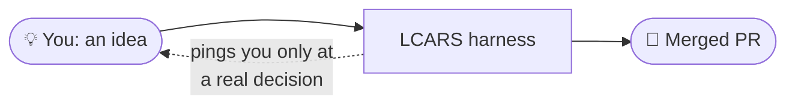
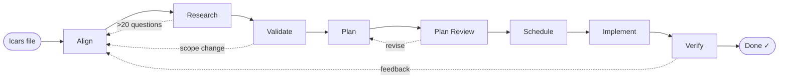
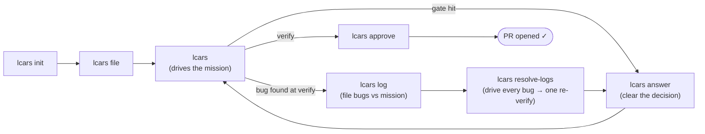
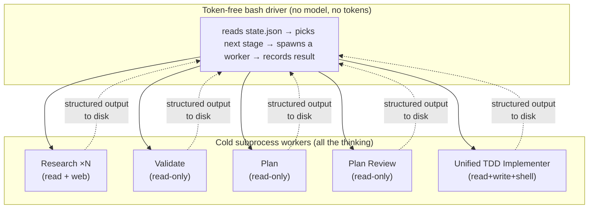

# LCARS

**Local mission control for shipping software with AI.** LCARS is a reusable
harness that takes a free-form human idea and drives it all the way to a merged
pull request — through alignment, research, planning, gate-proven
test-and-implement, and a human review gate — mostly unattended. You file the
idea and give the final yes; the harness does everything in between.

It installs as a set of Claude Code skills (`lcars init`, `lcars file`, …) that
work in **any** repo, and leaves **zero** files in your working tree. The
recommended way to drive it is the **viewscreen** — a local, Star-Trek-LCARS
web board — with the CLI available as the equivalent power path underneath.

> 📖 [`vision.md`](vision.md) is the full design. [`CONTEXT.md`](CONTEXT.md) is
> the domain glossary. [`docs/index.html`](docs/index.html) is this guide in
> LCARS livery. This README is the fast path to getting started.


<p align="center"><em>The <strong>viewscreen</strong> — local mission control. Every mission is a card in its stage, with actual/estimated cost, difficulty, live worker activity, and one-click file / pause / review.</em></p>

---

## Table of contents

- [What it does](#what-it-does)
- [The pipeline](#the-pipeline)
- [Install](#install)
- [Quick start (the viewscreen)](#quick-start-the-viewscreen)
- [The CLI (the power path)](#the-cli-the-power-path)
- [Running under GitHub Copilot](#running-under-github-copilot)
- [The commands](#the-commands)
- [How a mission runs (worked loop)](#how-a-mission-runs-worked-loop)
- [What to expect at each stage](#what-to-expect-at-each-stage)
- [How it runs under the hood](#how-it-runs-under-the-hood)
- [Where state lives](#where-state-lives)
- [GitHub labels (the board's data model)](#github-labels-the-boards-data-model)
- [Configuration & environment](#configuration--environment)
- [Develop / contribute](#develop--contribute)
- [Status](#status)

---

## What it does

LCARS is **not** a code generator, a chat box, or a one-shot prompt. It is an
**orchestration system** — a defined pipeline of LLM operations, automated
checks, and human checkpoints — that turns intent into shipped software.

Every piece of work is a **Mission**: a single human intent (a feature, an
improvement, or a bug fix). Each Mission gets its own branch, is mirrored as a
GitHub issue, and moves through a fixed sequence of **Stages** as a card on a
kanban board. Missions are branch-isolated, so many can run concurrently and
merge sequentially when you approve them.

The key idea: **you set a Mission in motion and walk away.** The harness
auto-advances it stage to stage on its own and stops only at a genuine human
gate — a strategic decision it can't make, or the final review. When it stops,
it pings you with a one-line, decision-ready summary. Being notified only when
you're actually needed is the normal way to use it.



---

## The pipeline

A Mission moves through eight Stages in order. The harness manages every
transition; you appear at gates, not at every step.



| # | Stage | Who | What happens |
|---|-------|-----|--------------|
| 1 | **Align** | 🧑 you + LLM | A structured grilling session — not a chat — that resolves ambiguity in the idea and produces a **PRD** (the canonical spec). A complex Mission also gets high-level **engineering ADRs** (architecture/data-shape decisions + rationale), seeded here and refined at Validate. When the PRD is finalized an **estimator** reads it against the real repo and assigns each downstream Stage a model tier (Sonnet or Opus) plus a token-grounded **cost estimate** — shown on the issue and the CLI readout, and overridable in plain language. |
| 2 | **Research** | 🤖 auto | Generates 0–20 questions from the PRD; each goes to a stateless parallel Research Agent that returns a recommendation + supporting points. |
| 3 | **Validate** | 🤖 auto | A Validator synthesises all findings into a plan, resolving the *how*. Escalates to you only when a finding changes *what* gets built. |
| 4 | **Plan** | 🤖 auto | Decomposes the validated plan into small, independently testable tickets — each a vertical slice owning **one cohesive behavior**, sized by total **comprehension load** (code-to-read + tests + new code) against a tunable budget, not a flat line count. |
| 5 | **Plan Review** | 🤖 auto | A *fresh* reviewer (no planning context) audits every ticket for slice, size, **coupling** (rejecting tickets whose criteria force changing behavior another ticket's tests pin — the real meaning of "too big"), testability, and dependencies. Loops back to Plan until clean; escalates after 3 rounds. |
| 6 | **Schedule** | 🤖 auto | Builds the dependency graph into sequential **Waves** and opens one GitHub sub-issue per ticket, each **nested under the Mission's issue** (a single-ticket Mission reuses its own issue instead of opening a redundant one). |
| 7 | **Implement** | 🤖 auto | Per ticket, one **unified TDD worker** writes tests and code and is proven by deterministic post-hoc gates: **flip-flop** (its new/changed tests must fail on the parent commit, pass on the tip), a **declared-edits** contract (any edit to an existing test must be declared with a reason, else the ticket blocks), a **quality floor**, and the **whole**-repo-suite green gate (no silent cross-ticket regression). A rejection bounces to a fresh worker (≤3 sessions) then parks awaiting-human — never a stage-stop. Independent tickets in a Wave build **concurrently** in isolated worktrees, committing serially in plan order; same-file tickets rebuild serially so every change lands. |
| 8 | **Verify** | 🧑 you | You read the diff, run the app, test the golden path — then **approve** (open the PR) or **send back** with feedback. |

Four feedback loops keep it honest: Research → Align (too much ambiguity),
Validate → Align (scope change), Plan Review → Plan (bad tickets), and
Verify → Align (you weren't satisfied).

---

## Install

LCARS lives in this repo and installs globally via symlinks, so a `git pull`
delivers updates with no re-install.

```bash
git clone <this-repo> lcars
cd lcars
./install.sh          # symlinks skills/* into ~/.claude/skills/ AND drops the
                      # lcars-viewscreen / lcars-serve launchers on ~/.local/bin
```

`./install.sh` also installs a real **`lcars-viewscreen`** command (alias
`lcars-serve`) into `~/.local/bin` — a wrapper that execs the repo's
`viewscreen.sh`, so the kanban board is one word to launch from any shell on
either CLI. If `~/.local/bin` isn't already on your `PATH`, the installer prints
the line to add it (e.g. `export PATH="$HOME/.local/bin:$PATH"` in your shell rc).

**Requirements**

- A host CLI — [Claude CLI](https://claude.com/claude-code) **or** the
  [GitHub Copilot CLI](https://github.com/features/copilot/cli). LCARS
  auto-detects whichever you launch from as the worker binary (see
  [Running under GitHub Copilot](#running-under-github-copilot) for the Copilot
  setup).
- [`gh` CLI](https://cli.github.com), authenticated (`gh auth login`) — used for
  issues, labels, sub-issues, and PRs.

**Updating**

```bash
git pull              # skill source updates in place — symlinks already point at it
./install.sh          # only needed to pick up brand-new skills
```

`install.sh` is idempotent. If a real (non-symlink) skill of the same name
already exists in `~/.claude/skills/`, it is backed up rather than clobbered.

From now on LCARS also **knows its version**. `lcars init` stamps the running
version into the repo, and interactive entry points (`lcars`, `lcars file`, an
interactive run start, the viewscreen launcher) notice on a throttled ~daily
basis when the source clone or this repo's stamp has fallen behind and **offer
to pull, reinstall, and `lcars update`** for you — always asking first,
defaulting to No, so nothing changes by surprise. Headless paths just print a
one-line warning and carry on. The manual `git pull` above still works; run
`lcars version` any time for the running / source / repo-stamp picture, or set
`LCARS_VERSION_CHECK=0` to silence the check.

---

## Quick start (the viewscreen)

The **recommended** way to use LCARS is the **viewscreen** — a local,
browser-based LCARS-themed kanban board. It's the default experience: you file an
idea, watch it drive to a merged PR, and answer any gates visually, all from one
screen. (Prefer the terminal? Everything here maps to `lcars` commands — see
[The CLI (the power path)](#the-cli-the-power-path).)

**Two kinds of commands — and where to run each.** LCARS has two surfaces, and
they run in different places:

- The **`lcars <verb>`** family (`lcars init`, `lcars file`, `lcars run`, …) are
  **agent skills** — type them to your agent (Claude Code or Copilot) inside the
  repo. They are not shell binaries.
- **`lcars-viewscreen`** (alias `lcars-serve`) is different: it's a **real command
  on your `PATH`** that `./install.sh` installs to `~/.local/bin`. Run it in **any
  plain terminal** — you do **not** need Claude Code or Copilot open.

So, inside **any repo** you want to ship work in:

```bash
# 1. In your agent (Claude Code or Copilot), inside the repo:
lcars init                # one-time per-repo setup: .git/lcars/ + GitHub labels

# 2. Then in any plain terminal — no agent needed:
lcars-viewscreen --open   # launch the board and open it in your browser
```

`lcars-viewscreen --open` starts a Python-3-stdlib-only daemon (no pip / npm /
build step), boots it on a free local port, and opens the kanban board in your
browser. Because it's a real command on your `PATH` (alias `lcars-serve`), the
**same invocation works from any shell** — a bare terminal, a Claude Code
session, or a Copilot session — and the daemon itself spawns no model workers, so
watching the board costs nothing. It runs in the foreground and is **session-bound**:
it stays up for that terminal and stops when you close it (or Ctrl-C). From there
you drive the whole idea → merged PR loop without leaving the page:

- **File a Mission.** Type your idea into the board; the live Align console
  **grills you** until the spec is sharp, then files the Mission as a card.
- **Watch it drive.** Each Mission is a card in its Stage column, carrying one
  **cost pill** and two **difficulty pills** (reasoning + implementation), with
  nested ticket rows and live Implement wave/ticket progress streamed over SSE.
  The harness auto-advances; the board updates itself as it goes.
- **Answer the gates, visually.** When LCARS needs you — a scope escalation, a
  design question, the Verify ship-or-send-back gate — the card flips to an
  **AWAITING YOU** state and you respond right there: Respond, **Verify**
  (approve / send back), **Pause** / **Resume**, and the **Mission Log** are all
  card actions.
- **Paste screenshots.** The File box, the live Align grill, and the Mission Log
  box all accept pasted images. Each shows as a CLI-style placeholder chip (never
  a rendered thumbnail), is saved into the Mission's `attachments/` dir,
  referenced by relative path in the PRD, and threaded by absolute path into every
  cold Stage — so the grill and the grounding worker actually *see* it (Claude via
  a path in the prompt, Copilot via `--attachment`).

The viewscreen is a **viewport over the same harness the CLI drives** — not a
separate implementation. CLI/UI parity is a core principle: every write the board
makes dispatches to the same `lcars` skills below, so the two surfaces never
drift. One adapter-neutral board shape backs two read adapters — a **local** one
parsing `.git/lcars/missions/*` (the default, with the operator write endpoints)
and a **GitHub** one reading issues + `lcars:*` labels (`--read-only`,
view-only) — so a hosted, read-only board is a configuration away.

---

## The CLI (the power path)

Everything the viewscreen does, you can do from the terminal — same harness
underneath. The CLI is the equivalent power path, handy in a headless shell, over
SSH, or when you want to script LCARS:

```bash
lcars init            # one-time per-repo setup: .git/lcars/ + GitHub labels
lcars file            # file your first Mission — describe the idea, get grilled, get a PRD
lcars                 # do the right thing: with the mission filed, it drives it forward
```

That's the whole rhythm. `lcars init` once per repo; then it's `lcars file` to
hand it work and bare `lcars` to push it along or answer what it's waiting on.
See [The commands](#the-commands) for the full surface.

### Running under GitHub Copilot

LCARS runs on **either Claude Code or GitHub Copilot CLI**. The worker CLI is
**auto-detected from whichever CLI you launched from** — launch from Claude Code
and workers run on `claude`; launch from Copilot and they run on `copilot`. No
config needed. (You can override it with `LCARS_WORKER_BIN` or `workerBin` in
`.git/lcars/config.json` if you ever need to pin it explicitly.)

**Maturity — the Claude path is stable; the Copilot path is new.** The worker
refactor that enabled multi-CLI support was a *no-behavior-change* extraction
(regression-locked by tests), so the **Claude Code experience is unchanged and
stable**. The **Copilot path is new**: it's been driven idea→PR end-to-end and
works, but it has fewer miles, so treat it as new and mind the two caveats below.
It is **not "beta" in the sense of unstable** — it works when used as documented.
**One honest expectation:** Copilot support does **not** yet run on Copilot's
*included* tokens — its workers run on premium **Claude** tiers (Sonnet or Opus,
assigned per Stage by the estimator and mapped to `claude-sonnet-4.6` /
`claude-opus-4.8`). So "LCARS runs on Copilot" is true today; "LCARS runs on
Copilot for free" is not yet (that needs an included model that can do the
workers' file ops).

Two Copilot-specific gotchas matter — both are real footguns:

**⚠ Workers must run on a Claude tier (Sonnet/Opus), never Copilot's non-Claude
defaults.** Since the cost estimator landed you no longer hand-pin a model: the
Align estimator assigns each Stage a Sonnet or Opus tier, and the per-CLI alias
map maps those to Copilot's `claude-sonnet-4.6` / `claude-opus-4.8` automatically —
both are Claude models that reliably perform the file operations LCARS workers
depend on. So filing a Mission and running it under Copilot just works. What you
must avoid is letting workers fall back to Copilot's lighter **non-Claude**
defaults (e.g. GPT-5.5): those could **not** reliably create/overwrite files in
the worker's fenced scratch directory, which **blocked the pipeline** (every worker
must write its output file — `questions.txt`, `plan.json`, etc.). The alias map
keeps workers on Claude tiers for you; if you ever override
`modelAliases.copilot.*`, keep both tiers on a Claude model. You can still pin one
model for every Stage with the legacy global if you want to:

```json
{ "workerModel": "claude-opus-4.8" }
```

**The Copilot cost figure.** Both Copilot tiers consume billable usage, not
Copilot's *included* tier, and LCARS shows a per-Mission cost estimate at Align.
By default it is computed on GitHub's **usage-based "AI Credits" (token) billing** —
the model GitHub moved to on **2026-06-01** — rendered as a dollar range with your
plan's monthly included credit noted, e.g. `$0.48–$3.59 (GitHub AI Credits; first
$19/mo included on business)`. Set `copilotPlan` (`pro` / `proPlus` / `business` /
`enterprise`) in `config.json` so the included-credit line matches your plan.
Grandfathered **annual** subscribers still on the old premium-request scheme can
switch the estimate back with `copilotBilling: "legacy"` (the Sonnet 9× / Opus 27×
× $0.04 figure). Every rate lives in `pricing.json`, and the Claude `$` figure and
the per-Stage model selection are unaffected by the billing mode.

**⚠ Launch with `--allow-all-tools`, NOT `--autopilot`.** The recommended
invocation is:

```bash
copilot --model claude-opus-4.8 --allow-all-tools
```

`--allow-all-tools` auto-approves tool actions so LCARS isn't blocked waiting for
per-command approval — **while keeping the human gates intact**: when LCARS asks
you something (the Align grill, an escalation, the Verify gate) it still stops and
waits for your answer. `--autopilot` is different — it makes the agent continue
*autonomously without asking questions*, which **bypasses LCARS's human gates**
(it blows straight through the Align grill without letting you answer). Do **not**
use `--autopilot` (or `--no-ask-user`) for interactive LCARS work. This is the
Copilot analog of Claude Code's `auto` permission mode: auto-approve tools, still
stop at real decisions.

**The viewscreen launches the same way on Copilot as on Claude.** From a Copilot
session started as above (`copilot --model claude-opus-4.8 --allow-all-tools`),
run the **same** on-PATH command — `lcars-viewscreen --open` — in the session
shell. There is no `~/.claude` path to get wrong: `./install.sh` put the launcher
on `~/.local/bin`, so the one command is identical and correct on both CLIs.



---

## The commands

LCARS collapses to **two things you do** — hand it work, and answer what it's
waiting on — surfaced through the **viewscreen** (the recommended board) or the
CLI. The older per-stage verbs still work as power entry points.

### The everyday surface

| Command | What it does |
|---|---|
| `lcars viewscreen` | **The recommended surface — the Kanban web board** (alias `lcars serve`). A Python-3-stdlib-only daemon — no pip/npm/build — serving every active Mission as a card in its Stage column, with a cost pill + reasoning/implementation difficulty pills, awaiting-you / paused states, nested ticket rows, and live Implement progress over SSE. Drive the whole idea→PR loop from the browser (File, the live Align console, Start with a plain-language model override, Respond, Verify, Pause/Resume, Mission Log) — a viewport over the same harness the CLI drives. It launches via the real on-PATH command `lcars-viewscreen --open` (alias `lcars-serve`), which you run in any plain terminal — no Claude Code or Copilot session needed — booting on a free port and opening it in your browser. |
| `lcars` | **The one CLI entry point.** Infers the right action from state and announces it first: nothing filed → runs the `lcars file` flow; work in flight & nothing pending → drives the active Mission (auto-advance); a decision waiting → opens the inbox. Never makes you remember a verb or paste an id. |
| `lcars answer` | **The inbox** — every pending decision across *all* Missions in one list: scope escalations, plan-review stand-offs, blocked tickets, and the Verify gate. **approve** and **send back** are actions on a Verify card here, not separate commands. (The viewscreen surfaces the same gates on the cards themselves.) |
| `lcars status` | The read-only **terminal board**: every active Mission, its Stage, and anything awaiting you. Add `--watch` to follow a running Mission **live** — a streaming event view with a pace line (wave, ticket, attempt, avg/ticket, elapsed). |
| `lcars init` | One-time per-repo setup (local config + GitHub labels). Safe to re-run — it **preserves** your config customizations, only filling in anything missing. |
| `lcars update` | Bring an already-initialized repo up to date after a `git pull`: adds any new LCARS labels and config keys, **never** clobbering your customizations or touching `missions/`, and re-stamps the repo's `lcarsVersion`. A clean no-op when nothing's changed. |
| `lcars version` | Show the version picture — the **running** version (this LCARS clone's `VERSION`), the source clone's path + git state, and, inside an initialized repo, its stamped `lcarsVersion` with a verdict (**current** / **needs `lcars update`** / unknown). Read-only, no network fetch. |
| `lcars file` | File a new Mission from a free-form idea; runs Align to a PRD. |
| `lcars log` | Log one or more bugs against an active Mission in free-form language; files a Mission per bug that enters at **Research in a grounding mode** — anchoring the free-form symptom to the parent's existing code so the fix modifies the real feature rather than a duplicate — then flows the full pipeline to Verify (only Align is skipped), and links them. Each logged bug gets its own dynamic estimate (cost + reasoning/implementation difficulty + per-stage model recommendation, now **including** the Research/Validate Stages) in a Launch-style review panel, with a plain-language per-bug model override. |
| `lcars resolve-logs <parent>` | Drive **every** bug logged against a Mission to its Verify gate in a sensible, worker-chosen order, then raise **one** consolidated re-verify gate on the parent instead of one per bug. |
| `lcars launch <mission> [hint]` | **Run the Mission's app so you can SEE it during Verify** (the board's ⚡ RUN/STOP does the same). Checks the branch into a disposable detached worktree, spawns a `launch`-role cold worker that *discovers* how to start the app (never starts it itself), then runs the command detached — the harness owns the process group, records `launch.json` for the CLI and the board, and `--stop` kills the group and prunes the worktree. The optional hint picks the target in a multi-app repo ("the example game"); each Mission gets its **own** instance, so two builds can run side by side. Your own checkout is never touched. |

### Power verbs (still supported)

| Command | What it does |
|---|---|
| `lcars run <id>` | Auto-advance a Mission stage-to-stage until a human gate. |
| `lcars run <id> --step` | Advance **exactly one** Stage, then stop (for debugging/inspection). |
| `lcars status --watch [<id>]` | Follow a Mission's run **live**: tails its event stream and re-renders a pace/position line on a configurable tick (default ~60s; override with `LCARS_WATCH_INTERVAL` or `--interval <secs>`) until the run reaches a gate. Rarely needed now that a run relays progress in the launching session. |
| `lcars respond [<id>]` | Answer a Mission's awaiting-human gate. No id lists everything waiting. |
| `lcars approve <id>` | Ship a verified Mission: push the branch, open the PR, mark it Done. |
| `lcars feedback <id> "<note>"` | Send a Mission at Verify back to Align with a note (kept in an accumulating history). |
| `lcars pause <id>` | Halt a Mission at the next safe boundary (between Stages, or between waves/tickets in Implement) — applies `lcars:paused`; never hard-kills a worker mid-step. |
| `lcars resume <id>` | Clear the pause and re-enter the driver from the recorded Stage. Both verbs are idempotent. |
| `lcars release` | Drift repair on a clean `main`: collect the commits that landed without a version bump, summarize them into a `CHANGELOG.md` entry (one cold worker), bump `VERSION`, and commit. Idempotent no-op when nothing's unstamped. |

> **No id juggling.** A shared resolver picks the target Mission: one candidate →
> no id needed; several → a fuzzy picker; an explicit id / partial / title always
> works. `lcars` and `lcars answer` both go through it.

---

## How a mission runs (worked loop)

Here's the full walk-away rhythm for a real feature, shown on the **CLI** so each
step is explicit. The **viewscreen** mirrors it beat for beat — File becomes the
board's File panel + live Align console, *drive* and *answer* become the card's
auto-advancing progress and AWAITING-YOU actions, and ship is the card's Verify
button — because both surfaces drive the same harness.

**1 — File it.** You describe the idea; Align grills you until the spec is sharp.

```text
$ lcars file
> Idea: Add XP, badges, and a per-course leaderboard to motivate learners.
  [Align asks a handful of clarifying questions; you answer in character.]

Mission filed: lcars-20260604-001
GitHub issue:  #42
Stage:         align
Next:          run `lcars` to continue
```

**2 — Let it drive.** Bare `lcars` auto-advances through the headless stages and
stops at the first real decision.

```text
$ lcars
Driving lcars-20260604-001 from research…

lcars-20260604-001  auto-advance
─────────────────────────────────────────────
research    ✓ ⊘ isolated  14 questions, agents complete
validate    ⏹ awaiting you
─────────────────────────────────────────────
⏹ stopped at: validate  (scope decision)
   Research is split on global vs per-course leaderboard — this changes the
   DB schema. Global, or per-course?
   Answer with `lcars answer`
                                            🔔 (notification fired)
```

**3 — Answer the gate.** Clear the one decision from the inbox.

```text
$ lcars answer
[1] lcars-20260604-001 · Validate · "Global or per-course leaderboard?"
> Per-course for now.
✓ answered — next `lcars` resumes validate
```

**4 — Walk away.** Bare `lcars` again resumes and runs the rest of the pipeline
unattended — Plan, Plan Review, Schedule, Implement — stopping only at Verify.

```text
$ lcars
Driving lcars-20260604-001 from validate…
─────────────────────────────────────────────
validate    ✓ ⊘ isolated  scope resolved (per-course)
plan        ✓ ⊘ isolated  11 tickets
plan-review ✓ ⊘ isolated  passed round 1
schedule    ✓             3 waves, 11 sub-issues
implement   ✓ ⊘ isolated  11/11 tickets green
─────────────────────────────────────────────
⏹ stopped at: verify  (human review required)
   Next: review the changes, then `lcars approve lcars-20260604-001`
                                            🔔 (notification fired)
```

**5 — Verify and ship.** You read the diff and run the app. Happy → approve and
the PR opens. Not happy → send it back with feedback and it re-enters Align with
the full history intact.

```text
$ lcars approve lcars-20260604-001
✓ branch pushed, PR opened: https://github.com/you/repo/pull/57
✓ lcars:done — mission complete
```

---

## Resolving bugs you logged during Verify

When you're reviewing a Mission at Verify and spot several bugs, `lcars log`
them as you go — each becomes a bug Mission linked to the parent and grounded
against the parent's existing code — read from the parent's own branch, not
whatever's checked out — so a casual report fixes the real feature, not a
duplicate. Paste screenshots straight into the log box: if you reference them per
bug ("see image 1", "the second screenshot"), the split routes each image to the
bug that names it (plus any image no bug claims), and the log-split preview shows
an **images pill per bug** so you can check the mapping before filing. With no
per-bug references, every image goes to every bug.


*Dump every bug you spot in plain language; LCARS splits them into linked bug Missions and routes each pasted screenshot to the bug that names it.*

Then hand the whole batch to **`lcars resolve-logs`** and walk away. It drives
every logged bug to its own Verify gate in a sensible order the worker chooses
(root-cause and dependency bugs first, cosmetic ones last), and collapses what
would be *N* separate "review me" interruptions into **one** consolidated
re-verify gate on the parent.

```text
$ lcars log
> Two bugs against the gamification mission: XP isn't awarded for video
  completions, and the leaderboard flickers on first load.
✓ filed lcars-20260604-002 (XP video) — linked to lcars-20260604-001
✓ filed lcars-20260604-003 (leaderboard flicker) — linked to lcars-20260604-001

$ lcars resolve-logs lcars-20260604-001
Resolving 2 logged bugs against lcars-20260604-001…
order: 002 (root cause) → 003 (cosmetic)   [worker-chosen]
─────────────────────────────────────────────
lcars-20260604-002  ✓ ⊘ isolated  fix on branch, at verify
lcars-20260604-003  ✓ ⊘ isolated  fix on branch, at verify
─────────────────────────────────────────────
⏹ stopped at: verify  (1 consolidated re-verify gate)
   2 logged bugs resolved [002, 003] — ready for you to re-verify.
   Re-inspect, then `lcars approve` / `lcars feedback` each.
                                            🔔 (one notification fired)
```


*One gate instead of N: the fixes ride the parent's pull request, you can launch the app to check them live, then accept the whole batch or send it back with a note.*

It never auto-approves and opens no PRs — re-verifying and shipping each bug
stays your call. If a bug escalates mid-batch (a cap-exhausted ticket, a scope
change), the batch **pauses** at that bug and drops its question into
`lcars answer`; the bugs already resolved are untouched, and a resumed
`lcars resolve-logs` picks up the rest after you answer.

---

## What to expect at each stage

- **Align is interactive and adaptive.** A one-line bug fix produces a thin PRD
  in a minute or two; a complex feature earns a thorough grilling. This is the
  one stage that is always a conversation. A complex Mission also comes out with
  high-level **engineering ADRs** — the framework/architecture/data-shape calls
  and their rationale — that downstream workers read instead of re-deriving
  (Validate refines them if research overturns a decision).
- **Cost is estimated up front; the model tier is chosen per Stage.** When Align
  finishes, an estimator scores the Mission on two axes — *reasoning/planning*
  criticality and *implementation* criticality — and from those assigns each Stage
  Sonnet or Opus, concentrating the expensive tier where mistakes are costliest
  (reasoning and implementation) and keeping routine work cheap. It reasons about
  the **whole problem** (problem type, blast radius, what it sets up for the
  future), not the line count. It also emits a token-grounded **cost range** in the
  active CLI's native unit. You see all of it on the GitHub issue and the
  `lcars file` readout, and can **override it in natural language** at kickoff —
  *"use Opus the whole way through"*, *"use Opus for implementation"*, *"keep
  reasoning cheap"*. A trivial fix no longer pays Opus prices end-to-end, and a
  genuinely hard feature isn't under-thought on Sonnet.
- **Research scales to ambiguity.** A crisp PRD yields *zero* questions and skips
  straight through. A broad one fans out up to 20 parallel agents. More than 20
  needed → it explains why and lets you override or sharpen the PRD.
- **Validate decides the *how*, escalates the *what*.** Implementation calls stay
  with the Validator; only choices that change *what gets built* come to you.
- **Plan / Plan Review enforce cohesive vertical slices.** Each ticket is a
  full-stack slice owning **one cohesive behavior**, sized by total comprehension
  load (existing code to read + tests + new code) against a tunable
  `comprehensionBudget` — not a flat line count, so greenfield tickets stay
  generous and later ones tighten as the codebase grows. An independent reviewer
  rejects horizontal slices, tickets that are over budget by *bundling*
  behaviors, and **coupled** tickets — ones whose criteria can only be met by
  changing behavior another ticket's tests already pin — naming the seam to
  re-slice along; it loops back until clean (or escalates after 3 rounds).
- **Implement is one unified TDD worker, proven by the harness, not the prompt.**
  Each ticket is built by a single cold worker that writes both tests and code and
  runs the suite freely — and its work is proven **afterward** by deterministic,
  post-hoc gates against git itself, because an LLM rewarded for a green suite will
  game any contract another LLM writes. The **flip-flop gate** re-runs the ticket's
  new/changed tests scoped twice — green on the tip, **red on the parent commit** —
  so a green-on-nothing contract can't slip through even in a repo whose own suite
  is green (zero tests collected on either leg is *inconclusive, never a pass*). The
  worker may adapt an existing test the ticket genuinely invalidates, but every edit
  must be **declared with a reason** in `result.json` — an **undeclared** test change
  blocks the ticket (the parent commit is the snapshot; git diff is the check), and
  declared edits ride to Verify as a first-class **contract-amendments** readout. A
  **quality floor** requires at least one new/changed test that actually asserts
  something (a genuinely behavior-free ticket may declare `flipFlop: not-applicable`
  with a reason). Tests are authored **in-tree at the repo's own convention**
  (co-located `*.test.ts`, a `__tests__/` dir, or a top-level `tests/`) so the
  coverage merges to the trunk, and every ticket commit must leave the **whole** repo
  suite green — a later ticket that silently regresses an earlier one fails the Wave
  loudly instead of slipping through to Verify. **No worker fails terminally on
  quality:** a gate rejection writes its verdict into a signal and re-spawns a
  **fresh** worker carrying it, up to **3 sessions**, then parks the ticket
  awaiting-human with the failing gate named — never a stage-stop.
  Independent tickets in a Wave build
  **concurrently** in isolated per-ticket worktrees (capped by `LCARS_MAX_PARALLEL`)
  and commit serially in plan order; when two tickets touch the **same file** the
  second is rebuilt serially on the current tip so a fully-overlapping Wave still
  lands every ticket's change instead of dropping one. Each worker reads a per-ticket **context
  manifest + repo pack** instead of cold-exploring the tree.
  And the gates **survive the repo's real test setup**: a runner preflight probes
  the ticket's package *before the worker is spent* (a runner that can't launch is
  a truthful "cannot run tests here" — never blamed on the tests); a package with
  **no runner** in a repo that tests elsewhere invites the worker to
  **declare the missing setup** (evidence-gated, ADD-only, package-manager installs
  only), which the harness applies **probe-verified** — exit codes are never
  trusted, and pnpm's silent symlink no-ops are healed by a forced relink — with a
  verified green recorded to the repo's **test landscape**
  (`.git/lcars/test-landscape/`) as a durable, proven fact. And the gates are
  **multi-stack**: `lcars init` detects the repo's toolchain (Rust, Go, Python,
  JS/TS, plus .NET / JVM for failure legibility) and seeds per-stack defaults,
  and the flip-flop scoped runs speak each runner's idiom — a directory scope for
  JS/Python, `cargo test --test` for Rust, `go test -run` for Go — so a compiled
  crate/package proves fail-on-parent / pass-on-tip and rides its test along at its
  own convention (`tests/*.rs`, `*_test.go`) without ever faking a green on no tests.
- **Verify never auto-passes.** Auto-advance always stops here. Shipping is your
  call — and **seeing it run is one click**: `lcars launch <mission> [hint]` (or
  the ⚡ **RUN/STOP** on the board's Verify dialogs) checks the branch into a
  disposable worktree, has a cold worker *discover* how to start the app, runs it
  detached with the harness owning the process group, and stops/prunes on demand.
  Per-Mission instances, plain-English failures, and your own checkout is never
  touched.

---

## How it runs under the hood



Two deliberate properties make this robust:

- **Token-free driver, model-selected workers.** The loop is plain shell — it
  never reasons about your code. Every token LCARS spends is spent in a worker,
  on **whichever CLI you launched from**. Run LCARS inside Claude Code and every
  worker is Claude. CLI choice is an implementation detail; **model choice is the
  meaningful one** — and model choice is made **per Stage, not once per run**. The
  Align estimator assigns each Stage a tier (Sonnet/Opus) sized to that Stage's
  criticality; the tiers are **logical**, and a per-CLI **alias map** translates
  them to each CLI's flag string (on Copilot, `claude-opus-4.8` /
  `claude-sonnet-4.6`), so the estimate stays CLI-agnostic and Copilot only ever
  runs Sonnet/Opus. Precedence is explicit: a global pin (`LCARS_WORKER_MODEL`)
  beats a captain's natural-language override, which beats the estimate, which beats
  a manual per-stage config, which beats the legacy global `workerModel`. With **no
  estimate and no override the legacy single-model path is byte-for-byte
  unchanged** — no `--model` flag when nothing is set.
- **Stage isolation (cold handoff).** Every headless Stage runs as a fresh
  subprocess that sees **only** what the previous Stage wrote to disk — never its
  conversation. The worker's prompt is assembled by `run.sh` from artifact
  *paths* alone, so there is no channel for one Stage's reasoning to leak into the
  next, even when the whole pipeline runs in one sitting. Each Stage records
  **decisions and their rationale** (the *why*, not just the *what*), because the
  artifact is the entire contract. A `⊘ isolated` marker on every stage line
  proves it; if a Stage ever can't isolate, the driver refuses **loudly** rather
  than running inline. What may cross the boundary is always a **declarative
  fact** — the PRD, the engineering ADRs, a ticket's context manifest, the repo
  pack — never another worker's generated reasoning, and never anything at all to
  a Research Agent: sharing facts lets a worker read instead of re-derive (cutting
  cost) without the conversational carryover cold isolation exists to prevent.
- **Your checkout is sacred (root-tree sovereignty).** A Mission never checks
  out, detaches, or dirties the working tree you sit in: builds run in per-ticket
  worktrees, commits land through an ephemeral **landing worktree** under a
  repo-global mutex, the reconcile works in its own worktree, and the PR opens by
  ref. Switch branches mid-drive with three Missions running — neither side
  notices; if *you* hold a Mission's branch, it says so plainly instead of moving
  your HEAD, and a failed worktree cut is **loud**, never a silent fallback into
  the shared tree.
- **Observable, not silent.** The driver keeps a per-Mission append-only **event
  log** (`events.jsonl`) as it goes — every Stage start and finish, every gate,
  and fine-grained Implement progress (each wave, each ticket, each attempt, and
  every green/flag). It prints each Stage line the moment it happens instead of
  only summarizing at halt. When you launch a run from `lcars` / `lcars run`,
  that same session relays a compact progress digest every ~60s (configurable
  via `LCARS_WATCH_INTERVAL` or `--interval`) until it halts — so you watch the
  run where you started it, without a second window. `lcars status --watch`
  tails the same log into a live view with a pace/position line —
  `Wave 3/6 · ticket t-004 · attempt 1 · ~12s avg/ticket · elapsed 4m12s` — on
  that same interval. The
  events are emitted by the bash harness *around* the worker calls — never by the
  worker — so the stream and the live view behave identically whatever CLI runs
  underneath. The **same shared renderer** also publishes progress to each
  Mission's **GitHub issue** as a small set of **living, per-Stage comments** —
  one per Stage (Research, Plan, Schedule, Implement, Verify), created once then
  *edited in place* as the Stage advances — so a run is observable off the laptop
  too. The bodies are rich: collapsed research Q&A, per-ticket rationale, `#`-links
  to the sub-issues, and an Implement **wave dashboard** (the same pace/position
  line plus a done / flagged / in-progress / pending ticket checklist) that
  refreshes on the same ~60s heartbeat (`LCARS_COMMENT_HEARTBEAT`). Mirroring is
  idempotent (a stored comment-id map means a re-run edits, never double-posts)
  and best-effort — a missing or failing `gh` never breaks or slows the run.

---

## Where state lives

All per-repo mission state lives under **`.git/lcars/`** — inside `.git/`, so git
never tracks it and the target repo's working tree stays clean. Don't add it to
`.gitignore` and don't commit it.

```text
.git/lcars/
  config.json                     repo config (model, context file, test command, notify)
  context-pack.md                 durable repo pack (run-tests, conventions, architecture)
  missions/
    lcars-20260604-001/
      state.json                  id, type, stage, githubIssue, flags
      prd.md                      Align output — the canonical spec
      adr.md                      engineering ADRs (complex Missions; refined at Validate)
      estimate.json               criticality scores + per-stage model tiers + cost range
      research/<n>.json           per-question findings
      validated-plan.md           Validate synthesis (+ rationale)
      plan.json                   Plan tickets (each with rationale)
      approved-plan.json          Plan Review's approved copy
      plan-review-<round>.json    objections per round
      manifests/<ticket>.md       per-ticket context manifest (files + signatures + ADRs)
      waves.json                  dependency graph → waves + sub-issue numbers
      tickets/<ticket>/result.json  pass/attempts/summary + newTests + declared testEdits (v2)
      tickets/<ticket>/flip-flop.json   the flip-flop verdict (green-on-tip / red-on-parent legs)
      tickets/<ticket>/test-edits.json  declared edits to existing tests ({path, reason})
      tickets/<ticket>/gate-signal.txt  why a rejected gate bounced (grounds the fresh worker)
      pending.json / answers.json   escalated questions + your answers
      feedback.md                 accumulating Verify feedback history
```

---

## GitHub labels (the board's data model)

`lcars init` creates the LCARS label set on the repo (and `lcars update`
backfills any that a later LCARS version adds). The harness applies them as
Missions move; a future kanban reads them directly via the Issues API.

| Label | Type | Purpose |
|---|---|---|
| `lcars:align` … `lcars:done` | Stage (exclusive) | The Mission's current column |
| `lcars:feature` / `lcars:bug` | Type | Mission kind |
| `lcars:paused` | Status (additive) | Overlaid when a Mission is paused |
| `lcars:awaiting-human` | Status (additive) | Overlaid when blocked on your answer |
| `lcars:linked` | Relationship | A bug Mission linked to a parent via `lcars log` |
| `lcars:mission` / `lcars:ticket` | Role (additive, permanent) | A Mission's own issue (`lcars:mission`) vs an implementation sub-issue Schedule opens (`lcars:ticket`) — disjoint, never swapped by a stage transition |

Filtering issues to `lcars:awaiting-human` shows every pending decision at a
glance — before the kanban UI even exists. Filtering to `lcars:mission` is the
command-and-control list (the Missions); `lcars:ticket` is the work (the
per-ticket sub-issues).

**Issue lifecycle.** Each ticket's sub-issue is relabelled `lcars:done` and
**closed** the moment the ticket goes green, so the board tracks real per-ticket
progress as a run proceeds. The Mission's own issue closes only when the PR is
**merged**: `lcars approve` opens the PR with a `Closes #<mission>` directive, so
the close is tied to the merge — never to approval or to reaching Verify.

---

## Configuration & environment

`lcars init` writes `.git/lcars/config.json` (default model, detected
`CONTEXT.md`, test command for the proof gates, optional notify target). The harness
**never** modifies `CLAUDE.md`, `.gitignore`, `CONTEXT.md`, `.claude/settings.json`,
or any source files.

Writing config is **merge-preserving**: re-running `lcars init` keeps every value
already in `config.json` (your customized `testCommand` / `model` /
`comprehensionBudget`) and only fills in keys that are missing — so re-init is
fully idempotent and never resets a customization. When LCARS itself gains new
labels or config keys, `lcars update` absorbs them into an already-initialized
repo the same way: missing labels and keys are added at their defaults, existing
values and `missions/` are left untouched, and it reports what it added (or says
there's nothing to update). It also refreshes the repo's stamped `lcarsVersion`
so the staleness checker reads the repo as current.

External dependencies are injected via env vars so they're swappable (and
stubbable in tests):

| Variable | Purpose | Default |
|---|---|---|
| `LCARS_WORKER_BIN` | The cold-worker CLI every headless Stage spawns | auto-detected from the host CLI (`claude` or `copilot`) |
| `LCARS_WORKER_MODEL` | **Global model pin** — overrides per-Stage selection for *every* Stage (config key: `workerModel`, the legacy global) | unset — the estimate's per-Stage tiers apply |
| `LCARS_MODEL_OVERRIDE` | Pin a tier for an axis on a re-run without re-filing — `all:opus`, `implementation:opus`, `reasoning:sonnet` | unset |
| `LCARS_GH_BIN` | The GitHub CLI | `gh` |
| `LCARS_MAX_PARALLEL` | Concurrency cap for a Wave's tickets and the Research fan-out | `4` |
| `LCARS_NOTIFY` | The walk-away notification hook fired at human gates | local desktop banner + bell |
| `LCARS_VERSION_CHECK` | Set `0` to disable the throttled staleness check on interactive entry points | enabled |

**Per-Stage model selection (config keys).** The Align estimator writes the
per-Stage tiers into the Mission's `estimate.json`; you rarely touch the model
config by hand. When you want to, these `config.json` keys participate (all
optional): `stages.<key>.model` pins one Stage to a tier (`sonnet`/`opus`);
`modelAliases.<cli>.<tier>` overrides how a logical tier maps to a CLI flag (the
defaults are claude `sonnet`/`opus` and copilot `claude-sonnet-4.6` /
`claude-opus-4.8`); `estimatorModel` sets the tier the estimator itself runs on
(default `opus`). For the Copilot cost figure, `copilotBilling` (`usage` *(default)*
/ `legacy`) selects usage-based AI-Credit billing vs. the legacy premium-request
model, and `copilotPlan` (`pro` / `proPlus` / `business` / `enterprise`) sets the
included-credit allotment netted against the estimate. The price/rate/allotment
data the cost figure is computed from lives in `skills/lcars-run/pricing.json` — the
single source of truth, so a billing change is a data edit, not a code change.

Notifications fire **only** at genuine gates (an escalation or Verify), batched
per Stage — never one-per-question, never on a clean transition. A phone push
(ntfy / Pushover) is opt-in via config.

---

## Develop / contribute

Skill source lives in `skills/<name>/` (one dir per `lcars` command); tests in
`tests/`. [`CLAUDE.md`](CLAUDE.md) is the contributor contract — read it first.

```text
skills/<name>/SKILL.md     frontmatter + instructions
skills/<name>/<name>.sh    the executable logic (kept testable; deps via env vars)
tests/<name>.test.sh       one suite per skill
tests/run.sh               runs every *.test.sh
install.sh                 symlinks skills/* into ~/.claude/skills/ and drops the
                           lcars-viewscreen / lcars-serve launchers on ~/.local/bin
```

The golden rule: **skills are authored in this repo, never directly under
`~/.claude/skills/`** — `./install.sh` symlinks them so `git pull` delivers
updates. The workflow for any change:

1. **Author** in `skills/<name>/`.
2. **TDD it** — write the failing test in `tests/<name>.test.sh` first, then make
   it pass. Keep logic in a bundled shell script; take external deps via env vars
   so tests can stub them.
3. **Install** — `./install.sh`.
4. **Verify** — `bash tests/run.sh` (all suites green).
5. **Commit** — source, test, and any doc updates are all tracked.

Open bugs against the harness are tracked in [`bugs.md`](bugs.md) with stable
`BUG-NNN` ids.

```bash
bash tests/run.sh         # run the whole suite
```

---

## Status

The full pipeline is built and runs unattended (idea → PR). Sessions 1–16 of the
[build order](CLAUDE.md) are complete:

| Stage of the build | Status |
|---|---|
| `lcars init` · `file` · `status` (foundation) | ✅ |
| Research · Validate · Plan · Plan Review (planning) | ✅ |
| Schedule · Implement · Verify + PR (build & ship) | ✅ |
| `lcars respond` (async human gate) | ✅ |
| Per-stage isolation (cold subprocess workers) | ✅ |
| Implement proof-of-work gates (flip-flop · declared-edits contract · quality floor · full-suite green gate) | ✅ |
| Auto-advance + notifications (the unattended loop) | ✅ |
| Human surface (`lcars` + `lcars answer`) | ✅ |
| Mission Log (`lcars log`) | ✅ |
| Mission Log batch resolve (`lcars resolve-logs`) | ✅ |
| **Copilot enablement** (run LCARS under GitHub Copilot — *new; premium model required*) | ✅ |
| **Cost estimator + per-stage model selection** (estimate at Align · Sonnet/Opus per Stage · NL override · per-CLI cost) | ✅ |
| **Tests ride along into the PR** (authored in-tree at the repo's own convention · declared-edits audited across the commit boundary) | ✅ |
| Under-slice pressure signal (Plan Review) | ✅ |
| Actionable proof-gate failure classification | ✅ |
| Unified TDD worker · bounce-3-then-park (no stage-stop on quality) | ✅ |
| Empty-output worker detection | ✅ |
| Reconcile env-parity (no phantom self-heal) | ✅ |

**Roadmap.** Copilot enablement is in: `$LCARS_WORKER_BIN` auto-resolves to
`copilot` when you launch from Copilot, so the harness runs on whichever CLI you
launch from (see [Running under GitHub Copilot](#running-under-github-copilot)).
The Claude path is stable; the Copilot path is **new** — it works idea→PR but
needs two documented setup caveats (premium **Claude** tiers, assigned per Stage
and alias-mapped + `--allow-all-tools`) and does not yet run on Copilot's
*included* tokens. The Copilot cost figure tracks GitHub's usage-based AI-Credit
billing by default (with the legacy premium-request model available for
grandfathered annual plans). Further out: a custom
**kanban interface** (cards, stages, pending-question badges, start/stop control)
and **production monitoring** to close the loop from live signal back to new
Missions. LCARS v1 covers idea → merged PR.
