# LCARS

**You describe what you want. LCARS builds it and brings you back a pull
request.**

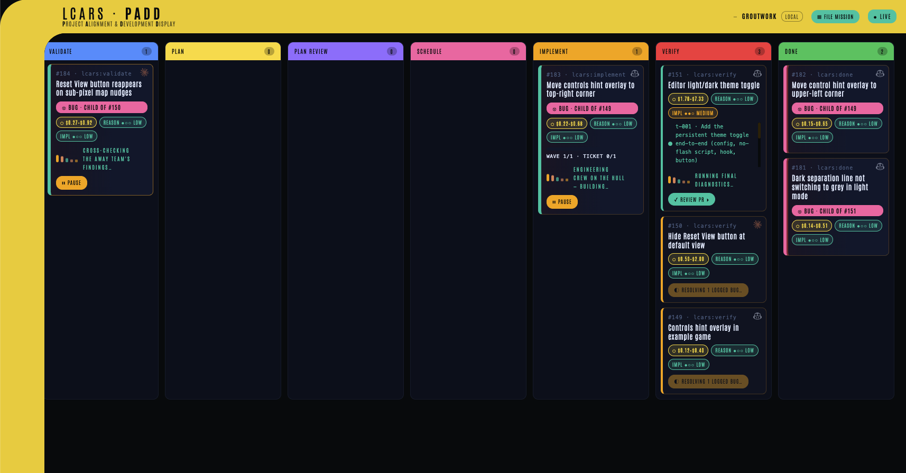

LCARS is a harness that sits on top of an AI coding CLI — **Claude Code** or the
**GitHub Copilot CLI** — and runs a whole piece of work end to end. An idea goes
in; it is sharpened into a spec, researched, planned, cut into small tickets,
built test-first, and handed back as a branch and a pull request. It runs
unattended between those two points and interrupts you only for a real decision.
**You keep the decisions. It keeps the typing.**

It installs once, works in **any** repo, and leaves **zero** files in your
working tree. The board above — the **viewscreen** — is the usual way to drive
it, and everything on it is also a terminal command. **The project need not exist
yet:** point LCARS at an empty folder and it recommends a stack, builds a running
skeleton with a real test system, and proves one thin slice end to end before any
feature work.

## What it does

Each piece of work is a **Mission**: one human intent, on its own branch,
mirrored as a GitHub issue, moving through eight Stages as a card on the board.
Many Missions run at once and merge one at a time, when you say so.

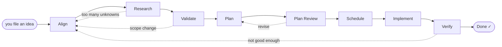

| Stage | Who | What happens |
|---|---|---|
| **Align** | 🧑 you | A structured interview — one question at a time, each with a recommended answer — that turns a rough idea into a written spec, then prices the work before anything is spent. |
| **Research** | 🤖 auto | Up to twenty open questions, each sent to its own independent agent that comes back with a recommendation and its reasons. |
| **Validate** | 🤖 auto | The findings are synthesised into a plan. It stops for you only if a finding changes *what* gets built, not *how*. |
| **Plan** | 🤖 auto | The plan becomes small tickets, each one a vertical slice owning a single behaviour. |
| **Plan Review** | 🤖 auto | A fresh reviewer with no memory of the planning audits every ticket for size, coupling and testability, and sends bad ones back. |
| **Schedule** | 🤖 auto | Tickets are ordered into waves by their dependencies, and each becomes a sub-issue under the Mission. |
| **Implement** | 🤖 auto | One test-first worker per ticket, checked afterwards by machine: its new tests must fail before its change and pass after it, any edit to an existing test must be declared with a reason, and the whole suite must stay green. |
| **Verify** | 🧑 you | You read the diff, run the app, and either approve — which merges the existing open pull request — or send it back with a note. |

## Install

You need **one** AI coding CLI, plus the GitHub CLI:

- [Claude Code](https://claude.com/claude-code) **or**
  [GitHub Copilot CLI](https://github.com/features/copilot/cli) — LCARS uses
  whichever it finds installed. Both is fine; you pick per Mission.
- [`gh`](https://cli.github.com), signed in (`gh auth login`) — for issues,
  labels and pull requests.

```bash
git clone https://github.com/roferg/LCARS.git
cd LCARS
./install.sh
```

`./install.sh` links the commands into the Claude Code skills directory, and
registers this clone as a Copilot CLI plugin too when Copilot is installed. It
also drops five real programs on your `PATH` at `~/.local/bin`:
**`lcars-viewscreen`** (alias **`lcars-serve`**) opens the board,
**`lcars-launch`** runs a Mission's app, **`lcars-eeh`** is the Emergency
Engineering Hologram (EEH) that rides along with you, and **`lcars-ech`** is the
Emergency Command Hologram (ECH) you hand the loop to. If `~/.local/bin` is not
on your `PATH`, the installer says so loudly and prints the exact line to add to
your shell profile.

The closing verdict is the exit contract: **READY exits 0; NOT READY exits 1**,
so `./install.sh && next-command` never continues with unusable commands — fix
what it reports and re-run. **PARTIAL exits 0** too: the commands work, but
something is unfinished, such as a refused Copilot registration.

Then, **inside the project you want to ship work in** (not this repo):

```bash
cd ~/path/to/your-project
lcars init          # one-time: per-repo state + the GitHub labels
```

> **Two kinds of command, and where each one runs.** `lcars <verb>`
> (`lcars init`, `lcars file`, `lcars answer`, …) are *skills*: you type them to
> your AI CLI inside the repo, not into a shell — shell `lcars status` is not an
> executable, so ask Claude Code or Copilot for it. The five hyphenated names
> above are real programs and run in any plain terminal; `lcars-launch --help`
> and `lcars-viewscreen --help` (also `-h`) are safe reads that start neither an
> app nor a board, even inside an agent.

**Updating** is `git pull` here — the skills are symlinked, so they update in
place. Re-run `./install.sh` only for brand-new commands, and `lcars update`
inside a project to absorb new labels and config keys.

To **try LCARS without touching HOME**, set `LCARS_INSTALL_PREFIX`: it redirects
all five install destinations beneath that one directory. Get its `bin` onto
`PATH` **before** installing so readiness can pass, and `unset` the five
individual overrides — each wins over the prefix — for a genuinely isolated
trial. [This page in LCARS livery](docs/index.html) names all five and their
defaults.

## Five minutes

**1. Open the board.** In a plain terminal, in your project:

```bash
lcars-viewscreen --open
```

It starts a local server (Python standard library only — no npm, no build step),
picks a free port, and opens the board. Watching costs nothing: the board never
calls a model.

**2. File an idea.** Press **FILE MISSION**, describe what you want in plain
language, and pick which CLI should do the work. Begin the alignment interview
now, or park it in the backlog for later.

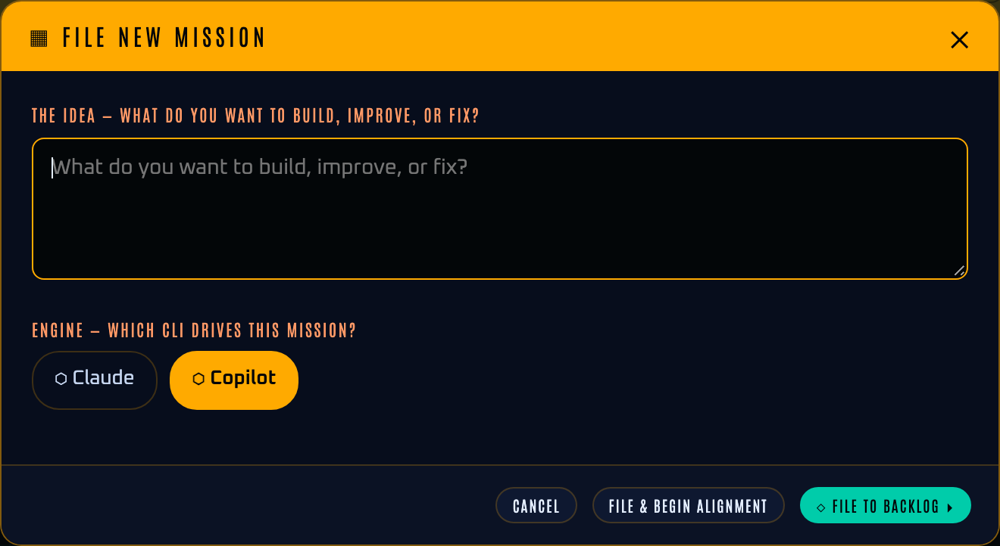

**3. Walk away.** The Mission advances itself through Research, Validate, Plan,
Plan Review, Schedule and Implement, the card showing the stage, the cost so far
and the ticket it is on. Nothing needs you until something does.

**4. Answer what it asks.** An escalation turns the card red, says what needs
your answer, and sends a notification; reaching Verify alone does not turn a card
red. Escalations and Verify reviews are both listed by `lcars answer`.

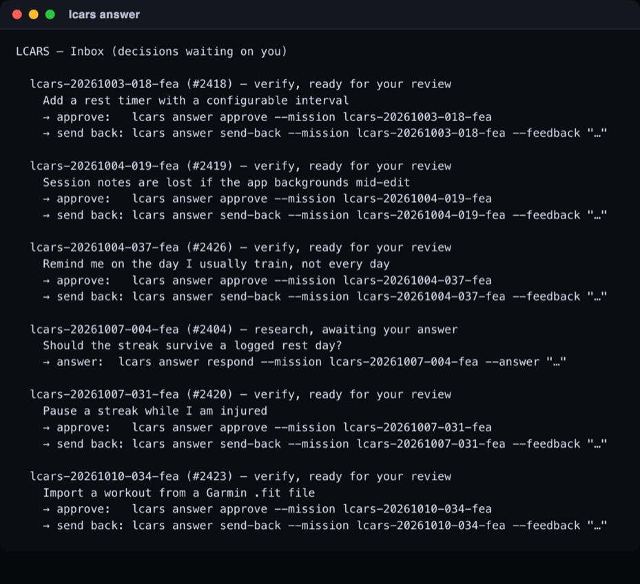

**5. Approve it.** At Verify you see what you asked for beside what was built,
the estimate beside the real cost, and the pull request when one is recorded.
**⚡ RUN** starts the built app so you can look at it before you decide. Then
merge the open PR, or send it back with a note; approval never opens and merges a
PR in one step. With no PR recorded the inbox says approval is unavailable: run
`lcars run <mission-id>` so Verify opens one — or, for a logged-bug child, which
has no PR of its own and ships via its parent, `lcars resolve-logs <parent>`.

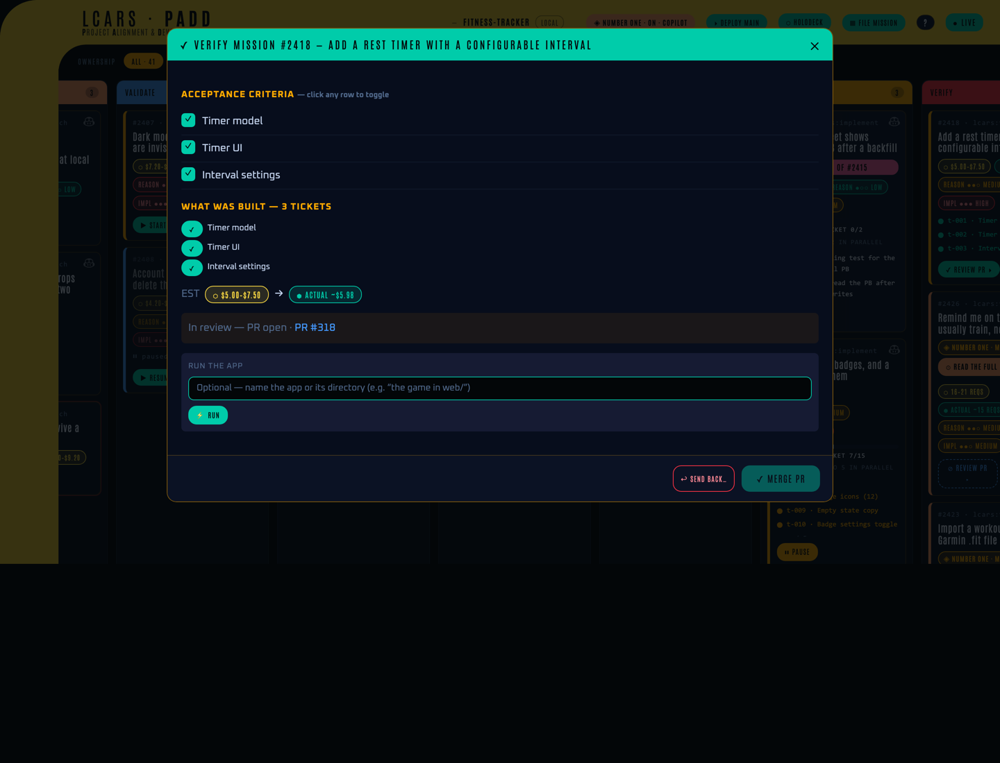

## The commands

In the order you meet them. `lcars-…` names are real programs; the rest are
skills you ask your AI CLI for, inside the repo.

- `lcars init` — per-repo setup: local state and the GitHub labels. Once.
- `lcars-viewscreen` — open the board (alias `lcars-serve`).
- `lcars file` — turn a free-form idea into a Mission.
- `lcars` / `lcars run <id>` — do the obvious next thing; `--step` advances one Stage.
- `lcars status` — the board in a terminal; `--watch` follows a run live.
- `lcars answer` — the one inbox for everything waiting on you, approve included.
- `lcars-launch` — start a Mission's app so you can look at it; `--stop` ends it.
- `lcars log` / `lcars resolve-logs` — describe bugs you found, each becoming a linked bug Mission; then drive them all to **one** re-verify gate.
- `lcars pause` / `lcars resume` — stop at the next safe boundary, and go again.
- `lcars adopt <issue>` — take a Mission over on this machine from its issue alone.
- `lcars xo` — engage or stand down Number One, and read his report.
- `lcars-eeh` / `lcars-ech` — the ride-along, and handing it the loop.
- `lcars update` / `lcars version` — absorb a `git pull`, and say where you are.

## What you get

### The viewscreen

Every Mission as a card in its Stage column, progress streamed live. Every button
maps to a command, so the board and the terminal never disagree. A Mission
belongs to a **person**, not a laptop: you can see Missions running on machines
you do not have, you cannot drive someone else's by accident, and you can
deliberately take one over.

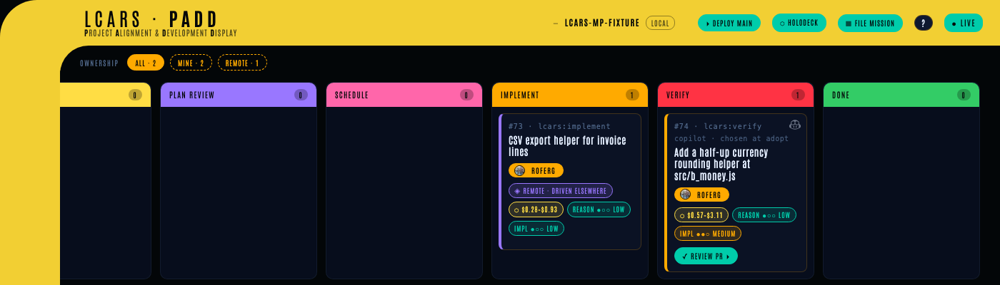

### The holodeck

When the thing you want is easier to draw than to describe, talk a mockup into
existence instead. The holodeck renders it live as you discuss it, can learn your
project's existing look in one read-only pass, and then hands the finished
drawing to a Mission that builds it.

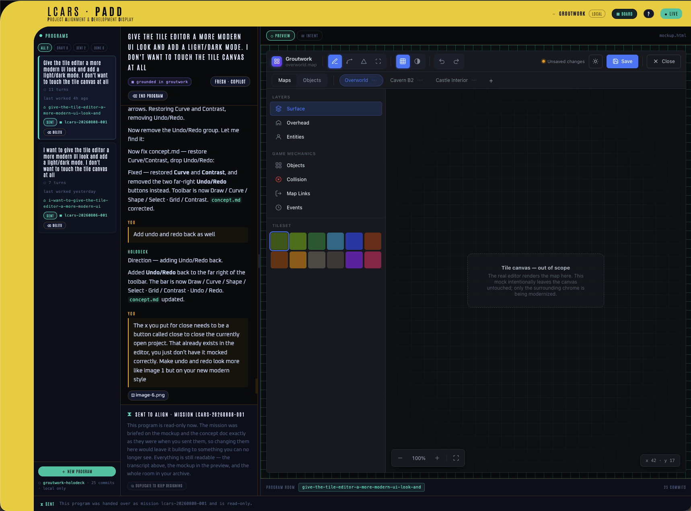

### Number One

A first officer who works your gates for you. He takes the stages parked for an
answer and the look at Verify, grades what was built against what you asked for,
and hands control back with a report — including a plain count of what he could
**not** check. He never writes code and never merges.

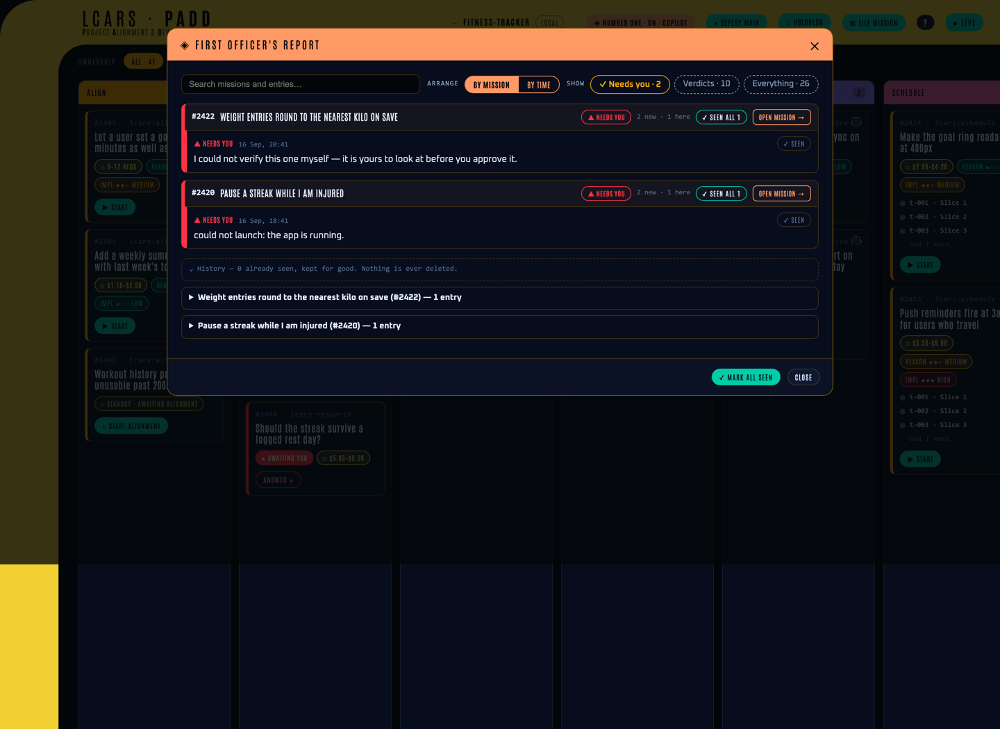

### Run the app, from the board

**DEPLOY MAIN** starts whatever is already merged; **⚡ RUN** on a Verify card
starts what the Mission just built. Both take a plain-English hint about which
app to start. Looking at the running thing is the check no suite performs for you.

### The Mission Log

Found three things wrong while reviewing? Describe them in one go — screenshots
included — and LCARS splits them into bug Missions linked to the parent, each
grounded against the code that Mission wrote so the fix lands in the real thing
rather than beside it. Fix them all for **one** re-verify gate, not one per bug.

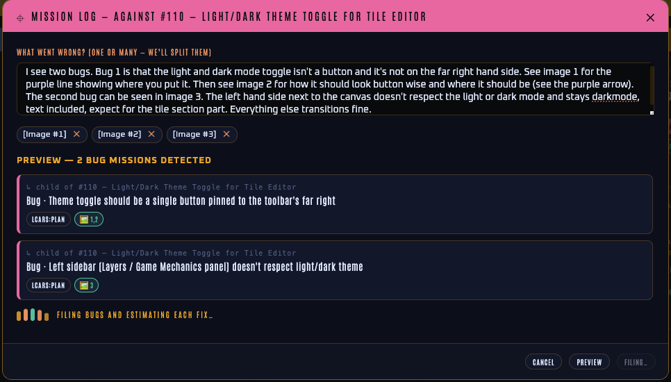

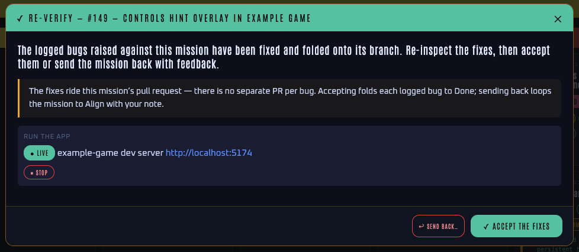

### The ECH — handing over the loop

A **software factory** is the shape this pipeline already has: signals in,
triaged into planned changes, built, tested, reviewed, out as merged pull
requests. The ECH is what lets you hand the *running* of it over. You give it a
goal, it holds one alignment round with you to agree what to build, and then it
works milestone after milestone, coming back only when it genuinely needs you.

The hard part of running a factory is not making the change — it is
**believing** it. Producing a change is the cheap half now; verifying one you did
not write is the expensive half, and that cost does not fall because the suite
came back green. So the ECH does not ask to be trusted: it *uses* what it built,
files what it finds with a reproduction quoting the real output, re-proves each
fix on deliberately different data, writes down every decision it made alone, and
says so plainly when a check found nothing.

On the run that proved it, across one night, it built a working command-line
tool, a page and a CI workflow, needed its operator **once** (the opening
alignment round), and **found two real bugs a fully green suite had passed**. A
human still ran the final landing; it is not claimed to ship with nobody there.

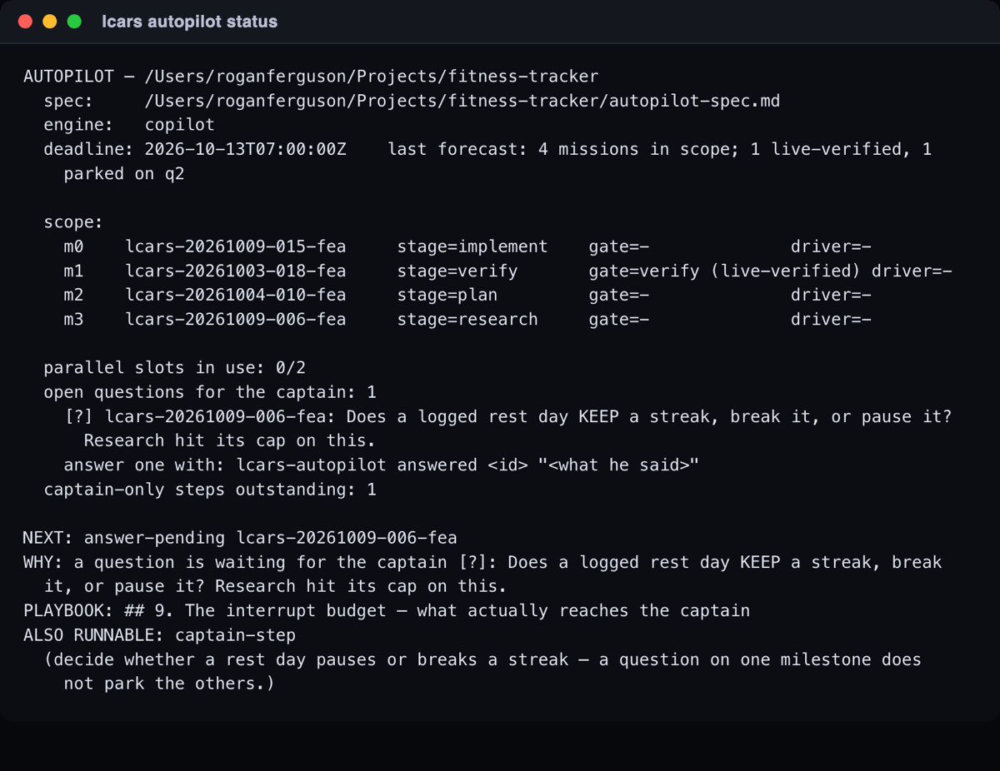

### Knowing the cost before you spend it

Once the spec is written, LCARS reads it against your actual repo, judges how
much reasoning and how much implementation it needs, picks a model tier per Stage
accordingly, and prices the run. The estimate sits on the card, and after the run
the real figure sits next to it.

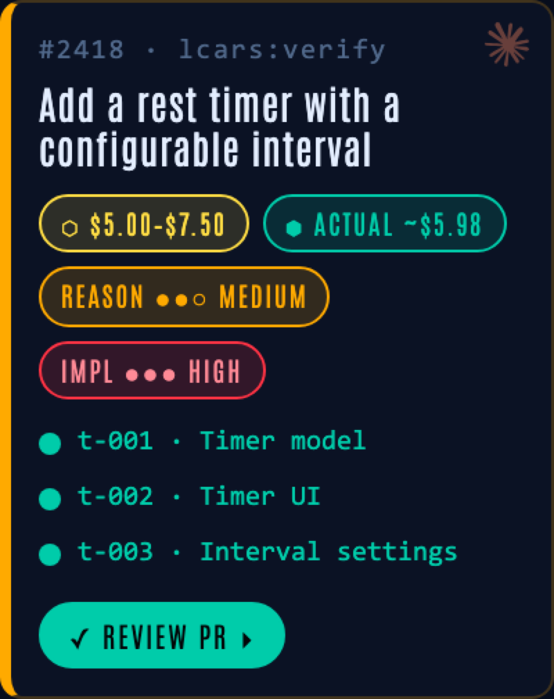

## Two engines

LCARS runs on **either** CLI, and offers you only what is installed on the
machine: every picker — filing a Mission, starting one, the holodeck, Number One
— greys out an engine that is not there rather than failing later.

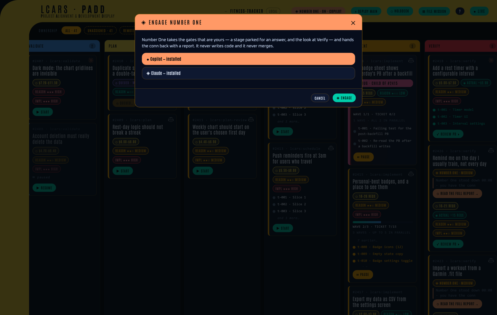

|  | Claude Code | GitHub Copilot CLI |
|---|---|---|
| The whole pipeline, idea → PR | ✅ | ✅ |
| Every LCARS command | ✅ | ✅ |
| The ECH and Number One | ✅ | ✅ |
| Cost shown before you spend | in dollars | in GitHub AI Credits, with your plan's included allowance netted off |
| Maturity | the original path, heavily used | newer — proven idea → PR, fewer miles |

Two things to know on Copilot. Start it as `copilot --allow-all-tools`, **not**
`--autopilot`: the first auto-approves tool calls while leaving LCARS's human
gates intact, the second answers LCARS's questions *for* you and blows straight
through them. And LCARS's workers run on Copilot's **Claude tiers** — the models
that reliably perform the pipeline's file operations — so a run draws on billable
usage rather than Copilot's included tier.

## How it works

**The loop that drives everything is plain shell, and it spends no tokens.** It
reads a Mission's state, picks the next Stage, starts a worker, records the
result, and repeats. Every token LCARS spends is spent inside a worker doing a
piece of thinking, on a model tier chosen for that Stage.

**Every Stage runs cold.** A worker is a fresh subprocess that sees only what the
previous Stage *wrote to disk*, never its conversation; the prompt is assembled
from file paths alone. One Stage's reasoning cannot leak into the next, so each
must record its decisions and its reasons — the written artifact is the entire
handover. A Stage that cannot isolate itself refuses loudly rather than quietly
running inline.

**Your checkout is never touched.** Missions build in their own worktrees and
commit through an ephemeral landing worktree. Switch branches with three Missions
running and neither side notices.

**State lives in `.git/lcars/`** — inside `.git/`, so git never tracks it and
your working tree stays clean. One directory per Mission holds its spec, its
research, its plan, its tickets' results, the questions it asked you and your
answers, and an append-only event log:

```text
.git/lcars/
  config.json                  engines, model tiers, test command, notifications
  missions/<mission-id>/
    state.json  prd.md  estimate.json  research/  validated-plan.md
    plan.json  waves.json  tickets/  pending.json  answers.json  events.jsonl
```

**Everything configurable is in one page** —
[`docs/configuration.md`](docs/configuration.md): model tiers per Stage, the
concurrency cap, the Copilot billing keys, the price data. You rarely need it.

**The board's data model is GitHub labels.** `lcars:align` … `lcars:done` say
which column a card is in, `lcars:awaiting-human` says it is waiting on you, and
`lcars:mission` / `lcars:ticket` separate the work from what tracks it. Filtering
issues by those labels gives you the same picture without the board.

## Where it stands

This is a real tool in daily use, not a finished product. The pipeline works end
to end and has shipped a great deal of its own code. It also ships imperfect on
purpose: the point is to keep using it, find where it falls down, and fix that
rather than wait until it is polished.

What is honestly rough today: the Copilot path works but has far fewer miles on
it than the Claude one, so you may hit edges there first. Number One grades what
he can reach and tells you what he could not — useful, but not a code review.
Multi-person support is real, but has only run against one GitHub account, and
two people acting in the same instant is not handled yet. The suite is slow
enough to be a gate rather than an inner loop. And **DEPLOY MAIN** has been seen
to take the viewscreen down on the Claude path and not bring it back; the work it
was doing still finishes, but you have to restart the board with
`lcars-viewscreen` to see it. Expect all of this to keep changing.

## Contributing

Issues and pull requests are welcome. [`CONTRIBUTING.md`](CONTRIBUTING.md) has
the short version: command source lives in `skills/<name>/`, every command has a
test in `tests/`, write the failing test first, and run `./install.sh` before you
try your change.

[`vision.md`](vision.md) is the long-form design and the story of how it got
here, [`CONTEXT.md`](CONTEXT.md) is the glossary for any word you are unsure of,
[`CLAUDE.md`](CLAUDE.md) is this same contract written for an AI agent, and
[`docs/index.html`](docs/index.html) is this page in LCARS livery.

## License

MIT — see [`LICENSE`](LICENSE).
