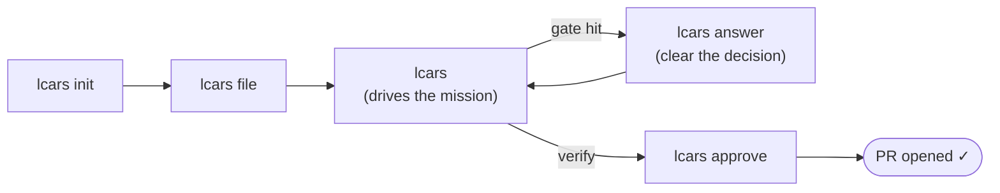
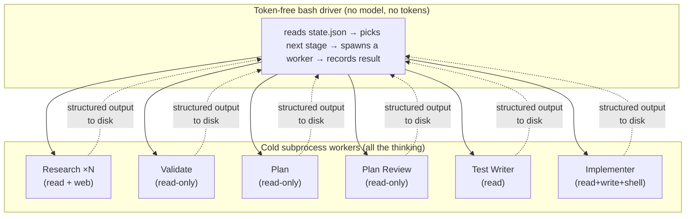

# LCARS

**Local mission control for shipping software with AI.** LCARS is a reusable
harness that takes a free-form human idea and drives it all the way to a merged
pull request — through alignment, research, planning, adversarial
test-and-implement, and a human review gate — mostly unattended. You file the
idea and give the final yes; the harness does everything in between.

It installs as a set of Claude Code skills (`lcars init`, `lcars file`, …) that
work in **any** repo, and leaves **zero** files in your working tree.

> 📖 [`vision.md`](vision.md) is the full design. [`CONTEXT.md`](CONTEXT.md) is
> the domain glossary. [`docs/index.html`](docs/index.html) is this guide in
> LCARS livery. This README is the fast path to getting started.

---

## Table of contents

- [What it does](#what-it-does)
- [The pipeline](#the-pipeline)
- [Install](#install)
- [Quick start](#quick-start)
- [The commands](#the-commands)
- [How a mission runs (worked loop)](#how-a-mission-runs-worked-loop)
- [What to expect at each stage](#what-to-expect-at-each-stage)
- [How it runs under the hood](#how-it-runs-under-the-hood)
- [Where state lives](#where-state-lives)
- [GitHub labels (the board's data model)](#github-labels-the-boards-data-model)
- [Configuration & environment](#configuration--environment)
- [Develop / contribute](#develop--contribute)
- [Status](#status)

---

## What it does

LCARS is **not** a code generator, a chat box, or a one-shot prompt. It is an
**orchestration system** — a defined pipeline of LLM operations, automated
checks, and human checkpoints — that turns intent into shipped software.

Every piece of work is a **Mission**: a single human intent (a feature, an
improvement, or a bug fix). Each Mission gets its own branch, is mirrored as a
GitHub issue, and moves through a fixed sequence of **Stages** as a card on a
kanban board. Missions are branch-isolated, so many can run concurrently and
merge sequentially when you approve them.

The key idea: **you set a Mission in motion and walk away.** The harness
auto-advances it stage to stage on its own and stops only at a genuine human
gate — a strategic decision it can't make, or the final review. When it stops,
it pings you with a one-line, decision-ready summary. Being notified only when
you're actually needed is the normal way to use it.


---

## The pipeline

A Mission moves through eight Stages in order. The harness manages every
transition; you appear at gates, not at every step.


| # | Stage | Who | What happens |
|---|-------|-----|--------------|
| 1 | **Align** | 🧑 you + LLM | A structured grilling session — not a chat — that resolves ambiguity in the idea and produces a **PRD** (the canonical spec). |
| 2 | **Research** | 🤖 auto | Generates 0–20 questions from the PRD; each goes to a stateless parallel Research Agent that returns a recommendation + supporting points. |
| 3 | **Validate** | 🤖 auto | A Validator synthesises all findings into a plan, resolving the *how*. Escalates to you only when a finding changes *what* gets built. |
| 4 | **Plan** | 🤖 auto | Decomposes the validated plan into small, independently testable tickets — each a vertical slice owning **one cohesive behavior**, sized by total **comprehension load** (code-to-read + tests + new code) against a tunable budget, not a flat line count. |
| 5 | **Plan Review** | 🤖 auto | A *fresh* reviewer (no planning context) audits every ticket for slice, size, testability, and dependencies. Loops back to Plan until clean; escalates after 3 rounds. |
| 6 | **Schedule** | 🤖 auto | Builds the dependency graph into sequential **Waves** and opens one GitHub sub-issue per ticket. |
| 7 | **Implement** | 🤖 auto | Per ticket, an adversarial **Test Writer → Implementer** pair. Tests are written first, must fail (red gate), then are locked while the Implementer makes them pass. |
| 8 | **Verify** | 🧑 you | You read the diff, run the app, test the golden path — then **approve** (open the PR) or **send back** with feedback. |

Four feedback loops keep it honest: Research → Align (too much ambiguity),
Validate → Align (scope change), Plan Review → Plan (bad tickets), and
Verify → Align (you weren't satisfied).

---

## Install

LCARS lives in this repo and installs globally via symlinks, so a `git pull`
delivers updates with no re-install.

```bash
git clone <this-repo> lcars
cd lcars
./install.sh          # symlinks skills/* into ~/.claude/skills/
```

**Requirements**

- [Claude CLI](https://claude.com/claude-code) — the host CLI and the default
  worker binary.
- [`gh` CLI](https://cli.github.com), authenticated (`gh auth login`) — used for
  issues, labels, sub-issues, and PRs.

**Updating**

```bash
git pull              # skill source updates in place — symlinks already point at it
./install.sh          # only needed to pick up brand-new skills
```

`install.sh` is idempotent. If a real (non-symlink) skill of the same name
already exists in `~/.claude/skills/`, it is backed up rather than clobbered.

---

## Quick start

Run these inside **any repo** you want to ship work in:

```bash
lcars init            # one-time per-repo setup: .git/lcars/ + GitHub labels
lcars file            # file your first Mission — describe the idea, get grilled, get a PRD
lcars                 # do the right thing: with the mission filed, it drives it forward
```

That's the whole rhythm. `lcars init` once per repo; then it's `lcars file` to
hand it work and bare `lcars` to push it along or answer what it's waiting on.



---

## The commands

LCARS collapses to **two things you do** — hand it work, and answer what it's
waiting on — plus a board to look at. The older per-stage verbs still work as
power entry points.

### The everyday surface

| Command | What it does |
|---|---|
| `lcars` | **The one entry point.** Infers the right action from state and announces it first: nothing filed → runs the `lcars file` flow; work in flight & nothing pending → drives the active Mission (auto-advance); a decision waiting → opens the inbox. Never makes you remember a verb or paste an id. |
| `lcars answer` | **The inbox** — every pending decision across *all* Missions in one list: scope escalations, plan-review stand-offs, blocked tickets, and the Verify gate. **approve** and **send back** are actions on a Verify card here, not separate commands. |
| `lcars status` | The read-only **board**: every active Mission, its Stage, and anything awaiting you. |
| `lcars init` | One-time per-repo setup (local config + GitHub labels). |
| `lcars file` | File a new Mission from a free-form idea; runs Align to a PRD. |
| `lcars log` | Log one or more bugs against an active Mission in free-form language; fast-tracks a Mission per bug straight to Plan and links them. |

### Power verbs (still supported)

| Command | What it does |
|---|---|
| `lcars run <id>` | Auto-advance a Mission stage-to-stage until a human gate. |
| `lcars run <id> --step` | Advance **exactly one** Stage, then stop (for debugging/inspection). |
| `lcars respond [<id>]` | Answer a Mission's awaiting-human gate. No id lists everything waiting. |
| `lcars approve <id>` | Ship a verified Mission: push the branch, open the PR, mark it Done. |
| `lcars feedback <id> "<note>"` | Send a Mission at Verify back to Align with a note (kept in an accumulating history). |

> **No id juggling.** A shared resolver picks the target Mission: one candidate →
> no id needed; several → a fuzzy picker; an explicit id / partial / title always
> works. `lcars` and `lcars answer` both go through it.

---

## How a mission runs (worked loop)

Here's the full walk-away rhythm for a real feature.

**1 — File it.** You describe the idea; Align grills you until the spec is sharp.

```text
$ lcars file
> Idea: Add XP, badges, and a per-course leaderboard to motivate learners.
  [Align asks a handful of clarifying questions; you answer in character.]

Mission filed: lcars-20260604-001
GitHub issue:  #42
Stage:         align
Next:          run `lcars` to continue
```

**2 — Let it drive.** Bare `lcars` auto-advances through the headless stages and
stops at the first real decision.

```text
$ lcars
Driving lcars-20260604-001 from research…

lcars-20260604-001  auto-advance
─────────────────────────────────────────────
research    ✓ ⊘ isolated  14 questions, agents complete
validate    ⏹ awaiting you
─────────────────────────────────────────────
⏹ stopped at: validate  (scope decision)
   Research is split on global vs per-course leaderboard — this changes the
   DB schema. Global, or per-course?
   Answer with `lcars answer`
                                            🔔 (notification fired)
```

**3 — Answer the gate.** Clear the one decision from the inbox.

```text
$ lcars answer
[1] lcars-20260604-001 · Validate · "Global or per-course leaderboard?"
> Per-course for now.
✓ answered — next `lcars` resumes validate
```

**4 — Walk away.** Bare `lcars` again resumes and runs the rest of the pipeline
unattended — Plan, Plan Review, Schedule, Implement — stopping only at Verify.

```text
$ lcars
Driving lcars-20260604-001 from validate…
─────────────────────────────────────────────
validate    ✓ ⊘ isolated  scope resolved (per-course)
plan        ✓ ⊘ isolated  11 tickets
plan-review ✓ ⊘ isolated  passed round 1
schedule    ✓             3 waves, 11 sub-issues
implement   ✓ ⊘ isolated  11/11 tickets green
─────────────────────────────────────────────
⏹ stopped at: verify  (human review required)
   Next: review the changes, then `lcars approve lcars-20260604-001`
                                            🔔 (notification fired)
```

**5 — Verify and ship.** You read the diff and run the app. Happy → approve and
the PR opens. Not happy → send it back with feedback and it re-enters Align with
the full history intact.

```text
$ lcars approve lcars-20260604-001
✓ branch pushed, PR opened: https://github.com/you/repo/pull/57
✓ lcars:done — mission complete
```

---

## What to expect at each stage

- **Align is interactive and adaptive.** A one-line bug fix produces a thin PRD
  in a minute or two; a complex feature earns a thorough grilling. This is the
  one stage that is always a conversation.
- **Research scales to ambiguity.** A crisp PRD yields *zero* questions and skips
  straight through. A broad one fans out up to 20 parallel agents. More than 20
  needed → it explains why and lets you override or sharpen the PRD.
- **Validate decides the *how*, escalates the *what*.** Implementation calls stay
  with the Validator; only choices that change *what gets built* come to you.
- **Plan / Plan Review enforce cohesive vertical slices.** Each ticket is a
  full-stack slice owning **one cohesive behavior**, sized by total comprehension
  load (existing code to read + tests + new code) against a tunable
  `comprehensionBudget` — not a flat line count, so greenfield tickets stay
  generous and later ones tighten as the codebase grows. An independent reviewer
  rejects horizontal slices and tickets that are over budget by *bundling*
  behaviors, looping back until clean (or escalating after 3 rounds).
- **Implement is adversarial and guarded by the harness, not the prompt.** The
  Test Writer's tests must actually **fail** before the Implementer runs (red
  gate), the test files are **locked** so green can't be reached by editing them,
  and a quality check rejects assertion-free suites. Up to 5 attempts per ticket,
  then it flags you.
- **Verify never auto-passes.** Auto-advance always stops here. Shipping is your
  call.

---

## How it runs under the hood



Two deliberate properties make this robust:

- **Token-free driver, model-selected workers.** The loop is plain shell — it
  never reasons about your code. Every token LCARS spends is spent in a worker,
  on **whichever CLI you launched from**. Run LCARS inside Claude Code and every
  worker is Claude. CLI choice is an implementation detail; **model choice is the
  meaningful one.**
- **Stage isolation (cold handoff).** Every headless Stage runs as a fresh
  subprocess that sees **only** what the previous Stage wrote to disk — never its
  conversation. The worker's prompt is assembled by `run.sh` from artifact
  *paths* alone, so there is no channel for one Stage's reasoning to leak into the
  next, even when the whole pipeline runs in one sitting. Each Stage records
  **decisions and their rationale** (the *why*, not just the *what*), because the
  artifact is the entire contract. A `⊘ isolated` marker on every stage line
  proves it; if a Stage ever can't isolate, the driver refuses **loudly** rather
  than running inline.

---

## Where state lives

All per-repo mission state lives under **`.git/lcars/`** — inside `.git/`, so git
never tracks it and the target repo's working tree stays clean. Don't add it to
`.gitignore` and don't commit it.

```text
.git/lcars/
  config.json                     repo config (model, context file, test command, notify)
  missions/
    lcars-20260604-001/
      state.json                  id, type, stage, githubIssue, flags
      prd.md                      Align output — the canonical spec
      research/<n>.json           per-question findings
      validated-plan.md           Validate synthesis (+ rationale)
      plan.json                   Plan tickets (each with rationale)
      approved-plan.json          Plan Review's approved copy
      plan-review-<round>.json    objections per round
      waves.json                  dependency graph → waves + sub-issue numbers
      tickets/<ticket>/tests/     Test Writer's locked tests
      tickets/<ticket>/result.json  pass/attempts/summary
      pending.json / answers.json   escalated questions + your answers
      feedback.md                 accumulating Verify feedback history
```

---

## GitHub labels (the board's data model)

`lcars init` creates the LCARS label set on the repo. The harness applies them as
Missions move; a future kanban reads them directly via the Issues API.

| Label | Type | Purpose |
|---|---|---|
| `lcars:align` … `lcars:done` | Stage (exclusive) | The Mission's current column |
| `lcars:feature` / `lcars:bug` | Type | Mission kind |
| `lcars:paused` | Status (additive) | Overlaid when a Mission is paused |
| `lcars:awaiting-human` | Status (additive) | Overlaid when blocked on your answer |
| `lcars:linked` | Relationship | A bug Mission linked to a parent via `lcars log` |

Filtering issues to `lcars:awaiting-human` shows every pending decision at a
glance — before the kanban UI even exists.

---

## Configuration & environment

`lcars init` writes `.git/lcars/config.json` (default model, detected
`CONTEXT.md`, test command for the red gate, optional notify target). The harness
**never** modifies `CLAUDE.md`, `.gitignore`, `CONTEXT.md`, `.claude/settings.json`,
or any source files.

External dependencies are injected via env vars so they're swappable (and
stubbable in tests):

| Variable | Purpose | Default |
|---|---|---|
| `LCARS_WORKER_BIN` | The cold-worker CLI every headless Stage spawns | the host CLI (e.g. `claude`) |
| `LCARS_GH_BIN` | The GitHub CLI | `gh` |
| `LCARS_NOTIFY` | The walk-away notification hook fired at human gates | local desktop banner + bell |

Notifications fire **only** at genuine gates (an escalation or Verify), batched
per Stage — never one-per-question, never on a clean transition. A phone push
(ntfy / Pushover) is opt-in via config.

---

## Develop / contribute

Skill source lives in `skills/<name>/` (one dir per `lcars` command); tests in
`tests/`. [`CLAUDE.md`](CLAUDE.md) is the contributor contract — read it first.

```text
skills/<name>/SKILL.md     frontmatter + instructions
skills/<name>/<name>.sh    the executable logic (kept testable; deps via env vars)
tests/<name>.test.sh       one suite per skill
tests/run.sh               runs every *.test.sh
install.sh                 symlinks skills/* into ~/.claude/skills/
```

The golden rule: **skills are authored in this repo, never directly under
`~/.claude/skills/`** — `./install.sh` symlinks them so `git pull` delivers
updates. The workflow for any change:

1. **Author** in `skills/<name>/`.
2. **TDD it** — write the failing test in `tests/<name>.test.sh` first, then make
   it pass. Keep logic in a bundled shell script; take external deps via env vars
   so tests can stub them.
3. **Install** — `./install.sh`.
4. **Verify** — `bash tests/run.sh` (all suites green).
5. **Commit** — source, test, and any doc updates are all tracked.

Open bugs against the harness are tracked in [`bugs.md`](bugs.md) with stable
`BUG-NNN` ids.

```bash
bash tests/run.sh         # run the whole suite
```

---

## Status

The full pipeline is built and runs unattended (idea → PR). Sessions 1–16 of the
[build order](CLAUDE.md) are complete:

| Stage of the build | Status |
|---|---|
| `lcars init` · `file` · `status` (foundation) | ✅ |
| Research · Validate · Plan · Plan Review (planning) | ✅ |
| Schedule · Implement · Verify + PR (build & ship) | ✅ |
| `lcars respond` (async human gate) | ✅ |
| Per-stage isolation (cold subprocess workers) | ✅ |
| Implement guardrails (red gate · immutable tests · quality) | ✅ |
| Auto-advance + notifications (the unattended loop) | ✅ |
| Human surface (`lcars` + `lcars answer`) | ✅ |
| Mission Log (`lcars log`) | ✅ |
| **Copilot enablement** (run LCARS under GitHub Copilot) | 🔬 deferred — research spike |

**Roadmap.** Copilot enablement makes `$LCARS_WORKER_BIN` resolve to `copilot`
so the harness runs on whichever CLI you launch from. Further out: a custom
**kanban interface** (cards, stages, pending-question badges, start/stop control)
and **production monitoring** to close the loop from live signal back to new
Missions. LCARS v1 covers idea → merged PR.
