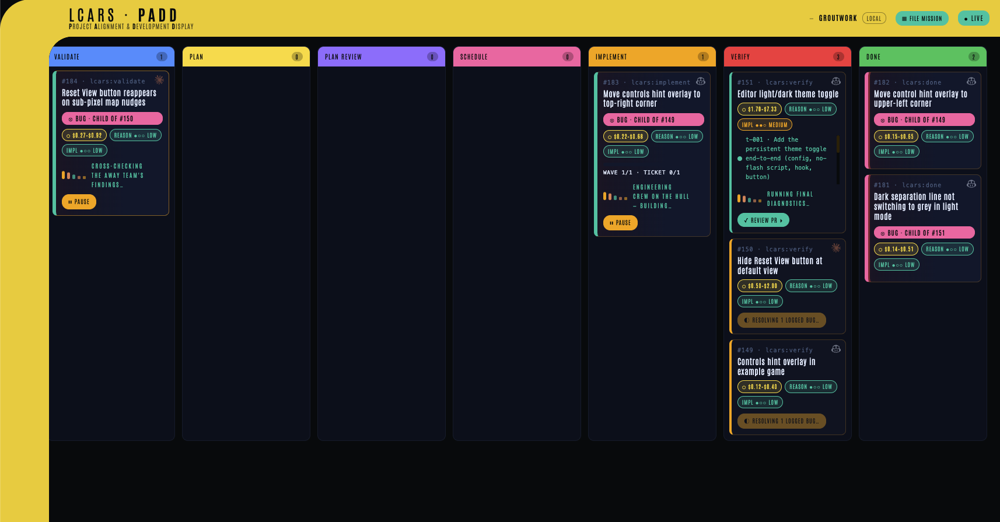
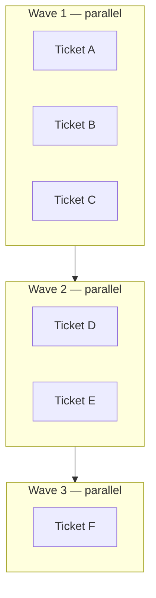
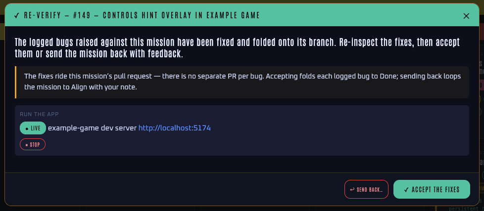
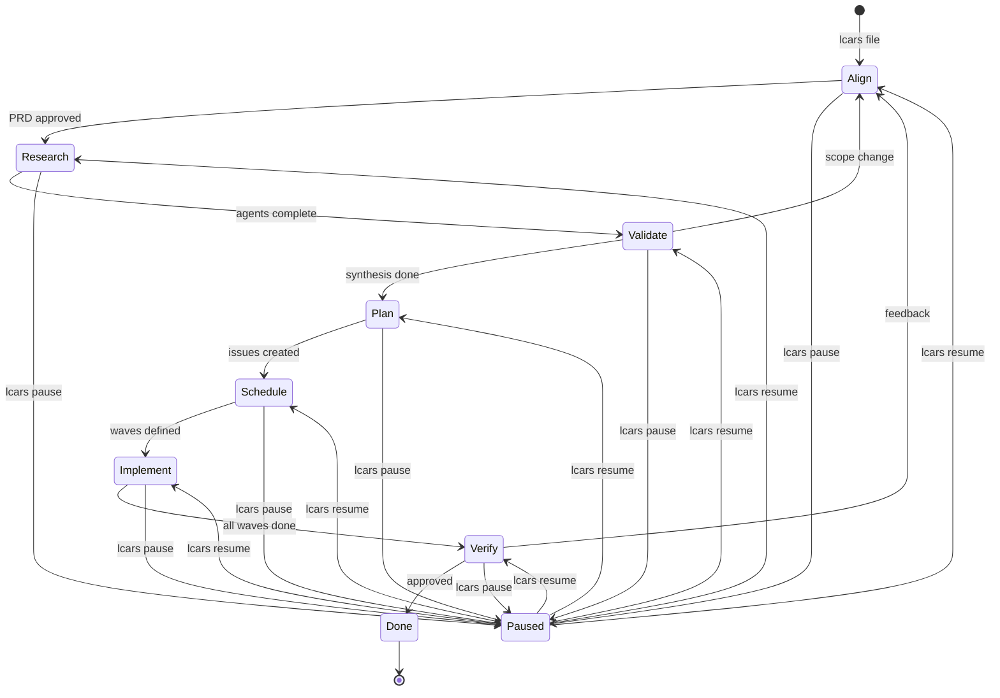
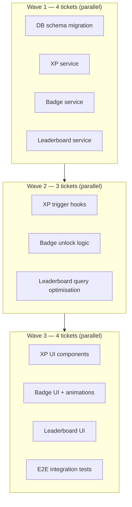
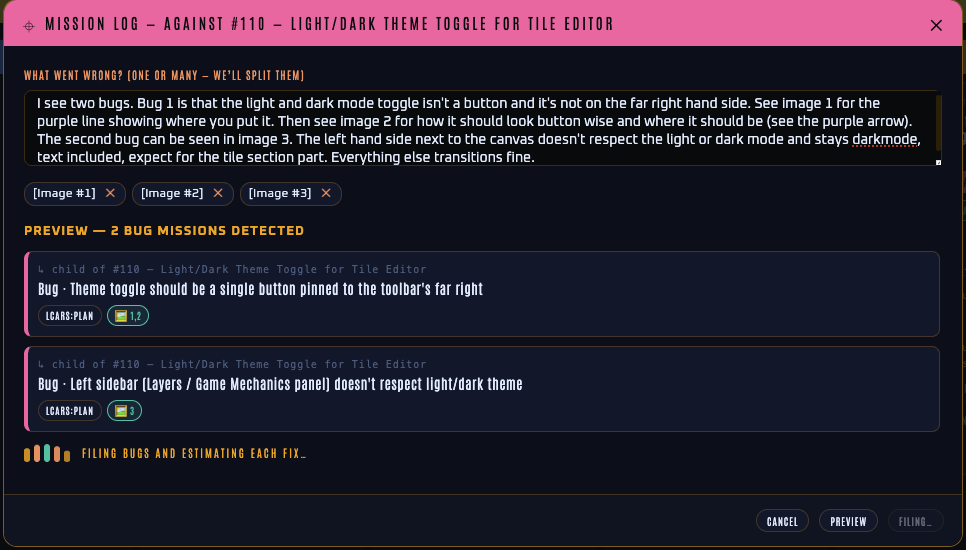
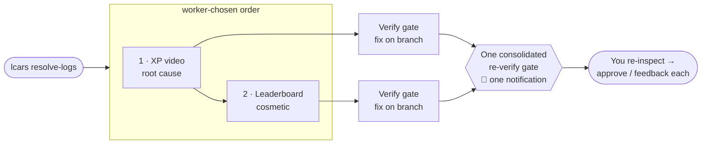

# LCARS — Vision

## What Is LCARS?

LCARS is a reusable AI harness that takes a human idea and drives it to a merged pull request. It is not a code generator, a chat interface, or a one-shot prompt. It is an orchestration system — a defined pipeline of LLM operations, automated checks, and human checkpoints — that turns intent into shipped software.

And it is a **shared board**, not a private one. A Mission belongs to a *person*, every card says which person, and everyone working the repo sees the same board — including the Missions running right now on machines they do not have. You cannot drive someone else's Mission by accident, and when one needs to change hands you take it over deliberately and on the record. LCARS is built for a crew, not for one operator at one keyboard.

The human provides the idea and the final judgment. The Harness does everything in between.



*The viewscreen — command and control for the whole idea → merged-PR loop.*

---

## The Core Unit: The Mission

Every piece of work in LCARS is a **Mission** — a single human intent, whether a new feature, an improvement, or a bug fix. Missions are filed via a global CLI skill invokable from any repo. On entry, a free-form description is the only requirement.

Each Mission:
- Gets its own branch
- Is represented as a GitHub issue
- **Belongs to a person** — the issue's assignee on the forge
- Moves through a defined set of Stages as a card on the Kanban Board
- Can be paused and resumed at any point

Missions can be active concurrently. Each is isolated on its own branch; merges happen sequentially when the human verifies and approves.

---

## The Crew: Whose Mission Is Whose

A Mission's real, portable home is its **GitHub issue**, not the laptop that filed it — a second clone has no `.git/lcars` at all. That one fact is what makes the board shared: the forge already records who a piece of work is assigned to, so LCARS reads ownership from there rather than keeping a second, private answer that could disagree with it. The captain changes who owns a Mission the way he changes anything else about an issue — on GitHub.


*One board, two machines. **#73** is being driven somewhere else entirely — this clone has no copy of it, and the card still shows its real stage. **#74** was adopted onto this laptop and sits at Verify, running on the engine a human picked at the handoff. The strip above counts what you are looking at: `ALL · 2`, `MINE · 2`, `REMOTE · 1`.*

**You are a person, not a machine.** Identity is the **`(host, login)` pair** — never a hostname, and never a numeric id. Measured against a real forge, the same login carries a different numeric id on github.com than on a GitHub Enterprise host, and a display name can be null; the login is the only thing that is both stable and the string the assignee API actually takes. Every lookup and every cache key is host-scoped, so the same handle on two forges is correctly **two different people**. Two humans sharing one laptop are two people; one human on two laptops is one person.

**Every card says whose it is.** The owner rides in an LCARS pill with their avatar and handle. Yours reads as a **solid block**; someone else's as **hollow and dashed** — so ownership survives greyscale, a projector, and colour-blindness rather than depending on hue alone (the pair measures 8.18:1).

**You cannot drive someone else's Mission.** This is not a greyed-out button. The daemon refuses **ten write verbs** at the door with a status code — start, pause, resume, respond, verify, reapprove and the four Mission Log verbs — because a disabled control is decoration to anyone who can POST past the DOM, and because the long verbs are dispatched detached, where a child's refusal would land in a log nobody reads seconds after the card had already flipped to *starting*. The CLI refuses the same work for the same reason, and both say **one byte-identical sentence**: *assigned to `<login>` — reassign it to yourself on GitHub to take command.* There is exactly one implementation of "whose Mission is this?" in LCARS, and every surface shells to it.

The lock is deliberately **light**. Reading is never gated — `lcars status`, `lcars eeh` and every board read work on anyone's Mission. An **unassigned** Mission is not locked: empty means *unowned*, not *forbidden*. And an identity LCARS cannot resolve never locks anything, because a false lock — telling the captain he is someone else — is strictly worse than the thing the lock prevents.

**You can see work happening on machines you do not have.** A Mission with no local copy is not missing from the board; it is read from the forge and rendered as a **remote** card at its real stage, with its cost and difficulty pills intact, marked `◈ REMOTE · DRIVEN ELSEWHERE`. Its write controls are disabled and carry the same sentence the daemon would answer with: *driven from another machine — adopt at Align/Verify to act here.*

**You can take one over.** `lcars adopt <issue#>` — or the **Adopt** button on the card — rebuilds a Mission on this laptop from its issue alone: it reuses the Mission's own id (a new one would fork the Mission in two), rebuilds the spec and state from the issue body and the `lcars:handoff` envelope, reads the stage from the `lcars:<stage>` label, seeds a config if this clone has none, and carries the estimate across so the pills survive the moment the Mission becomes local. At **Align** it claims the Mission by assigning you on GitHub; at **Verify** it joins without claiming and resolves the open PR, so `lcars approve` and `lcars feedback` work with no further command. Any stage *between* those two ends is refused honestly: v1 portability is the two ends, and the stages in between keep their working artifacts on the laptop driving them. Adopt also **asks which engine should drive it here** — a laptop may only have one CLI installed — and records that a human chose, which is why #74 above reads `copilot · chosen at adopt` rather than silently inheriting.

**You can filter the board by ownership.** A strip above the columns switches between `ALL`, `MINE`, `THEIRS`, `UNASSIGNED` and `REMOTE`, each carrying its own count, so a busy shared board narrows to the question you actually have.

All of this has been driven on **two genuinely cold clones against real GitHub** — live pipelines, real merges, repeatedly.

**Where this goes next.** The multi-person foundation is laid and working: people are distinguishable rather than machines, every Mission carries an owner, the lock is enforced per-person on both surfaces, and the board renders and filters by whose work is whose. None of that is a single-user design with a hole cut in it. What remains is the rest of the build-out, and two pieces of it are worth naming plainly. LCARS has so far only been run against **one GitHub account** — "someone else's Mission" has been exercised end to end with planted owner data, not yet with a second human at a second account. And **two people acting in the same moment** is deliberately still ahead: the race tiebreak and every contention mechanism were consciously deferred, and the shape here was chosen to make that swap cheap (one function body defines "the owner", and no caller reads an assignee *list*). The next round owns both. LCARS is set up to support multiple people; the full multi-person experience is what comes after this one.

---

## Day Zero: A Project That Doesn't Exist Yet

Every Stage of the pipeline proves its work the same way: the ticket's tests are **red on the parent commit and green on the tip**. That proof is the spine of the whole system — and a project with no test runner cannot produce it. On such a repo LCARS was, quite correctly, unable to prove anything at all.

So on a repo with no foundation, LCARS does not show you an empty Kanban board. It replaces the board with a door.

**Establish Vision** is a short conversation, one question at a time. You describe what you want in a sentence; LCARS reads whatever is actually in the repo, asks a few questions, and then **recommends a stack and says why** — in terms of what you told it, not a generic template. Nothing is filed until you approve a recommendation you are free to refuse. Features you mention that are not the foundation are not discarded: they are recorded by name and deferred to normal Missions.

Accepting files an **initialization Mission**. It is a Mission like any other and runs the same pipeline, with one exception that exists precisely because the honesty rule cannot be waived twice: its **first ticket** — and only its first — may exit without a flip-flop, because it is the ticket that creates the runner there was none of. That waiver is recorded with a reason and surfaces at Verify. Every later ticket is held to the real gate, against the runner the first one established.

When you approve the Mission at Verify, the repo **graduates**: the test command it established is promoted into the repo's own config, normal Missions unlock, and the holodeck opens. Until that moment the foundation gate refuses to file ordinary work — not to be obstructive, but because a Mission filed on an unprovable repo is a Mission whose result nobody can trust.

The narrow rule matters: the door replaces the board only when the repo is foundationless **and** has nothing to put on the board. A repo with Missions in flight keeps its board.

The loop is proven end to end on JavaScript/TypeScript, Python, Rust, Go, Ruby and .NET. **JVM is not proven**: there is no JDK detection arm yet, so a Java or Kotlin project cannot establish a foundation this way.

### Which engine drives it

The same screen asks which CLI you want: **Claude Code** or **GitHub Copilot**. Only engines actually installed on the machine are offered, and the choice runs both the conversation and every Stage of the Mission it files, then becomes that project's default so later Missions inherit it. It is asked once, at the moment the decision is actually being made, rather than buried in configuration.

---

## Before the Mission: The Holodeck

A Mission begins with a description. But some work is far easier to *draw* than to describe, and a description of a screen — handed to a builder who never saw the picture — is a lossy encoding of something that only ever existed in the human's head.

The **holodeck** is where that picture gets made instead. It is a room on the viewscreen, reached by the `⬡ HOLODECK` control in the band, where the human talks a mockup into existence with an AI, watches it render live as it changes, and then hands the drawing to a Mission that builds it.

It is deliberately **pre-Mission**. The holodeck runs no Stages, opens no issue, and writes no mission state. Its only bridge to the pipeline is the attachments path at filing time — the same road a pasted screenshot takes — so design work and build work stay separate things that meet at exactly one point.


*The holodeck — talk to it on the left, watch the mockup redraw on the right, then send the drawing to Align.*

**The Program.** The unit of design work is a **Program**, as the Mission is the unit of build work. A Program is a `draft` while it is being worked on and becomes `sent` — locked — once it has been filed as a Mission, so it survives as the record of what was actually handed over rather than drifting on afterwards.

**A sidecar, not your working tree.** Programs live in a **sidecar git repo** beside the project — `<repo>-holodeck` — with every turn committed. Nothing the holodeck writes ever enters the project's own tree. This is the same principle as `.git/lcars/`: a mockup is not the product, so it must be impossible to mistake for the product and impossible to commit to it by accident.

**Grounding.** A Program can start with a bounded, **read-only** pass over the real project, recorded in `basis.md`: its actual colour tokens and their values, the type scale, spacing and radius, and the shape of the components it already has — each named against the file it was read from, and with an explicit note of what could not be found. A mockup drawn on that basis arrives looking like it belongs in that product rather than inventing a design system that the Mission would then have to reconcile. The pass genuinely holds no write tool (on Claude the deny list is the load-bearing half, not the allow list), and it is exactly one turn; after it the Program switches to designing. A blank deck is the alternative, and spends nothing.

**The room.** Three panes: the Program list, the conversation, and a pane that toggles between the mockup **rendered live** — in a sandboxed frame jailed to the sidecar, so model-written bytes can never reach the rest of the machine — and an **Intent** view of what has been captured: the requirements in the human's *own words*, each attributed to the turn it was said in; what the mockup *implies* but has not settled, written as open questions rather than assumed answers; and what is explicitly out of scope. The mockup itself is **one self-contained HTML file** — inline CSS and JS, no build step, revised in place — so even a rich multi-screen prototype stays a single atomic artifact.

A Program also outlives the daemon. Reopening one replays its transcript into a **fresh** worker and says so plainly: it knows what was decided, it remembers nothing itself. The whole record is on disk in the room's `transcript.md`; the conversation is a durable artifact, not a live session that dies with the process.

**The hand-off is a gate, not a surprise.** Sending a Program to Align is two deliberate steps. First a read-only pass reads the real application *as it stands today* and produces the only thing a builder actually needs: **what is different between the finished mockup and the app as it is now**. That is a diff, not a transcript — a turn in which the human corrected the *mockup* must never read downstream as an instruction to change the *product*, which is exactly how a design conversation poisons a build. What that pass finds but cannot scope comes back as a **question** rather than silently vanishing, because a line nobody writes leaves no trace. Then the filing carries the mockup, the captured requirements and that change list into the Mission — and the brief opens with **what the human actually typed, byte-for-byte**. Nothing generates prose in their voice. If a later turn redraws the mockup or moves the concept doc, the generated list stops matching what is on disk and the control reverts to *generate*, so a stale change list can never be filed.

**The drawing survives into the tickets.** A drawing that reaches Align and then evaporates at Plan has bought nothing. So when a Mission carries a mockup, Plan must account for it: every ticket declares whether it changes what the screen looks like, and a ticket that says it does must carry an acceptance criterion **naming the mockup file** — a mention in the description does not count. A plan that omits the declaration, or that declares no ticket visual while a mockup rides along, is rejected and re-planned. Missions with no mockup are validated exactly as before.

**Duplicating a sent Program.** Because a sent Program is locked, continuing a design means copying it: a new room carrying the mockup, the concept doc, the grounding, the attachments and the whole conversation, editable from the first turn, while the original stays precisely as it was handed over. The worker is told the history is context and **not a contract** — where what the human asks for now contradicts a decision in the record, what they ask for now wins, and the record is never used to argue back. Lineage is recorded on the copy and the inherited grounding is marked possibly-stale, since it describes the project as it was. The change list deliberately does not travel: it described the app as it was when the *old* draft was filed, and re-using it would be a lie about today.

---

## Pipeline Overview


Feedback loops exist at four points: Research can return to Align if ambiguity runs too deep; Validate can escalate a scope change back to Align; Plan Review loops back to Plan until issues pass quality checks; and Verify can send a completed Mission back if the human isn't satisfied.

---

## The Pipeline

A Mission moves through eight Stages in order. The Harness manages all transitions. The human is present at key gates, not at every step.

### 1. Align

The human and an LLM get on the same page. This is a structured grilling session — not a chat — where ambiguity in the idea is surfaced and resolved. The output is a **PRD** (Product Requirements Document) that becomes the canonical spec for the Mission.

The Align stage adapts to complexity. A small bug produces a thin PRD in minutes. A complex feature takes longer. If downstream stages reveal that the PRD was underspecified, the Mission can loop back to Align with that context baked in.

**Park now, grill later.** Align has two entry modes. The default is grill-first: you describe the idea, the interview runs, and the Mission files once its PRD exists. But an idea often arrives when there's no time to think it through — so a Mission can also be **parked**: filed from just an engine and the raw idea text, with the mission directory and GitHub issue created immediately and the card dropped into the Align column in a **pre-PRD standby state**. A parked Mission has no PRD, no type (feature-or-bug comes *from* the grill), and no estimate; it is never runnable and the driver never auto-picks it — it simply waits, visibly marked *awaiting alignment*, until you have a moment. Starting the grill later (from the CLI or a one-click board action) runs the same warm interview seeded with the parked idea and completes it in place: the PRD is validated, the issue is retitled and re-bodied with a type label added, the estimator runs, and the result is **indistinguishable from a grill-first filing**. Backlog fast; grill when ready.

For a complex Mission, Align also records high-level **engineering ADRs** (Architecture Decision Records) alongside the PRD — the framework, architecture, and data-shape decisions, each with its rationale and the alternatives weighed. A trivial bug gets none. The ADRs exist so the downstream cold workers inherit the architectural frame instead of silently re-deriving it and taking wrong turns. Align seeds them; Validate refines them when research changes a decision. They are declarative facts every later Stage may read — except the Research Agents, who stay deliberately context-free.

When the PRD (and ADRs) are finalized, Align runs one more cold worker: an **estimator**. It reads the finished spec *and inspects the real codebase*, then reasons like a senior engineer about the **whole problem** — the kind of problem it is, how the change evolves the codebase, its blast radius, and what it sets up for future scale and reliability. Code size is one signal, never the deciding one. From that it produces two independent **criticality scores** — *reasoning/planning* and *implementation*, each low/medium/high — and from those assigns **each downstream Stage a model tier** (Sonnet or Opus), concentrating the expensive tier where mistakes are costliest (the reasoning and the implementation) and keeping routine Stages cheap. It also emits a token-grounded **cost estimate** for the Mission, rendered in the active CLI's native billing unit. All of this — scores, per-Stage model mix, cost, and the estimator's rationale — is written into the GitHub issue and the CLI readout for the human to review, and the human can **override it in plain language** when kicking off the run (*"use Opus the whole way through"*, *"use Opus for implementation"*, *"keep reasoning cheap"*). The estimator never blocks filing: if it can't run, the Mission still files and every Stage falls back to its default model. See *[How it runs](#how-it-runs-a-token-free-driver-model-selected-workers)* for how the tiers reach the workers.

### 2. Research

The Harness generates up to 20 questions based on the PRD. Each question covers a design choice, product consideration, or engineering decision that needs clarity before work begins.


Each question is sent to a **Research Agent** — a stateless LLM worker with access to the codebase and the web. Agents work in parallel. They have no access to the PRD or each other's findings. Their only job is to return a recommendation and 2–3 supporting points for their single question.

If more than 20 questions are needed, the Harness explains why and gives the human the choice to override (proceed with more questions) or return to Align with that context so the PRD can be sharpened.

**Grounding — Research for a logged bug.** A bug filed via the **Mission Log** (against an existing parent Mission) does not run the question fan-out. Instead Research runs in a **grounding** mode: a single bounded, read-only worker anchors the bug's free-form symptom to the *existing* code it is about — reading the parent Mission's PRD, plan, and delivered code — and records which existing files and symbols the fix must modify, explicitly forbidding a parallel duplicate. It never escalates. This is what stops a casually-worded bug ("the icon is missing when no game is open") from being "fixed" by building a new control beside the real one instead of changing it — the failure grounding exists to prevent. The logged bug then flows the full pipeline (Research → Validate → Plan → … → Verify); only Align is skipped. Any screenshots pasted with the bug report are threaded into the grounding worker by absolute path, so it anchors the symptom against what the captain actually saw, not just the words.

### 3. Validate

A **Validator** LLM reviews all Research Agent responses against the PRD. It synthesizes recommendations into a plan, resolving conflicts and making implementation decisions where it can.

The Validator escalates to the human only when a finding implies a scope or direction change — something that would change *what* gets built, not *how*. Implementation decisions stay with the Validator. Strategic decisions come to the human. When a finding overturns an architectural decision, the Validator updates the engineering ADRs Align seeded, so the recorded frame stays current rather than going stale.

### 4. Plan

The validated plan is decomposed into small, independently testable GitHub issues. Each issue is a vertical slice of full-stack functionality that owns **one cohesive, user-observable behavior** — cohesion is the primary slicing rule, not a line count.

Size is the secondary guardrail, and it is measured as **total comprehension load** rather than net-new lines: the existing code the implementer must read (`estimatedReadLoc`), the issue's test suite (`estimatedTestLoc`), and the net-new production code (`estimatedNewLoc`). Their sum targets a tunable `comprehensionBudget` (default 1200) — the real constraint is keeping each issue within the effective working window of the LLM that will implement it, and the same diff is trivial against a blank file but hard against a large one. So net-new floats while the total stays bounded: greenfield issues run generous (little to read) and tighten as the codebase grows. The budget is a **planning target, not a hard reject** — an issue may exceed it when a large existing file makes the read load unavoidable; what is not allowed is exceeding it by *bundling* two behaviors.

**And every ticket declares its seams.** Six live bugs shipped past a fully green suite in one weekend, and every one of them sat at the same kind of place — a **seam**, where two code paths touch one piece of state, one writing it and one reading it, and the suite only ever drove one side. So a plan *declares* those places as two arrays rather than leaving them to be inferred. **`seams`** — each entry naming what **writes** the state, what **reads** it, the test that drives both halves for real, and **one sentence saying how that test drives both real halves**. **`entrypoints`** — each entry naming a workflow or CLI file CI actually runs, the test that runs it exactly as CI runs it, and the sentence for that. The sentence is the point: a bare test path is unauditable, because nobody downstream can tell from `tests/test_list.py` whether it drives two real halves or hands a typed fixture to one of them. A ticket with no seam and no new entrypoint writes an **empty array plus a one-line note saying why**, since an empty list is a *claim*, not a blank. Nothing scans prose and nothing parses a diff for them: the planner records them, a mechanical validator checks only the mechanical parts — present, non-blank, and a rejection that names the ticket and the file so the retry can act on it — and the judgement of whether the named test is real belongs to Plan Review.

A Mission whose GitHub host is **not github.com** — knowable mechanically at plan time, from the repo's own origin or from the PRD naming one — additionally makes every ticket carry a four-point **host checklist**: every outbound URL built from the host rather than a literal, every `gh` invocation on a runner pinned to it, the auth check naming it, and a test asserting the host a real call would actually hit. Three separate hardcoded-`github.com` bugs shipped past green suites in one product because every suite stubbed the call and nothing asserted *which* host a real one went to. On plain github.com the checklist is absent entirely.

**An anchor failure parks rather than stops.** When a Mission carries a mockup, a ticket that changes what a screen looks like must *cite* one of the drawing's own element ids — the planner is shown that list from the same reader the validator checks it against, so the rule it is given is the rule it is held to — and if a retry still cannot produce one, the Mission **parks awaiting a human**, naming the failing tickets and the valid anchors, instead of the Stage dying under the captain; every other plan-validation failure keeps the stage stop byte for byte.

### 5. Plan Review

A fresh LLM session — with no access to the planning conversation — audits every issue against a fixed set of quality criteria before anything is scheduled:

- **Vertical slice** — does the issue touch multiple layers end-to-end (UI, logic, data), not just one horizontal layer like "add all the database migrations"?
- **Size** — is the total comprehension load (read + test + new code) within `comprehensionBudget`? An over-budget issue is an objection *only* when the overage comes from bundling two behaviors that should be split; load driven by an unavoidably large existing file to read is acceptable.
- **Coupling** — can each issue's acceptance criteria be satisfied *without* changing behavior that another issue's tests already pin? If satisfying issue A requires modifying behavior issue B locks down, the two are coupled — the reviewer objects and names the behavioral seam to re-slice along, so each issue owns exactly one contract. This is the real meaning of "too big": size alone never catches it, since a sub-100-line issue can still be dangerously coupled. Coupling is a first-class reject reason, on equal footing with the others.
- **Slice pressure** — a per-ticket heuristic (declared acceptance criteria, new files, and breadth of touched directories) flags a ticket that may hide a whole surface behind a simple title. The reviewer must reject a ticket whose title conceals multiple behaviors *or* whose scope silently omits part of the surface it claims — a "migrate all the chrome" ticket that leaves a file unthemed is an under-slice. A soft signal, never a mechanical size-reject; the budget stays a planning target.
- **Testability** — is there a clear, observable acceptance criterion?
- **Explicit dependencies** — are all dependencies on other issues captured in the graph?
- **Seams and entrypoints** — are the two declarations **complete, and is the named test real**? The shape is checked first: every seam entry names its producer, its consumer, a round-trip test and a proof sentence; every entrypoint entry names its kind, its path, a real-run test and a proof sentence. Then the reviewer *reads those sentences* and objects when one describes a **stub** — a mocked producer, a patched consumer, a literal payload, an in-process import standing in for a command — or when it is boilerplate that restates the rule instead of describing this test. An empty list is audited as the claim it is: a ticket whose own text names a writer and a reader while declaring no seam, or one that adds a workflow while declaring no entrypoint, is an objection. Completeness is the reviewer's judgement, not a prose scan — an earlier mechanical check that decided ownership by hunting a filename in free text produced three faults in one session and had begun teaching the planner to delete workflow names from its own "do not edit this file" sentences, so it was deleted rather than patched a third time.

If any issues fail, Plan Review returns the full set with specific objections — "issue #3 is a horizontal slice of the data layer, split it" — and the Plan stage must revise. An objection is printed **whole** on every surface a human reads, including the escalation question — they used to be cut at the first quoted phrase, which lost exactly the quoted text that made them worth reading. This loop repeats until all issues pass. After three rounds without a clean plan, Plan Review escalates to the human with the unresolved issues flagged. The human can override and proceed, or redirect with guidance.

The reviewer's independence is deliberate: the same LLM that planned the work should not also grade it.

### 6. Schedule

The Harness builds a dependency graph across all Plan issues and groups them into sequential **Waves**. Issues within a Wave are independent of each other and can be implemented concurrently. The next Wave begins only when all issues in the current Wave are complete.

Each ticket is opened as a GitHub sub-issue **nested under the Mission's own issue**, so the board renders the Mission with its tickets beneath it rather than a flat pile of look-alike cards. A Mission that plans to a single ticket skips the redundant sub-issue entirely and reuses its own issue — with one ticket there is nothing to schedule and nothing to duplicate.



### 7. Implement

Each issue in a Wave is handled by **one unified TDD worker** — a single cold session that writes both the tests and the code, in whatever order it likes:

```mermaid
sequenceDiagram
    participant H as Harness
    participant W as Unified TDD Worker
    participant TS as Test Suite
    participant G as Proof Gates (deterministic)

    H->>W: Ticket + codebase context (parent commit = the snapshot)
    W->>TS: Write tests AND code, run the suite freely
    Note over W,TS: Ping-pong tests↔code until green; declare any edit to existing tests
    W-->>H: result.json v2 (green, new tests, declared edits)
    H->>G: Prove it: flip-flop · declared-edits · quality floor
    G-->>H: Accepted ✓ — commit · or rejected → fresh worker (≤3), then park
```

The worker owns the ticket end-to-end. It writes failing tests, implements against them, runs the suite as often as it wants, and authors tests **in-tree at the repo's own convention** so they ride into the PR. It may **adapt an existing test the ticket genuinely invalidates**, but every such edit must be declared, with a reason, in its `result.json` — an undeclared test change voids the ticket. Behavioral tests describe *what* the system does, not *how*, and only the **objective residue** of the criteria: placement, visibility, state, persistence, a stated property. The worker never invents a numeric proxy for a preference word ("unobtrusive", "looks right") the captain didn't state; subjective qualities are deliberately left to the human's eyes at Verify, because an invented proxy becomes a contract that fights every future restyle.

**Why one worker instead of the old two-agent split?** Quality does not come from a second agent's judgment — an LLM rewarded for a green suite will game whatever contract another LLM writes. It comes from **proof moved out of any worker's judgment into the deterministic driver**: mechanical, post-hoc gates the harness runs *after* implementation, against git itself. The parent commit is the snapshot; fail-on-parent / pass-on-tip is the proof. That is strictly stronger than trusting a separate, disempowered test-authoring agent to hand over a red suite, and it removes that split's structural failure mode — an agent that wrote failing tests against code that didn't exist yet, couldn't iterate against reality, and stopped the whole ticket dead when it failed.

Within a Wave, independent tickets build **concurrently** — each unified worker runs in its own isolated git worktree off the Mission branch, so parallel file writes and test runs never collide. As a ticket goes green its commit is replayed serially onto the Mission branch in plan order, so the observable history is unchanged: exactly one commit per ticket, with its summary, in order. When two tickets in the same Wave touch the **same file**, the second can't replay cleanly onto the first, so the Harness rebuilds it serially on the current tip — re-running the one worker against the updated tip, its proof gates re-proving on the new base — so a fully-overlapping Wave degrades gracefully toward serial and every ticket's change still lands, never silently dropped. A bounded concurrency cap (`LCARS_MAX_PARALLEL`) keeps a wide Wave — and the Research fan-out — from spawning unboundedly.

To keep each cold worker from re-exploring the repo from scratch, Plan and Schedule attach a per-ticket **context manifest** — the relevant files, their interface *signatures* (skeletons, not bodies), and the ADRs the ticket touches — and the Harness maintains a durable **repo pack** (how to run the tests, the conventions, an architecture summary) refreshed each Wave. The unified worker reads these instead of cold-walking the tree, and never reaches a Research Agent.

As each ticket goes green and commits, its sub-issue is relabelled `lcars:done` and **closed** — so the board reflects real per-ticket progress while a Wave is still running, instead of a pile of open issues that only clears at the end.

The Harness — not the LLM — proves the work with a **proof-of-work trio** plus the full-suite gate, all deterministic and all run *after* the worker finishes:

- **Flip-flop gate.** The ticket's new and changed tests must **fail on the parent commit and pass on the tip**. The Harness runs them scoped, twice: green in the worker's worktree, then red in a disposable scratch worktree checked out at the parent (provisioned the same way Implement provisions any package). Order-independent and mechanical, and immune to a prompt that talks its way to green. Which copy of a test file the parent leg runs depends on the file, and the difference matters: a file that is **new at the parent** is staged into it, and its red proves the test depends on the change. A file that **already existed** runs the **parent's own committed copy**, so its red proves that file was genuinely failing before this ticket — which is what makes an honest **repair** of a test another ticket broke provable at all, instead of a loop that can never be exited. One check guards that path, and it reads no source: the runner must not **execute fewer** tests on the tip than it did on the parent. A source-reading guard was built for the rest — could a repair have quietly deleted coverage? — and then abandoned: five successive reviewers broke it at a new token, and its false-fails re-created the very loop the repair path exists to end. So the Harness does not claim a repair was honest. It states what it established, states plainly that **when the parent's copy was dead at import it executed nothing and the count check therefore proves nothing there**, and surfaces every repaired file at Verify for the human to read the diff — backed by the declared-edits contract, which already forces the worker to name each test file it touched and why. What is *not* at risk is the acceptance bar: weakening a test that PASSED on the parent is caught by the parent leg itself. A leg whose runner announces it collected nothing is **inconclusive, never a pass** (the green-on-nothing trap) — and because some runners report a fully-skipped file as a clean zero instead, the executed-count comparison above is what closes that door on the repair path. A compile or resolution failure on the parent, caused by the change's own new symbols, counts as a legitimate red.
- **Declared-edits contract.** The worker may edit an existing test the ticket genuinely invalidates, but every edit must be declared with a reason in `result.json`. The Harness diffs the tests against the parent commit — the commit *is* the snapshot, no repo-wide hashing — and any test change that wasn't declared **blocks the ticket**, naming the file. Declared edits ride to Verify as a first-class **contract-amendments** readout, so the human sees exactly which existing tests the change rewrote and why. A pre-merge check re-audits this: a later ticket editing an earlier ticket's committed test must itself have declared it.
- **Quality floor.** A ticket must carry at least one new or changed test, and its tests must actually assert something — a light check against a suite that proves nothing. A genuinely behavior-free ticket may declare `flipFlop: "not-applicable"` with a reason; that carve-out is recorded as an event and shown at Verify, the flip-flop gate is skipped for it, and the declared-edits and full-suite gates still apply.
- **Full-suite green gate.** Passing a ticket's own tests is not enough — its commit must also leave the **entire** repo suite green, so one ticket can't silently regress another's behaviour. A cross-ticket regression fails the Wave loudly instead of slipping through to Verify. Every ticket's own recorded tests are re-run, so the gate names the ticket that **authored** each failing suite; the reconcile is handed to that ticket, re-decided each self-heal round from that round's failures, and where ownership can't be resolved the brief says so rather than naming the last ticket built as if it were the culprit.

These live in the deterministic driver, because an LLM rewarded for a green suite will otherwise game the contract. **No worker can fail terminally on quality grounds.** A gate rejection doesn't stop the ticket — it writes the gate's own verdict (which gate, why, the runner tail) into a signal and re-spawns a **fresh** worker carrying that signal, up to **three sessions** per ticket. Only then, if still unproven, does the ticket **park awaiting a human** — with the failing gate's category named and its last verdict quoted — never a stage-stopping crash. Answering it and re-running resumes the same ticket with the captain's direction.

**The gates survive contact with the repo's real test setup.** Real repos are messy — a monorepo package with *no* test runner at all, pnpm worktrees whose store refuses installs, a greenfield module no test can import yet. The Harness treats these as *its* problem, never the worker's:

- A **runner preflight** probes the ticket's target package *before the worker is spent*. A runner that cannot launch is a distinct, truthful verdict — "cannot run tests here" — that escalates or self-heals; it is never mis-blamed on the tests, and it never burns a session on something no retry can fix.
- When a package has no runner but the repo demonstrably tests elsewhere, the worker is **invited to declare the missing test setup** — new config files and a package-manager install, evidence-gated (no observed gap, no invitation) and whitelist-bounded (ADD-only, never `src/`, never an existing file). The Harness applies it and **verifies by probing, never by exit codes** — a silent no-op install is healed by force-relinking the tree — and the honest fail-first transition (runner dead → suite red → green) proves the setup works before any code ships.
- A setup that carries a ticket to a verified green is recorded to the repo's **test landscape** (`.git/lcars/test-landscape/`) — a durable, *proven* fact about how that package tests, written only after the gates confirmed it, so the repo's testing knowledge accretes mission by mission instead of being rediscovered.
- Rejection feedback states **verdicts, not choices**: an unresolved import is checked against the repo per specifier — "this module *exists* at `<path>`, fix your import" versus "no such file anywhere, you must stub it" — so a weaker model follows a fact instead of guessing between remedies.
- **The toolchain is detected, not assumed.** `lcars init` recognizes the repo's stack from its markers — Rust, Go, Python, JavaScript/TypeScript, and (for failure legibility) .NET and the JVM — and seeds sane per-stack defaults, warning instead of guessing when a repo is ambiguous. The flip-flop gate's scoped runs are expressed in **each runner's own idiom**: a JS or Python suite is scoped by directory, a Rust ticket by `cargo test --test`, a Go ticket by `go test -run`. So a compiled crate or package — whose tests live *inside* it and can't be pointed at an external directory — still proves fail-on-parent / pass-on-tip and rides its test along at the stack's own convention (`tests/*.rs`, `*_test.go`), never faking a green on zero tests. And a `cargo` compile error or a Go "cannot find package" is named as the compile/resolution failure it is, never mistaken for a genuine test red. Adding a stack only makes the gate *more* precise — it never loosens it.

### 8. Verify

When all Waves are complete, the human reviews the Mission. This is a full inspection — reading the diff, running the app locally, testing the golden path. The human either approves or sends feedback that re-enters the loop.

The Verify record also lists **every seam the plan declared** — its round-trip test, whether that test actually exists in the repo, and the recorded proof sentence in full. It grades none of it; it is there so the human reads the boundary the suite claims to cover, in the planner's own words.

Running the app is one click. `lcars launch <mission> [hint]` — and the **⚡ RUN / STOP** controls on the viewscreen's Verify dialogs — check the Mission's branch out into a **disposable detached worktree**, spawn a `launch`-role cold worker that *discovers* how to start the app (it inspects `package.json` / Makefile / README and reports the exact command — it never starts anything itself), then start that command detached with the Harness owning the whole process group. A `launch.json` record drives both the CLI readout and the board's state (launching → running → stopped), the optional *hint* picks the right target in a multi-app repo ("the example game", "the editor"), and each Mission launches its **own** instance — so two Missions' builds can run side by side for comparison. Stop kills the process group and prunes the worktree; failures are plain English, never a stack trace. The captain's own checkout is never touched.



*The human review gate: inspect the diff, launch the app live in one click, then accept or send back with feedback.*

### 8. Done

The human requests a PR. The Harness opens it with a body that summarises the Mission for a reviewer — a user-facing summary above the technical detail and a per-Wave manifest of the tickets — and a `Closes #` directive for the Mission's own issue, so that issue closes when the PR is **merged** — the close is tied to the merge event, not to approval. (The stage label moves to `lcars:done` at approval; the issue itself stays open until the merge.) The human merges, the branch is cleaned up, and the card moves to Done on the Kanban.

---

## Stage Isolation

Every Stage runs as a fresh session that sees only what the previous Stage wrote to disk — never the previous Stage's conversation. The persisted artifact (the PRD, the research findings, the validated plan, `plan.json`) is the *entire* contract between Stages. This is what lets the loop run many Stages unattended without any of them inheriting another's reasoning, and it is enforced structurally: the loop spawns each worker as a cold, one-shot invocation and assembles its prompt from artifact paths alone, so there is no carryover for a Stage to lean on even when the whole pipeline runs in one sitting. And every read-only reasoning Stage (Research, Validate, Plan, Plan Review) reads the Mission's *own branch*, not whatever branch happens to be checked out in the working tree — so a logged bug's fix is planned against its parent's real code and never leaks context from a sibling Mission or an incidental checkout.

Because the artifact is the only thing that crosses the boundary, each Stage records **decisions and their rationale, not just output** — the *why*, not only the *what*. A handoff that drops the implicit reasoning behind a choice is how the next Stage ends up building the wrong thing; capturing the rationale in the artifact is what keeps the cold handoff sufficient.

What crosses that boundary is always a **declarative fact** — the PRD, the engineering ADRs, a ticket's context manifest, the repo pack — never another worker's generated reasoning, and never anything at all to a Research Agent. Sharing facts is what lets a worker read instead of re-derive (cutting cost and wrong turns) without ever creating the conversational carryover cold isolation exists to prevent.

Isolation extends to the captain's own working tree: **a Mission never checks out, detaches, or dirties the checkout you sit in.** Every build runs in a per-ticket worktree, every commit lands on the Mission branch through an ephemeral landing worktree under a repo-global mutex, the merge-time reconcile works in its own attached worktree, and opening the PR pushes by ref. You can switch branches and edit files mid-drive — with three Missions running — and neither side notices the other; if *you* are holding a Mission's branch, the Mission tells you plainly instead of moving your HEAD. A failed worktree cut is loud, never a silent fallback into the shared tree.

---

## Human Control

LCARS is designed to run without constant supervision. The human sets a Mission in motion and the Harness drives it — but the human is never locked out.



By default a Mission **auto-advances**: once filed, the Harness drives it Stage to Stage on its own and stops only at a human gate — an escalation, or the Verify review. At each gate it notifies you and waits, so being pinged when you're actually needed is the normal way to use it.

At any point, the human can:
- **Pause / Resume** a Mission — the Harness serializes its state and stops, then picks up exactly where it left off.
- **Answer** a pending decision — `lcars answer` surfaces everything the Harness is waiting on, across every Mission, and accepts the answer. The Harness resumes from there.

Every Mission's state is persisted. Walking away and coming back is a first-class interaction pattern, not an edge case.

---

## Number One: The First Officer

Human Control assumes there is a human awake. **Number One is the AI first officer who holds the conn when there isn't** — an optional, per-repository crew member that works a Mission's gates on the captain's behalf and hands command back with a report.

It is off by default, and turning it on is one line:

```bash
lcars xo on --engine copilot      # engage for this repo
lcars xo                          # who has the conn, and what they did
lcars xo off                      # stand down, hand the conn back
```

The choice is recorded in `.git/lcars/config.json` as a one-line `numberOne` block, so the engine that reviews your work is a **declared fact, not a default that drifted**. With no `--engine` and a terminal, a picker names the CLIs actually installed on the machine; with no terminal it refuses out loud rather than choosing in silence. A single Mission can be opted out with `lcars xo off <mission>` without standing the whole repo down.

Number One does two jobs.

**It takes a park.** When a Stage escalates and a Mission stops awaiting a human, `lcars xo answer` reads that Mission's record in a **read-only copy** and either answers the gate through the ordinary `lcars respond` — attributed `answeredBy: number-one`, so the record always says who decided — or escalates with a note and a recommendation and **leaves the gate standing**. It always escalates a scope question, an answer it cannot cite, and anything malformed. The bias is deliberate: a first officer who guesses is worse than one who wakes you.

**It looks at what got built.** At Verify, `lcars xo evaluate` writes its checklist *before* it opens a browser — the PRD's acceptance criteria, the plan's per-ticket criteria, the drawing's place names — then launches the build, walks it headless, photographs it, and scores the intent match. The order is the contract: *a judge that writes its checklist after looking writes a checklist of what it happened to notice.* If the build never comes up, the score is LOW quoting the launch message and no browser starts at all.

Two things about that look are worth stating plainly, because both were learned the hard way. **A screen that needs data to exist cannot be photographed into existence**, so a repo may *declare* sample data (`verifySeed` in config, or an executable `.lcars/verify-seed.sh`); with neither declared, **nothing is invented** — the report names the screens it could not see and marks those rows *couldn't check*, never a fault in the build. And the walk itself is read out of the record rather than improvised: the drawing's screen order, each screen's forward control, the PRD's own steps. Every gate is tried **both ways** — once while the thing it waits for is blank, once when it is filled — and a step recorded `unreachable` is forced to *couldn't check* whatever the pictures seem to say.

**What it cannot check holds the grade back.** Appearance is judged on one rail and behaviour on another, a headline may not read HIGH over a rail that looked at nothing, and the report records **what it checked, not only what it faulted** — so "no faults" has to be earned rather than assumed from silence.

**While Number One is engaged, the write verbs refuse.** `approve`, `feedback`, `respond`, `log`, `pause`, `resume` and `resolve-logs` — and the viewscreen's matching endpoints — answer with one sentence, because Number One is already acting through exactly those verbs on the captain's behalf. Reading is never gated.

### Where this goes next

**Ship the review; do not yet let it take the gates.** That is the standing ruling, and it comes from measurement rather than caution. On three identical looks at one build, Number One published `high` over a review that was only **55–64% checked**, and the single highest-impact criterion it never verified was the very thing LCARS had decided on the captain's behalf. In 3 of 3 runs, two frames filed under the names of screens it meant to reach were **byte-identical to the opening shot** — it had never navigated, and nothing checked that it had, so a whole feature read as reviewed when nobody had looked at it. Roughly half of each review goes unchecked, with a nine-point swing run to run.

None of that makes the review worthless — it is a genuinely useful second pair of eyes, and it names real blockers. It makes it an **advisory** second pair of eyes. Two things have to land before it holds a gate unsupervised: the headline must state how much of the review it actually rests on, and a shot that did not show what it was sent for must stop counting as evidence. Until then, Number One reviews and recommends; the captain still ships.

---

## Hologram Command Mode: Handing Over the Factory

Number One works one Mission's gates. **The ECH takes the loop itself.**

> It helps take on the loop — the factory — for you, and further focuses your time on the most critical things, while handling the rest with evidence and confidence.

A **software factory** is the shape this whole pipeline already has: signals in — an idea, a bug, a ticket — triaged into planned changes, then built, tested, reviewed and shipped by agents, and out the other end as a merged pull request. LCARS *is* that factory. The ECH is what lets you hand the running of it over, because the repetitive middle — file a milestone, drive it, wait on it, look at what came out, fix what is wrong, land it, start the next one — is work that has to happen and does not need the captain to do it.

You hand `lcars eeh` a goal, it holds **one** alignment round with you to agree what to build, and then it runs the factory, milestone after milestone, coming back only when it genuinely needs you. **What you keep is the part that actually needs you:** deciding what to build, and the final yes.

**The hard part of running a factory is not making the change — it is believing it.** Producing a change is the cheap half now; the expensive half is verifying one you did not write, and that cost does not fall just because a suite came back green. A loop you cannot see into turns every output into something you have to re-derive by hand, which is how an agent that is nominally saving you time quietly hands the work back.

**So the ECH does not ask to be trusted. It produces the evidence that makes trust unnecessary.** It *uses* what it built, against a checklist for that kind of product; records what it saw — transcripts, screenshots — under the Mission's own state; files what it finds with a reproduction quoting the real output; re-proves a fix on deliberately *different* data; writes down each decision it made alone together with the evidence that decision rests on; and says so plainly when a check found nothing. The trail runs from the thing it did to the change it made, generated by the loop as it went rather than reconstructed afterwards. Confidence here is not a claim the ECH makes about itself — it is what you get from being able to go and look.

It is a *mode* of the EEH, asked for in plain words rather than a new verb:

```bash
lcars eeh
the EEH> run it for me <spec>       # or "drive this for me" / "run while I sleep"
```

### What one full run looked like

Across one night, the ECH took a goal and built a working product — a command-line tool, a page that renders its state, and a CI workflow that republishes that page — driving each milestone through the pipeline and landing the work. It **needed the captain exactly once**: the opening alignment round. Two questions came up after that, and it **resolved both itself** rather than spending him on them.

It also did the thing the gates cannot. Using what it had built instead of trusting a green suite, it **found two real bugs the suite had passed** — a list command that broke its own "one per line" promise on a value containing a line break, and a crash path that silently stored a blank value — filed both with reproductions, fixed them through the ordinary verbs, and re-proved them on deliberately *different* data. When a check was genuinely clean it **said so**: the browser pass attacked the page first and then reported nothing, rather than flattering it. And it used judgement about what *not* to file, declining a finding that was real but out of scope — while recording it anyway, because the failure mode there is silence.

One step remains the captain's: on the final milestone, a human ran the landing. So the ECH **builds, checks and fixes a round on its own and comes back when it needs you** — it is not claimed to ship a round end to end with nobody there.

### Using the thing, not just testing it

This is where the evidence comes from, and it is the reason the loop can be handed over at all.

A green suite is not evidence that the product works. Over one weekend of an EEH driving LCARS to build a real product, **31 bugs were found and every one of them came from someone using the thing by hand**. Number One filed none of them — and its misses were, every one, a **reach** error rather than a judgement error: there was no screen to look at, nothing had been seeded so the surface was never reached, or a stub made the seam untestable.

So the step that found them is an instrument now instead of a habit. At the Verify gate, the ECH runs a checklist for **each kind of thing the milestone actually is** — a command line, a web page, or a CI workflow — and every item is an **action, plus the evidence to capture, plus what counts as a defect**; no item is "verify that X works". The script owns the setup, the evidence paths and the record; the *looking* is the model's. Setup is a **detached** worktree of the Mission's branch and a **throwaway HOME**, never the checked-out branch and never the operator's own home, where a config written last week makes an unconfigurable product look configured. Evidence lands under the Mission's own state, numbered per item, so no observation is untraceable and a re-check after a fix round writes a *new* file rather than overwriting the first observation.

The items are the ones that caught the bugs: run `--help` and bad input; **two actors with two HOMEs**; make the identities that usually coincide differ; **follow one record end to end through both real halves**, with no hand-written fixture between a producer and its consumer; check the host of every outbound call; real headless Chrome, with a recipe for phone width; **read the deployed artifact** rather than trusting "deploy succeeded"; and re-verify after every fix round **with different data**. A workflow the milestone adds is run exactly as CI runs it — the job's steps in order, each from its own working directory, with the environment a runner always sets, and the first failing step named — which is the check a green suite cannot do: on the modelled run a workflow ran a module as a file and died on a relative import while every test that imported the same function passed. A packaged third-party step is reported **SKIPPED, which means unproven, never passed**.

The verdict is recorded explicitly, because an unrecorded live check would read later as one that passed. A small table then turns the pair of verdicts — Number One's and the live check's — into exactly **one** action: merge; merge and file the gaps it named as their own Missions; send back; or override. **The merge is the ECH's call** — Number One recommends. A `bugs` live check sends back even a `high` review, and a `low` that is purely about infrastructure it could not reach is an override rather than a stop. Every override is written to a ledger **with its evidence path, and refused outright when that path does not exist on disk** — an unevidenced override is a shrug, and that ledger is what the captain reads afterwards. Bugs go back through the pipeline evidence-first: a bug PRD whose first acceptance criterion is not a live observation quoting the real output is refused, a bug at a seam needs a round-trip criterion using both real halves, and a filing the harness cannot see afterwards is a refusal rather than a filing.

**Measured, which is the point.** A fresh tester drove all three checklists against a real fixture product and found **twelve** faults — **eleven** of them named verbatim by a defect bullet, and only four of the twelve had been planted deliberately. The twelfth is the honest limit: a page visibly broken at phone width, which all six of the web checklist's defect bullets answered "no" to, and which only looking at the screenshot caught. The checklist gained a clause for that failure shape and a second tester confirmed it converts the same screen from *pass* to *bugs* on fresh data.

### How it stays out of your way

**One question round, then it goes.** Three to five questions, each with a recommended answer: scope and its milestones, what counts as a live check, where the thing deploys, what to do if LCARS itself breaks, and the steps only the captain can take (tokens, secrets, SSO, renames). Every answer is written to `.git/lcars/autopilot.json` and read back from there — **never from the transcript** — so a context compaction cannot lose the brief; a corrupt record **fails closed naming the file** rather than being quietly replaced with an empty one.

**The driver spends nothing.** `ech.sh` is plain shell, in the same spirit as the Stage loop: it sequences file → drive → wait → verify gate → land for each milestone over LCARS's own verbs, and answers `next` with the one next step plus the playbook heading that describes it. It never reasons about your code — all the thinking happens in the session following it and in the cold Stage workers the pipeline already spawns. A waiter watches the driving **process**, not a clock; two milestones in flight is the ceiling; a crontab heartbeat keeps a long run alive.

**Four things reach the captain, and nothing else:** a product call only he can make, a scope change, a standing-rule conflict (including every permission denial and a refused merge), and an LCARS bug with no verb-level workaround. The quality decisions — whether the live check passed, whether a bug round-tripped, whether to merge — the ECH makes alone and **records**.

**One home for a question.** `ech.sh ask` is the only way a question is raised, and it carries the same four fields every time: what is blocked, why it is safe, the one command that will run, and the rollback. The question lands in a questions ledger with its own id and pings once; asking the same thing again while it is open is a no-op. Several questions can be open at once and none of them parks the run — each blocks only its own milestone, so the driver still names the runnable work on the others. The single `pending` line that other code used to read is now **derived** from that ledger on every write rather than stored beside it. That is a design decision, not a patch: five separate defects in one session came from `pending` being a mirror in some code paths and the sole storage in others with nothing declaring which, so a hand-written question could be masked by another open one, or destroyed when a different one was answered. One verb, one record, one ping.

**It never edits LCARS.** An LCARS bug is recorded and worked around with another verb, or it becomes one of the four interrupts. Fixing LCARS is the EEH's *other* mode, and that one briefs and waits for the go.

---

## Multi-Mission Management

Multiple Missions can be active simultaneously at different Stages. `lcars status` is the command-and-control view — all active Missions, each showing its current Stage and anything awaiting you. Pending decisions from every Mission collect in one inbox (`lcars answer`), so the union of "what needs me" is a single list to clear rather than something scattered across Missions. Notifications fire only at genuine gates, batched per Stage, so concurrent Missions running unattended don't become a stream of interruptions.

---

## Driving LCARS: the Viewscreen and the CLI

LCARS is driven through two interchangeable surfaces over one harness. The
**viewscreen** — the LCARS-themed kanban web board (see *[The Kanban
Interface](#the-kanban-interface)*) — is the **recommended, default** way to use
it: you file an idea, watch each Mission drive to a merged PR as a card, and
answer every gate visually, all from one screen. The **CLI** is the equivalent
power path — the same harness, command-line first — for headless shells, SSH, and
scripting. CLI/UI parity is a core principle: every action the board takes
dispatches to the same `lcars` skills the CLI exposes, so the two never drift.
The sections below describe the harness and the CLI surface; the viewscreen is a
viewport over exactly this.

### How it runs: a token-free driver, model-selected workers

LCARS is driven by a **deterministic loop** — plain shell, no model, no tokens. The loop never reasons about your code; it reads each Mission's state, decides the next Stage mechanically, and spawns a fresh worker to do that Stage's thinking. All the *reasoning* happens in those workers; the loop only sequences them and records results.

Each headless Stage (Research, Validate, Plan, Plan Review, Implement) runs as a **cold worker** — a one-shot, non-interactive LLM invocation given only the Mission's on-disk artifacts. A worker shares no context with the loop or with the previous Stage; the persisted artifact is the entire contract between Stages (see *Stage Isolation*). Workers are spawned through a single, swappable binary that defaults to **whichever CLI you launched from**. Run LCARS inside Claude Code and every worker is Claude; run it inside GitHub Copilot and every worker is Copilot. The interactive Stages — Align's grilling and the Verify gate — run on that same host CLI.

This is what makes CLI choice an implementation detail and **model choice the meaningful one**: the loop costs nothing, and every token LCARS spends is spent on the CLI you chose to run it under. The only piece that is ever CLI-specific is a thin adapter that normalizes a given CLI's one-shot invocation and output — never any Stage logic.

And model choice is made **per Stage, not once per run**. The Align estimator (above) assigns each Stage a tier sized to its criticality; those tiers are **logical** (`sonnet`/`opus`), and a small per-CLI **alias map** translates a tier into the flag string the active CLI actually accepts — on Claude `sonnet`/`opus`, on Copilot `claude-sonnet-4.6` / `claude-opus-4.8` — so the estimate stays CLI-agnostic and Copilot only ever runs Sonnet/Opus. The resolver applies a clear precedence: a global pin (`LCARS_WORKER_MODEL`) over a captain's natural-language override over the estimate over a manual per-Stage config over the legacy global `workerModel`. The guarantee at the bottom of that stack is that with **no estimate and no override, the worker invocation is byte-for-byte the pre-estimator path** — no `--model` flag at all — so the feature is purely additive. A trivial fix no longer pays Opus prices end-to-end; a genuinely hard feature isn't under-thought on Sonnet.

### Claude Code or GitHub Copilot

LCARS runs on **either Claude Code or GitHub Copilot CLI**, and the worker binary is **auto-detected from the CLI you launched from** — no configuration required. Launch LCARS inside Claude Code and every worker runs on `claude`; launch it inside Copilot and every worker runs on `copilot`. The detection can be overridden when you need to — `LCARS_WORKER_BIN` (or `workerBin` in `.git/lcars/config.json`) pins the worker CLI explicitly — but the common path is to launch from the CLI you want and let LCARS follow.

The one thing CLI choice does change is **which model the workers must run on**. Workers do real file work — every Stage must write its output artifact to disk (`questions.txt`, `plan.json`, the validated plan, and so on), and a Stage that can't write its artifact stalls the whole pipeline. On Copilot this makes model choice load-bearing: the workers must run on a **Claude tier**, never one of Copilot's lighter non-Claude defaults (e.g. GPT-5.5), whose file-creation tool could not reliably overwrite or create files inside a worker's fenced scratch directory and so blocked Stages from emitting their artifacts. Since the estimator landed this is handled for you: it assigns each Stage a Sonnet or Opus tier and the per-CLI alias map maps those to `claude-sonnet-4.6` / `claude-opus-4.8` — both Claude models that do the file work — so you no longer hand-pin `workerModel` on Copilot; filing and running a Mission just works. (The legacy global `workerModel` still works if you want to pin one model for every Stage.) The trade-off is real — both Copilot tiers consume *billable* usage, not the included tier — and LCARS surfaces a per-Mission cost estimate so you see it before the run. (Under Claude Code there is no such constraint; the default tiers handle the file work.)

A note on that Copilot cost figure: by default it tracks GitHub's **usage-based "AI Credits" (token) billing** — the model GitHub moved to on **2026-06-01** — computed per token like the Claude figure and shown as a dollar range with your plan's monthly included credit noted (set `copilotPlan` to match your plan). Grandfathered **annual** subscribers still on the old premium-request scheme can switch the estimate back to it with `copilotBilling: "legacy"`. Every rate lives in `pricing.json` and the cost is computed by code (not guessed by the model), so the figure is reproducible; neither the Claude `$` figure nor the per-Stage model selection is affected by the billing mode.

**Maturity.** Because multi-CLI support arrived as a *no-behavior-change* worker refactor (the Claude adapter reproduces the prior invocation byte-for-byte, regression-locked by tests), the **Claude Code path is stable and unchanged**. The **Copilot path is new** — driven idea→PR end-to-end and working, but with fewer miles, so treat it as new rather than battle-tested. It is not "beta" in the sense of unstable; it works when used as documented. And note the honest limit on the original goal: Copilot support does **not** yet run on Copilot's *included* tokens — its workers run on premium Claude tiers (Sonnet/Opus) — so "LCARS runs on Copilot" holds today, while "LCARS runs on Copilot for free" awaits an included model that can do the workers' file work.

### Watching a run

A long Mission running unattended should not be a black box until its next gate. The loop keeps a per-Mission **append-only event log**: every Stage transition, every gate, and — inside Implement, where the time actually goes — every wave, every ticket, every worker session, and each pass or flag. The driver prints each Stage as it happens rather than only summarizing at the end, and the session you launch a run from relays that progress to you in place — a compact digest on a steady tick (~60s by default, configurable via `LCARS_WATCH_INTERVAL` / `--interval`) until the run halts — so watching a run no longer means opening a second window. **`lcars status --watch`** tails the same log into a live view on that same interval: human-readable progress lines plus a refreshing pace/position line — `Wave 3/6 · ticket t-004 (5/14) · hire 2 · 1 bounce · ~12s avg/ticket · elapsed 4m12s`, whose bounce counter appears only when a gate has actually rejected a hire — that ends cleanly when the run reaches a gate. Because the log is written by the deterministic loop *around* each worker — never by the worker itself, and never parsed from its output — the stream and the live view are identical no matter which CLI runs underneath, exactly like every other Stage.

### The commands

LCARS collapses to two things you do — **hand it work** and **answer what it's waiting on** — plus a board to look at:

- **`lcars`** — the one entry point. With nothing filed, it takes a free-form idea and files a Mission. With work in flight and nothing pending, it drives the active Mission forward, auto-advancing through Stages until a human gate. With a decision waiting, it drops you into the inbox. You never have to remember which verb to type or paste a Mission id.
- **`lcars file`** — file a new Mission. By default it runs the Align grill to a finished PRD. `lcars file --park "<idea>" [--engine claude|copilot]` instead **parks** the idea: it creates the Mission and its issue instantly in the pre-PRD standby state (no grill, no PRD, no estimate) so a raw idea is captured in seconds, and `lcars file <id>` later runs the seeded grill and completes it in place — landing exactly where a grill-first filing lands.
- **`lcars answer`** — the inbox of every pending decision across all Missions: scope escalations, plan-review stand-offs, blocked tickets, and the Verify ship-or-send-back gate. Clear them here; **approve** and **send back with feedback** are actions on a Verify card, not separate commands.
- **`lcars status`** — the read-only board: every active Mission, its Stage, and anything awaiting you. With `--watch` it follows a single running Mission live, tailing its event stream into a streaming view with a pace/position line — current wave, current ticket, how many tickets are green, the current ticket's hire count, any gate bounces, average time per ticket, and elapsed — so a long unattended run is observable as it moves instead of a black box until the next gate.
- **`lcars eeh`** — the ride-along companion. Read-only by default: where the LCARS source sits and its git state, whether the installed skills match that checkout, and a live snapshot of this repo's Missions. It is also the way in to the two things that drive LCARS *for* you — an orchestrated fix of LCARS itself, and the **the ECH** that runs the factory for you (see *[Hologram Command Mode](#hologram-command-mode-handing-over-the-factory)*).
- **`lcars adopt <issue#>`** — pick up a Mission on *this* machine from its GitHub issue alone. It reuses the Mission's id, rebuilds `.git/lcars/missions/<id>/` from the issue body and its `lcars:handoff` envelope, reads the stage from the label, carries the estimate across, and asks which engine should drive it here — claiming the Mission at **Align**, or joining at **Verify** and resolving the open PR so `approve` / `feedback` work immediately. The stages between the two ends are refused honestly. The board's **Adopt** button on a remote card does the same thing.
- **`lcars init`** — one-time per-repo setup: creates `.git/lcars/`, **detects the repo's stack** (Rust, Go, Python, JS/TS, .NET, JVM — warning rather than guessing when the markers are ambiguous) and seeds sane per-stack defaults, writes repo config, scans for `CONTEXT.md`, verifies CLI auth, and creates the LCARS Labels on the repo. Run once before the first Mission. Safe to re-run: writing config is merge-preserving, so a re-init keeps every value you've customized and only fills in what's missing — it never resets your `testCommand`, `model`, or `comprehensionBudget`.
- **`lcars update`** — bring an already-initialized repo up to date after pulling a newer LCARS. It backfills any LCARS Labels and `config.json` keys that the new version added, at their defaults, while preserving every existing value and leaving `missions/` untouched, and re-stamps the repo's `lcarsVersion` so the version checker reads it as current. It reports what it added, and is a clean no-op when the repo is already current. This is the discoverable "absorb new LCARS labels and config keys" command — distinct from `lcars init`, which is the first-time setup.
- **`lcars version`** — the version picture, read-only and with no network fetch. It prints the **running** version (this LCARS clone's `VERSION`), the source clone's path and git state (branch, clean/dirty), and — inside an LCARS-initialized repo — that repo's stamped `lcarsVersion` with a one-line verdict: **current**, **repo needs `lcars update`**, or **unknown** (only a malformed stamp reads as unknown; an initialized repo that predates versioning reads as *needs update*).
- **`lcars release`** — the manual drift repair. When `main` has moved without a version bump, it collects the unstamped commits on a clean `main`, spawns one cold worker to summarize them into a `CHANGELOG.md` entry, bumps `VERSION`, and commits — an idempotent no-op when nothing is unstamped.
- **`lcars log`** — log bugs against an active Mission in free-form natural language. One invocation can describe several bugs; the Harness extracts each, files a Mission per bug **grounded against the parent's existing code** (each enters at Research in the grounding mode above, so a casual symptom is anchored to the real files it touches and fixed there rather than duplicated — only Align is skipped), and links them to the referenced open Mission. If none is named, it asks first.
- **`lcars resolve-logs <parent>`** — hand the Harness *every* bug you logged against a Mission and walk away. It chooses a sensible resolution order (root-cause and dependency bugs before cosmetic ones), drives each linked bug Mission to its own Verify gate, and then raises a **single** consolidated re-verify gate on the parent — one notification, one decision — instead of one interruption per bug. It never auto-approves; re-inspecting and shipping each fix stays yours. If a bug escalates mid-batch the run pauses at it (its question lands in `lcars answer`), leaves the already-resolved bugs intact, and resumes with the rest once you answer.

**Staying current.** LCARS now knows its own version. It ships a `YYYY.M.N` `VERSION` file and a newest-first `CHANGELOG.md`, and — since the project runs no CI — every PR into `main` carries its own version bump and changelog entry, applied by the LLM author so the merge lands it atomically. Staleness is tracked at two levels: the **source clone** can fall behind `origin/main`, and a **working repo's** stamped `lcarsVersion` can fall behind the running version even when the source is current (you pulled and reinstalled by hand but never re-updated the repo). `lcars init` seeds the stamp; `lcars update` refreshes it; the checker reports whichever level is behind. Interactive entry points — `lcars`, `lcars file`, the interactive start of a run, and the viewscreen launcher — check on a throttled (~daily) basis and **ask** before doing anything, defaulting to No on ENTER so nothing updates by surprise; saying yes fast-forwards the source's `main` (only when it's clean and on `main`), reinstalls, and re-stamps this repo, declining with a one-line reason and running the verb anyway when anything is unsafe. Headless paths never block — the run loop, every cold Stage worker, and `lcars resolve-logs` print at most a one-line warning and proceed, preserving the walk-away principle. Set `LCARS_VERSION_CHECK=0` to disable the check entirely.

When a Mission reaches a gate, the Harness fires a notification — a local banner by default, or a phone push if you've wired one — with a one-line, decision-ready summary, then stops. File a Mission, walk away, and come back when it pings.

---

## Worked Examples

### Example 1 — Simple Mission: Fix a Broken Route

**The idea:** "The /about link in the nav goes to a 404."

**What happens:**


The Align session is quick — the PRD is essentially one sentence: *The `/about` route returns 404. It should resolve to the About page.* Research generates zero questions; there's nothing ambiguous. The Validator passes immediately. Plan produces a single issue: *Fix /about route handler.* One wave, one ticket.

The unified TDD worker writes a single failing test and the route to satisfy it:
```
expect(GET('/about')).resolves.toMatchObject({ status: 200 })
```

The suite goes green; the flip-flop gate proves the test was red on the parent and passes on the tip; the commit lands. The human confirms the link works. Total wall clock: ~10 minutes.

---

### Example 2 — Complex Mission: Add Gamification to a Course Website

**The idea:** "I want to add XP, badges, and a leaderboard to motivate learners on my course platform."

**Align** produces a PRD with eight acceptance criteria: XP awarded per activity type, badge unlock on milestone thresholds, per-course leaderboard, XP displayed on the learner dashboard, badge showcase on profiles, admin panel for managing badge definitions, no performance regression on course pages, and mobile-responsive UI.

**Research** generates 14 questions:
- Should XP decay over time if the learner is inactive?
- Global leaderboard or per-course leaderboard?
- Which animation library fits the current stack for badge unlock moments?
- How do we handle XP for partially-completed videos?
- Should badges be retroactively awarded when a learner crosses a threshold?
- ...and nine more.

Each question goes to a parallel Research Agent. Fourteen agents run concurrently.

**Validate** synthesizes the 14 answers and escalates one to the human: *"Research is split on global vs. per-course leaderboard — this choice changes the DB schema significantly. Which do you want?"* The human responds: *"Per-course for now."* The Validator incorporates the answer and produces a complete plan.

**Plan** generates 11 issues. **Schedule** builds the dependency graph and produces three waves:



Each of the 11 tickets is built by one unified TDD worker and proven by the harness's proof-of-work gates. Tickets within a wave run concurrently.

**Verify**: The human earns XP by completing a quiz, watches the badge unlock animation, and checks their position on the course leaderboard. Satisfied, they approve. PR created, merged.

---

### Example 3 — Bug Logged Against an Open Mission

**The scenario:** The gamification Mission is in Wave 2 of Implement. A manual test reveals two bugs: XP isn't awarded for video completions, and the leaderboard flickers when the page first loads.

**The human invokes Mission Log** and types:

> *"Found two bugs. XP isn't being awarded when a video is marked complete — only quiz completions trigger it. Also, the leaderboard has a visible flicker on first page load before the data comes in. These are against the gamification mission."*

The Harness extracts two distinct bugs, creates a fast-tracked Mission for each, and links both to the open gamification Mission as native GitHub sub-issues. No second step required.



*Mission Log: dump the bugs in plain language, and the Harness splits them into linked bug Missions, routing each screenshot to the bug that names it.*

When a report carries pasted screenshots and refers to them per bug ("see image 1", "the second screenshot"), the split routes each image to the bug that names it — a bug gets the images that explicitly reference it *plus* any image no bug claims (an unreferenced image goes to every bug; if the report ties each image to a specific bug, a bug that names none gets none). The log-split preview shows an **images pill per bug**, so the captain can check the mapping before filing. With no per-bug references the default is unchanged: every image goes to every bug.

The two bug Missions and the original gamification Mission now run in parallel on separate branches:


Both bug Missions fast-track in parallel: thin PRDs, zero research questions, one issue each. They run concurrently with each other and with the in-progress gamification Mission. The Kanban Board shows all three cards simultaneously. A bug logged against a Mission that has **already merged** rides its own branch and merges as soon as it's verified; a bug logged against a Mission still **in flight** lands its fix on that Mission's branch, so the fix ships with the parent rather than stranding on a branch whose base never merges. Either way the gamification Mission continues uninterrupted.

**Resolving a batch with one re-verify.** When the bugs are found during the parent's *own* Verify — you're reviewing the finished gamification Mission and file three bugs in a row — driving each linked bug to its own Verify gate would mean three separate "review me" interruptions. **`lcars resolve-logs <parent>`** collapses them: it asks the worker for a sensible order (root-cause and dependency bugs first, cosmetic ones last), drives every linked bug Mission to its Verify gate one-by-one, and then raises a **single** consolidated re-verify gate — one notification — on the parent.



It never auto-approves and opens no PRs. If a bug escalates mid-batch (a cap-exhausted ticket, a scope change), the run **pauses** at that bug and routes its question into `lcars answer`; the bugs already resolved are untouched, and a resumed `lcars resolve-logs` continues with the rest once you've answered.

---

## Installation & Adoption

LCARS is designed to drop into any repo — new or existing — leaving zero artifacts in the working tree.

**Skills live globally.** The harness skills are installed once at the user level (`~/.claude/`) and are available in every repo without any per-project setup step.

**On first use, `lcars init` does two things:**

*Locally* — creates `.git/lcars/` and a repo-level config file. All mission state (paused state, wave graphs, question queues, stage checkpoints) lives inside `.git/`. Git never tracks anything in `.git/`, so nothing appears in `git status`. The working tree is untouched.

*On GitHub* — creates the **LCARS Labels** on the repo. These labels are the Kanban board's data model. The harness applies them as Missions move through stages; the future Kanban reads them directly via the GitHub Issues API. No other GitHub setup is needed.

Both steps are idempotent, and config writing is **merge-preserving** — re-running `lcars init` keeps every value you've customized in `config.json` and only fills in missing keys, so it never resets a customization. After you pull a newer LCARS, **`lcars update`** absorbs whatever the new version added — backfilling any missing Labels and config keys at their defaults, preserving existing values, and leaving `missions/` untouched (a clean no-op when the repo is already current).

LCARS also **knows its own version** now. `lcars init` stamps the running `lcarsVersion` into the repo's config, and from then on LCARS notices when either the source clone or this repo's stamp has fallen behind and **offers to update** — interactively it asks first, never updating by surprise, and `lcars update` re-stamps the repo as part of catching it up.

**LCARS Labels created by `lcars init`:**

| Label | Type | Purpose |
|---|---|---|
| `lcars:align` … `lcars:done` | Stage (exclusive) | The Mission's current column on the Kanban |
| `lcars:feature` / `lcars:bug` | Type | Mission kind |
| `lcars:paused` | Status (additive) | Overlaid on the stage label when `lcars pause` is called |
| `lcars:awaiting-human` | Status (additive) | Overlaid when the harness is blocked on a human answer |
| `lcars:linked` | Relationship | Bug Mission linked to an active parent Mission via Mission Log |
| `lcars:mission` / `lcars:ticket` | Role (additive, permanent) | Distinguishes a Mission's own command-and-control issue (`lcars:mission`) from an implementation sub-issue Schedule opens (`lcars:ticket`). The two are disjoint and ride the issue for its whole life — no stage transition ever strips them |

Filtering GitHub Issues to `lcars:awaiting-human` across all columns shows every pending human question at a glance — before the Kanban UI even exists. Filtering to `lcars:mission` is the command-and-control list (the Missions); `lcars:ticket` is the work (the per-ticket sub-issues), so during Implement a Mission and its tickets are no longer indistinguishable.

**The harness never modifies:**
- `CLAUDE.md` or any equivalent CLI config file
- `.gitignore`
- `CONTEXT.md` — reads for domain language, never writes
- `.claude/settings.json` — existing permissions and hooks are preserved
- Any source files, branches, or GitHub configuration

Each LLM session spawned by the harness — every cold Stage worker — receives its context via its prompt directly, assembled by the loop from on-disk artifacts rather than from any repo-level config file. This is what makes the harness CLI-agnostic: workers are spawned through one swappable binary, so Claude Code and GitHub Copilot sessions are orchestrated identically, with no dependency on `CLAUDE.md` or any Copilot equivalent.

---

## The Kanban Interface

The **viewscreen** is the **primary, recommended** way to use LCARS. It is a dedicated visual interface — a full application, not a GitHub Projects board, but a custom kanban purpose-built for the Harness. Launch it with **`lcars-viewscreen`** (alias `lcars-serve`) — unlike the `lcars <verb>` skills you type to an agent, this is a **real command on your `PATH`** that `./install.sh` installs to `~/.local/bin`, so it runs from **any plain terminal with no agent (Claude Code or Copilot) open**; the same one invocation is identical on both CLIs. `lcars-viewscreen --open` boots on a free port and opens the board in your browser. It is a Python-3-stdlib-only daemon — no pip, npm, or build step — serving a vanilla LCARS-themed front end, and it spawns no model workers, so watching the board costs nothing. It runs in the foreground and is session-bound: it stays up for that terminal and stops when you close it. It is the default surface for the whole idea → merged PR loop; the CLI (above) is the equivalent power path for when you'd rather stay in the terminal.

Each column corresponds to a Stage. Each Mission is a card carrying its **owner pill** (avatar + handle — solid when it is yours, hollow and dashed when it is not), one **cost pill** and two **difficulty pills** (reasoning + implementation), with awaiting-you and paused card states, nested ticket rows, and live Implement wave/ticket progress. Missions being driven on other machines appear too, as **remote** cards at their real stage with their write controls disabled and an **Adopt** action offered instead; an **ownership strip** above the columns filters the board to `ALL` / `MINE` / `THEIRS` / `UNASSIGNED` / `REMOTE`. The human can see at a glance what is in flight, what is waiting for human input, and what is blocked. Questions from the Harness appear on Mission cards; the human responds from the interface and the Harness resumes.

This is the command-and-control layer: one view of all Missions, all Stages, all pending decisions — with the ability to start, stop, and steer from a single screen. You can drive the whole idea→PR loop from the browser: File a Mission, watch the live Align grilling console, Start a run (with a plain-language model override), answer a Respond gate, work the centered two-pane mission-detail modal, Verify (approve / send-back), and use the Mission Log. You can also **park** an idea straight from the File console — engine plus idea text, one click, no grill — and it lands as a standby card in the Align column badged *◇ STANDBY — AWAITING ALIGNMENT*; a **Start Alignment** action on that card opens the same warm grill seeded with the idea, and on completion the card swaps in place to a normal aligned Mission (its estimate pills appearing as usual). **Pause** and **Resume** halt and continue a Mission at a safe boundary right from the board, and the Mission Log gives each logged bug its own estimate (cost + reasoning/implementation difficulty + per-stage model recommendation) with a plain-language per-bug model override. When the running LCARS is stale, the board raises a themed LCARS topbar **update banner** — *LCARS &lt;version&gt; AVAILABLE — ENGAGE UPDATE* when the source clone is behind, or *UPDATE LCARS IN THIS REPO → &lt;version&gt;* when the LCARS wired into this repo is on an older version (each names LCARS explicitly and shows the version it would move to) — with a one-click **update button** that turns blue while it runs and teal on success; view-only builds (the GitHub adapter or `--read-only`) show the banner without the button.

**The holodeck lives here too.** A `⬡ HOLODECK` control in the band swaps the board for the design room described in *[Before the Mission: The Holodeck](#before-the-mission-the-holodeck)*, and `▦ BOARD` swaps back. It is a **local-adapter** surface: because a design session writes files, a view-only build (the GitHub adapter or `--read-only`) shows the control **disabled with its reason stated** rather than hiding it — the affordance is still discoverable, and the board says plainly that it needs to be opened locally.

**Pasting screenshots.** Every free-form input the board takes — the File idea box, the live Align grill, and the Mission Log box — accepts pasted images. A pasted screenshot shows inline as a CLI-style placeholder chip (never a rendered thumbnail), is persisted durably into the Mission's `attachments/` directory, and is referenced by relative path in the PRD. From there each image is threaded — by absolute path — into every cold-worker Stage that follows, so the grill, the grounding worker, and every downstream Stage actually *see* the picture rather than a paraphrase of it. This works on both engines: Claude reads the image from a path in its prompt, Copilot receives it as an `--attachment`.

One adapter-neutral board shape backs two interchangeable read adapters: a **local** adapter parsing `.git/lcars/missions/*` (the default) and a **GitHub** adapter reading issues + `lcars:*` labels. A live SSE channel pushes updates on every state change; the local adapter also exposes operator write endpoints, while the GitHub adapter (and `--read-only`) stay view-only — so a hosted, view-only reader is a configuration away.

Run progress is also mirrored onto each Mission's **GitHub issue as living, per-Stage comments** — one per Stage, created once then edited in place as it advances — with collapsed research Q&A, `#`-links to the sub-issues, and an Implement **wave dashboard** (a pace/position line plus a done / flagged / in-progress / pending ticket checklist) that refreshes on a ~60s heartbeat. It reuses the same renderer as `lcars status --watch`, so the issue, the live CLI view, and the board never drift.

---

## Scope

LCARS v1 covers idea to merged PR, on a board a crew shares.

The multi-person half of that is laid and working — identity, ownership, the lock, remote cards, adopt, the ownership filter — and **its build-out continues in the next round**, which owns the two things this one deliberately did not take on: a second real GitHub account, and two people acting at the same moment.

Monitoring in production — watching deployed behavior, surfacing regressions, closing the feedback loop from live traffic back to new Missions — is a planned extension. The vision is a full lifecycle: idea → code → production → signal → new idea.
