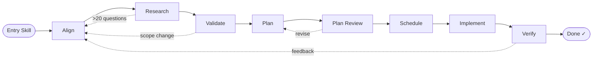
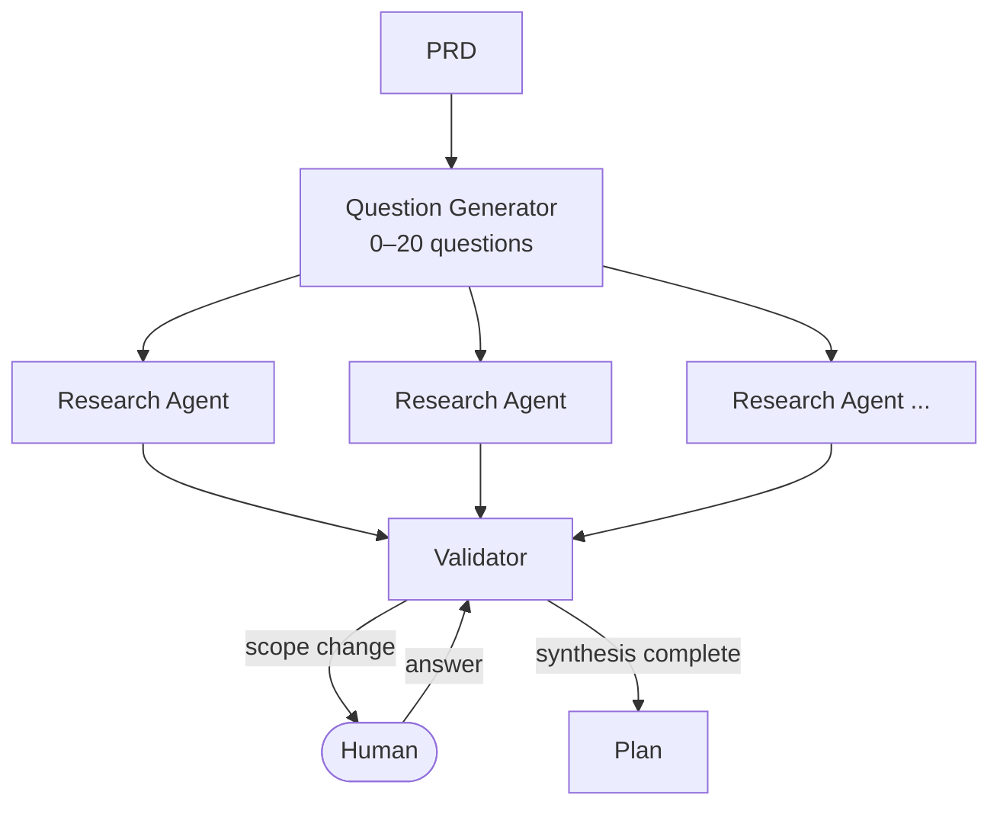
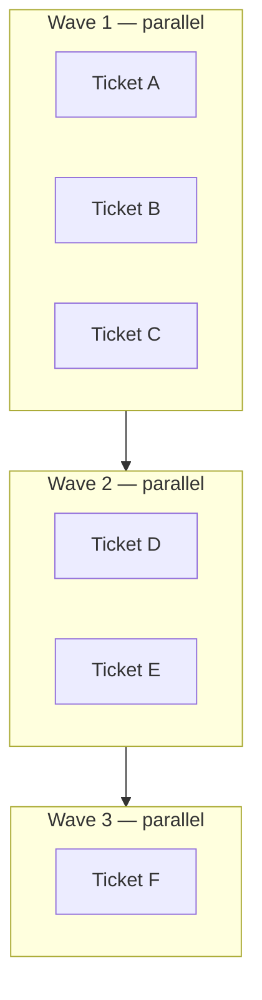
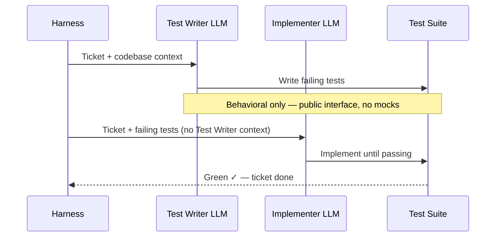
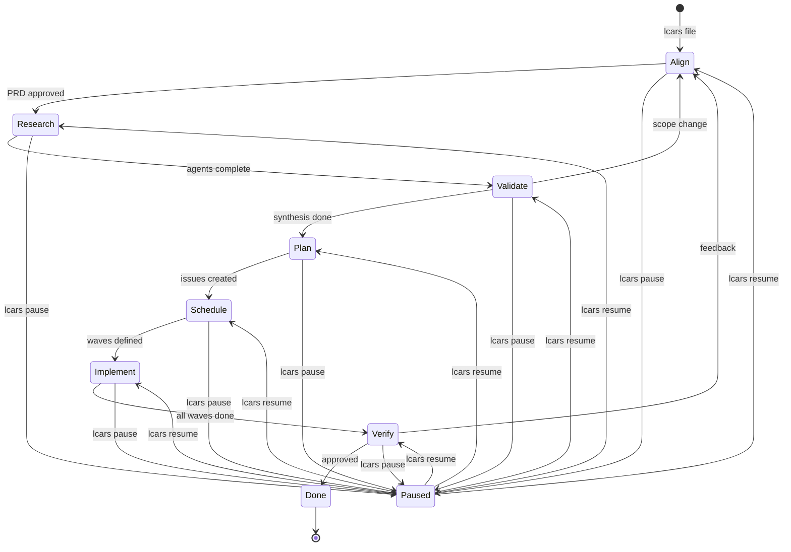
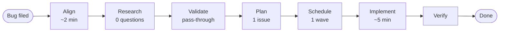
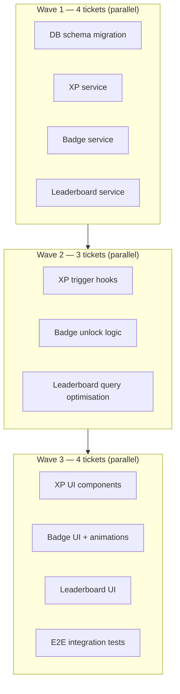
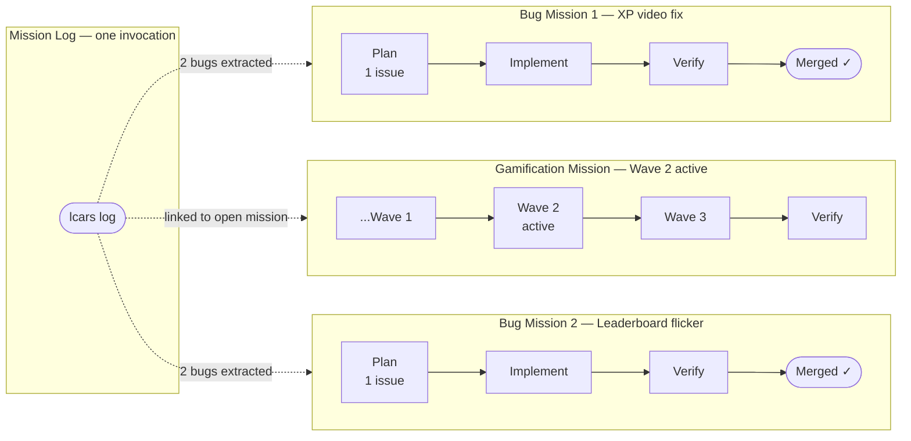

# LCARS — Vision

## What Is LCARS?

LCARS is a reusable AI harness that takes a human idea and drives it to a merged pull request. It is not a code generator, a chat interface, or a one-shot prompt. It is an orchestration system — a defined pipeline of LLM operations, automated checks, and human checkpoints — that turns intent into shipped software.

The human provides the idea and the final judgment. The Harness does everything in between.

---

## The Core Unit: The Mission

Every piece of work in LCARS is a **Mission** — a single human intent, whether a new feature, an improvement, or a bug fix. Missions are filed via a global CLI skill invokable from any repo. On entry, a free-form description is the only requirement.

Each Mission:
- Gets its own branch
- Is represented as a GitHub issue
- Moves through a defined set of Stages as a card on the Kanban Board
- Can be paused and resumed at any point

Missions can be active concurrently. Each is isolated on its own branch; merges happen sequentially when the human verifies and approves.

---

## Pipeline Overview



Feedback loops exist at four points: Research can return to Align if ambiguity runs too deep; Validate can escalate a scope change back to Align; Plan Review loops back to Plan until issues pass quality checks; and Verify can send a completed Mission back if the human isn't satisfied.

---

## The Pipeline

A Mission moves through eight Stages in order. The Harness manages all transitions. The human is present at key gates, not at every step.

### 1. Align

The human and an LLM get on the same page. This is a structured grilling session — not a chat — where ambiguity in the idea is surfaced and resolved. The output is a **PRD** (Product Requirements Document) that becomes the canonical spec for the Mission.

The Align stage adapts to complexity. A small bug produces a thin PRD in minutes. A complex feature takes longer. If downstream stages reveal that the PRD was underspecified, the Mission can loop back to Align with that context baked in.

For a complex Mission, Align also records high-level **engineering ADRs** (Architecture Decision Records) alongside the PRD — the framework, architecture, and data-shape decisions, each with its rationale and the alternatives weighed. A trivial bug gets none. The ADRs exist so the downstream cold workers inherit the architectural frame instead of silently re-deriving it and taking wrong turns. Align seeds them; Validate refines them when research changes a decision. They are declarative facts every later Stage may read — except the Research Agents, who stay deliberately context-free.

When the PRD (and ADRs) are finalized, Align runs one more cold worker: an **estimator**. It reads the finished spec *and inspects the real codebase*, then reasons like a senior engineer about the **whole problem** — the kind of problem it is, how the change evolves the codebase, its blast radius, and what it sets up for future scale and reliability. Code size is one signal, never the deciding one. From that it produces two independent **criticality scores** — *reasoning/planning* and *implementation*, each low/medium/high — and from those assigns **each downstream Stage a model tier** (Sonnet or Opus), concentrating the expensive tier where mistakes are costliest (the reasoning and the implementation) and keeping routine Stages cheap. It also emits a token-grounded **cost estimate** for the Mission, rendered in the active CLI's native billing unit. All of this — scores, per-Stage model mix, cost, and the estimator's rationale — is written into the GitHub issue and the CLI readout for the human to review, and the human can **override it in plain language** when kicking off the run (*"use Opus the whole way through"*, *"use Opus for implementation"*, *"keep reasoning cheap"*). The estimator never blocks filing: if it can't run, the Mission still files and every Stage falls back to its default model. See *[How it runs](#how-it-runs-a-token-free-driver-model-selected-workers)* for how the tiers reach the workers.

### 2. Research

The Harness generates up to 20 questions based on the PRD. Each question covers a design choice, product consideration, or engineering decision that needs clarity before work begins.



Each question is sent to a **Research Agent** — a stateless LLM worker with access to the codebase and the web. Agents work in parallel. They have no access to the PRD or each other's findings. Their only job is to return a recommendation and 2–3 supporting points for their single question.

If more than 20 questions are needed, the Harness explains why and gives the human the choice to override (proceed with more questions) or return to Align with that context so the PRD can be sharpened.

### 3. Validate

A **Validator** LLM reviews all Research Agent responses against the PRD. It synthesizes recommendations into a plan, resolving conflicts and making implementation decisions where it can.

The Validator escalates to the human only when a finding implies a scope or direction change — something that would change *what* gets built, not *how*. Implementation decisions stay with the Validator. Strategic decisions come to the human. When a finding overturns an architectural decision, the Validator updates the engineering ADRs Align seeded, so the recorded frame stays current rather than going stale.

### 4. Plan

The validated plan is decomposed into small, independently testable GitHub issues. Each issue is a vertical slice of full-stack functionality that owns **one cohesive, user-observable behavior** — cohesion is the primary slicing rule, not a line count.

Size is the secondary guardrail, and it is measured as **total comprehension load** rather than net-new lines: the existing code the implementer must read (`estimatedReadLoc`), the issue's test suite (`estimatedTestLoc`), and the net-new production code (`estimatedNewLoc`). Their sum targets a tunable `comprehensionBudget` (default 1200) — the real constraint is keeping each issue within the effective working window of the LLM that will implement it, and the same diff is trivial against a blank file but hard against a large one. So net-new floats while the total stays bounded: greenfield issues run generous (little to read) and tighten as the codebase grows. The budget is a **planning target, not a hard reject** — an issue may exceed it when a large existing file makes the read load unavoidable; what is not allowed is exceeding it by *bundling* two behaviors.

### 5. Plan Review

A fresh LLM session — with no access to the planning conversation — audits every issue against a fixed set of quality criteria before anything is scheduled:

- **Vertical slice** — does the issue touch multiple layers end-to-end (UI, logic, data), not just one horizontal layer like "add all the database migrations"?
- **Size** — is the total comprehension load (read + test + new code) within `comprehensionBudget`? An over-budget issue is an objection *only* when the overage comes from bundling two behaviors that should be split; load driven by an unavoidably large existing file to read is acceptable.
- **Coupling** — can each issue's acceptance criteria be satisfied *without* changing behavior that another issue's tests already pin? If satisfying issue A requires modifying behavior issue B locks down, the two are coupled — the reviewer objects and names the behavioral seam to re-slice along, so each issue owns exactly one contract. This is the real meaning of "too big": size alone never catches it, since a sub-100-line issue can still be dangerously coupled. Coupling is a first-class reject reason, on equal footing with the others.
- **Testability** — is there a clear, observable acceptance criterion?
- **Explicit dependencies** — are all dependencies on other issues captured in the graph?

If any issues fail, Plan Review returns the full set with specific objections — "issue #3 is a horizontal slice of the data layer, split it" — and the Plan stage must revise. This loop repeats until all issues pass. After three rounds without a clean plan, Plan Review escalates to the human with the unresolved issues flagged. The human can override and proceed, or redirect with guidance.

The reviewer's independence is deliberate: the same LLM that planned the work should not also grade it.

### 6. Schedule

The Harness builds a dependency graph across all Plan issues and groups them into sequential **Waves**. Issues within a Wave are independent of each other and can be implemented concurrently. The next Wave begins only when all issues in the current Wave are complete.

Each ticket is opened as a GitHub sub-issue **nested under the Mission's own issue**, so the board renders the Mission with its tickets beneath it rather than a flat pile of look-alike cards. A Mission that plans to a single ticket skips the redundant sub-issue entirely and reuses its own issue — with one ticket there is nothing to schedule and nothing to duplicate.



### 7. Implement

Each issue in a Wave is handled by two sequential LLM sessions:



1. **Test Writer** — reads the issue and writes failing behavioral tests against its public interface. Tests describe *what* the system does, not *how*.
2. **Implementer** — reads the issue and the failing tests (without access to the Test Writer's session) and implements until all tests pass.

The separation is adversarial by design. The Test Writer cannot write easy tests it knows will pass, because it doesn't know who is implementing. The Implementer cannot skip or weaken tests, because they arrive as a constraint. A passing test suite means the ticket is done.

Within a Wave, independent tickets build **concurrently** — each Test Writer → Implementer pair runs in its own isolated git worktree off the Mission branch, so parallel file writes and test runs never collide. As a ticket goes green its commit is replayed serially onto the Mission branch in plan order, so the observable history is unchanged: exactly one commit per ticket, with its summary, in order. When two tickets in the same Wave touch the **same file**, the second can't replay cleanly onto the first, so the Harness rebuilds it serially on the current tip with its locked tests — a fully-overlapping Wave degrades gracefully toward serial and every ticket's change still lands, never silently dropped. A bounded concurrency cap (`LCARS_MAX_PARALLEL`) keeps a wide Wave — and the Research fan-out — from spawning unboundedly.

To keep each cold worker from re-exploring the repo from scratch, Plan and Schedule attach a per-ticket **context manifest** — the relevant files, their interface *signatures* (skeletons, not bodies), and the ADRs the ticket touches — and the Harness maintains a durable **repo pack** (how to run the tests, the conventions, an architecture summary) refreshed each Wave. The Test Writer and Implementer read these instead of cold-walking the tree; neither ever carries the implementation to write, and neither reaches a Research Agent.

As each ticket goes green and commits, its sub-issue is relabelled `lcars:done` and **closed** — so the board reflects real per-ticket progress while a Wave is still running, instead of a pile of open issues that only clears at the end.

The Harness — not the LLMs — enforces four guardrails that make the adversarial split hold:

- **Red gate.** The Test Writer's tests must actually *fail* before the Implementer is allowed to run. The gate evaluates the Test Writer's tests **in isolation** — only that quarantined suite, never the repo's existing passing tests — so a contract that is green before anything is built is always caught, even in a repo whose own suite is green. A rejection is never a silent stall: the Harness reports *why* and feeds that signal into the next Test-Writer attempt, so it writes a genuinely failing test instead of blindly retrying.
- **Immutable tests.** The Implementer cannot modify the test files; they are locked as the contract. Green is earned by implementing, never by editing the tests.
- **Test quality.** A light check guards against a sandbagging Test Writer handing over a contract that proves nothing.
- **Full-suite green gate.** Passing a ticket's own locked tests is not enough — its commit must also leave the **entire** repo suite green, so a later ticket can't silently regress an earlier one's behaviour. A cross-ticket regression fails the Wave loudly instead of slipping through to Verify.

These live in the deterministic driver, because an LLM rewarded for a green suite will otherwise game the contract.

### 8. Verify

When all Waves are complete, the human reviews the Mission. This is a full inspection — reading the diff, running the app locally, testing the golden path. The human either approves or sends feedback that re-enters the loop.

### 8. Done

The human requests a PR. The Harness opens it with a body that summarises the Mission for a reviewer — a user-facing summary above the technical detail and a per-Wave manifest of the tickets — and a `Closes #` directive for the Mission's own issue, so that issue closes when the PR is **merged** — the close is tied to the merge event, not to approval. (The stage label moves to `lcars:done` at approval; the issue itself stays open until the merge.) The human merges, the branch is cleaned up, and the card moves to Done on the Kanban.

---

## Stage Isolation

Every Stage runs as a fresh session that sees only what the previous Stage wrote to disk — never the previous Stage's conversation. The persisted artifact (the PRD, the research findings, the validated plan, `plan.json`) is the *entire* contract between Stages. This is what lets the loop run many Stages unattended without any of them inheriting another's reasoning, and it is enforced structurally: the loop spawns each worker as a cold, one-shot invocation and assembles its prompt from artifact paths alone, so there is no carryover for a Stage to lean on even when the whole pipeline runs in one sitting.

Because the artifact is the only thing that crosses the boundary, each Stage records **decisions and their rationale, not just output** — the *why*, not only the *what*. A handoff that drops the implicit reasoning behind a choice is how the next Stage ends up building the wrong thing; capturing the rationale in the artifact is what keeps the cold handoff sufficient.

What crosses that boundary is always a **declarative fact** — the PRD, the engineering ADRs, a ticket's context manifest, the repo pack — never another worker's generated reasoning, and never anything at all to a Research Agent. Sharing facts is what lets a worker read instead of re-derive (cutting cost and wrong turns) without ever creating the conversational carryover cold isolation exists to prevent.

---

## Human Control

LCARS is designed to run without constant supervision. The human sets a Mission in motion and the Harness drives it — but the human is never locked out.



By default a Mission **auto-advances**: once filed, the Harness drives it Stage to Stage on its own and stops only at a human gate — an escalation, or the Verify review. At each gate it notifies you and waits, so being pinged when you're actually needed is the normal way to use it.

At any point, the human can:
- **Pause / Resume** a Mission — the Harness serializes its state and stops, then picks up exactly where it left off.
- **Answer** a pending decision — `lcars answer` surfaces everything the Harness is waiting on, across every Mission, and accepts the answer. The Harness resumes from there.

Every Mission's state is persisted. Walking away and coming back is a first-class interaction pattern, not an edge case.

---

## Multi-Mission Management

Multiple Missions can be active simultaneously at different Stages. `lcars status` is the command-and-control view — all active Missions, each showing its current Stage and anything awaiting you. Pending decisions from every Mission collect in one inbox (`lcars answer`), so the union of "what needs me" is a single list to clear rather than something scattered across Missions. Notifications fire only at genuine gates, batched per Stage, so concurrent Missions running unattended don't become a stream of interruptions.

---

## The CLI

### How it runs: a token-free driver, model-selected workers

LCARS is driven by a **deterministic loop** — plain shell, no model, no tokens. The loop never reasons about your code; it reads each Mission's state, decides the next Stage mechanically, and spawns a fresh worker to do that Stage's thinking. All the *reasoning* happens in those workers; the loop only sequences them and records results.

Each headless Stage (Research, Validate, Plan, Plan Review, Implement) runs as a **cold worker** — a one-shot, non-interactive LLM invocation given only the Mission's on-disk artifacts. A worker shares no context with the loop or with the previous Stage; the persisted artifact is the entire contract between Stages (see *Stage Isolation*). Workers are spawned through a single, swappable binary that defaults to **whichever CLI you launched from**. Run LCARS inside Claude Code and every worker is Claude; run it inside GitHub Copilot and every worker is Copilot. The interactive Stages — Align's grilling and the Verify gate — run on that same host CLI.

This is what makes CLI choice an implementation detail and **model choice the meaningful one**: the loop costs nothing, and every token LCARS spends is spent on the CLI you chose to run it under. The only piece that is ever CLI-specific is a thin adapter that normalizes a given CLI's one-shot invocation and output — never any Stage logic.

And model choice is made **per Stage, not once per run**. The Align estimator (above) assigns each Stage a tier sized to its criticality; those tiers are **logical** (`sonnet`/`opus`), and a small per-CLI **alias map** translates a tier into the flag string the active CLI actually accepts — on Claude `sonnet`/`opus`, on Copilot `claude-sonnet-4.6` / `claude-opus-4.8` — so the estimate stays CLI-agnostic and Copilot only ever runs Sonnet/Opus. The resolver applies a clear precedence: a global pin (`LCARS_WORKER_MODEL`) over a captain's natural-language override over the estimate over a manual per-Stage config over the legacy global `workerModel`. The guarantee at the bottom of that stack is that with **no estimate and no override, the worker invocation is byte-for-byte the pre-estimator path** — no `--model` flag at all — so the feature is purely additive. A trivial fix no longer pays Opus prices end-to-end; a genuinely hard feature isn't under-thought on Sonnet.

### Claude Code or GitHub Copilot

LCARS runs on **either Claude Code or GitHub Copilot CLI**, and the worker binary is **auto-detected from the CLI you launched from** — no configuration required. Launch LCARS inside Claude Code and every worker runs on `claude`; launch it inside Copilot and every worker runs on `copilot`. The detection can be overridden when you need to — `LCARS_WORKER_BIN` (or `workerBin` in `.git/lcars/config.json`) pins the worker CLI explicitly — but the common path is to launch from the CLI you want and let LCARS follow.

The one thing CLI choice does change is **which model the workers must run on**. Workers do real file work — every Stage must write its output artifact to disk (`questions.txt`, `plan.json`, the validated plan, and so on), and a Stage that can't write its artifact stalls the whole pipeline. On Copilot this makes model choice load-bearing: the workers must run on a **Claude tier**, never one of Copilot's lighter non-Claude defaults (e.g. GPT-5.5), whose file-creation tool could not reliably overwrite or create files inside a worker's fenced scratch directory and so blocked Stages from emitting their artifacts. Since the estimator landed this is handled for you: it assigns each Stage a Sonnet or Opus tier and the per-CLI alias map maps those to `claude-sonnet-4.6` / `claude-opus-4.8` — both Claude models that do the file work — so you no longer hand-pin `workerModel` on Copilot; filing and running a Mission just works. (The legacy global `workerModel` still works if you want to pin one model for every Stage.) The trade-off is real — both Copilot tiers consume *billable* usage, not the included tier — and LCARS surfaces a per-Mission cost estimate so you see it before the run. (Under Claude Code there is no such constraint; the default tiers handle the file work.)

A note on that Copilot cost figure: by default it tracks GitHub's **usage-based "AI Credits" (token) billing** — the model GitHub moved to on **2026-06-01** — computed per token like the Claude figure and shown as a dollar range with your plan's monthly included credit noted (set `copilotPlan` to match your plan). Grandfathered **annual** subscribers still on the old premium-request scheme can switch the estimate back to it with `copilotBilling: "legacy"`. Every rate lives in `pricing.json` and the cost is computed by code (not guessed by the model), so the figure is reproducible; neither the Claude `$` figure nor the per-Stage model selection is affected by the billing mode.

**Maturity.** Because multi-CLI support arrived as a *no-behavior-change* worker refactor (the Claude adapter reproduces the prior invocation byte-for-byte, regression-locked by tests), the **Claude Code path is stable and unchanged**. The **Copilot path is new** — driven idea→PR end-to-end and working, but with fewer miles, so treat it as new rather than battle-tested. It is not "beta" in the sense of unstable; it works when used as documented. And note the honest limit on the original goal: Copilot support does **not** yet run on Copilot's *included* tokens — its workers run on premium Claude tiers (Sonnet/Opus) — so "LCARS runs on Copilot" holds today, while "LCARS runs on Copilot for free" awaits an included model that can do the workers' file work.

### Watching a run

A long Mission running unattended should not be a black box until its next gate. The loop keeps a per-Mission **append-only event log**: every Stage transition, every gate, and — inside Implement, where the time actually goes — every wave, every ticket, every attempt, and each pass or flag. The driver prints each Stage as it happens rather than only summarizing at the end, and the session you launch a run from relays that progress to you in place — a compact digest on a steady tick (~60s by default, configurable via `LCARS_WATCH_INTERVAL` / `--interval`) until the run halts — so watching a run no longer means opening a second window. **`lcars status --watch`** tails the same log into a live view on that same interval: human-readable progress lines plus a refreshing pace/position line — `Wave 3/6 · ticket t-004 · attempt 1 · ~12s avg/ticket · elapsed 4m12s` — that ends cleanly when the run reaches a gate. Because the log is written by the deterministic loop *around* each worker — never by the worker itself, and never parsed from its output — the stream and the live view are identical no matter which CLI runs underneath, exactly like every other Stage.

### The commands

LCARS collapses to two things you do — **hand it work** and **answer what it's waiting on** — plus a board to look at:

- **`lcars`** — the one entry point. With nothing filed, it takes a free-form idea and files a Mission. With work in flight and nothing pending, it drives the active Mission forward, auto-advancing through Stages until a human gate. With a decision waiting, it drops you into the inbox. You never have to remember which verb to type or paste a Mission id.
- **`lcars answer`** — the inbox of every pending decision across all Missions: scope escalations, plan-review stand-offs, blocked tickets, and the Verify ship-or-send-back gate. Clear them here; **approve** and **send back with feedback** are actions on a Verify card, not separate commands.
- **`lcars status`** — the read-only board: every active Mission, its Stage, and anything awaiting you. With `--watch` it follows a single running Mission live, tailing its event stream into a streaming view with a pace/position line — current wave, current ticket, attempt, average time per ticket, and elapsed — so a long unattended run is observable as it moves instead of a black box until the next gate.
- **`lcars init`** — one-time per-repo setup: creates `.git/lcars/`, writes repo config, scans for `CONTEXT.md`, verifies CLI auth, and creates the LCARS Labels on the repo. Run once before the first Mission. Safe to re-run: writing config is merge-preserving, so a re-init keeps every value you've customized and only fills in what's missing — it never resets your `testCommand`, `model`, or `comprehensionBudget`.
- **`lcars update`** — bring an already-initialized repo up to date after pulling a newer LCARS. It backfills any LCARS Labels and `config.json` keys that the new version added, at their defaults, while preserving every existing value and leaving `missions/` untouched. It reports what it added, and is a clean no-op when the repo is already current. This is the discoverable "absorb new LCARS labels and config keys" command — distinct from `lcars init`, which is the first-time setup.
- **`lcars log`** — log bugs against an active Mission in free-form natural language. One invocation can describe several bugs; the Harness extracts each, fast-tracks a Mission per bug, and links them to the referenced open Mission. If none is named, it asks first.
- **`lcars resolve-logs <parent>`** — hand the Harness *every* bug you logged against a Mission and walk away. It chooses a sensible resolution order (root-cause and dependency bugs before cosmetic ones), drives each linked bug Mission to its own Verify gate, and then raises a **single** consolidated re-verify gate on the parent — one notification, one decision — instead of one interruption per bug. It never auto-approves; re-inspecting and shipping each fix stays yours. If a bug escalates mid-batch the run pauses at it (its question lands in `lcars answer`), leaves the already-resolved bugs intact, and resumes with the rest once you answer.

When a Mission reaches a gate, the Harness fires a notification — a local banner by default, or a phone push if you've wired one — with a one-line, decision-ready summary, then stops. File a Mission, walk away, and come back when it pings.

---

## Worked Examples

### Example 1 — Simple Mission: Fix a Broken Route

**The idea:** "The /about link in the nav goes to a 404."

**What happens:**



The Align session is quick — the PRD is essentially one sentence: *The `/about` route returns 404. It should resolve to the About page.* Research generates zero questions; there's nothing ambiguous. The Validator passes immediately. Plan produces a single issue: *Fix /about route handler.* One wave, one ticket.

The Test Writer produces a single failing test:
```
expect(GET('/about')).resolves.toMatchObject({ status: 200 })
```

The Implementer adds the missing route. Test passes. The human confirms the link works. Total wall clock: ~10 minutes.

---

### Example 2 — Complex Mission: Add Gamification to a Course Website

**The idea:** "I want to add XP, badges, and a leaderboard to motivate learners on my course platform."

**Align** produces a PRD with eight acceptance criteria: XP awarded per activity type, badge unlock on milestone thresholds, per-course leaderboard, XP displayed on the learner dashboard, badge showcase on profiles, admin panel for managing badge definitions, no performance regression on course pages, and mobile-responsive UI.

**Research** generates 14 questions:
- Should XP decay over time if the learner is inactive?
- Global leaderboard or per-course leaderboard?
- Which animation library fits the current stack for badge unlock moments?
- How do we handle XP for partially-completed videos?
- Should badges be retroactively awarded when a learner crosses a threshold?
- ...and nine more.

Each question goes to a parallel Research Agent. Fourteen agents run concurrently.

**Validate** synthesizes the 14 answers and escalates one to the human: *"Research is split on global vs. per-course leaderboard — this choice changes the DB schema significantly. Which do you want?"* The human responds: *"Per-course for now."* The Validator incorporates the answer and produces a complete plan.

**Plan** generates 11 issues. **Schedule** builds the dependency graph and produces three waves:



Each of the 11 tickets gets a Test Writer + Implementer pair. Tickets within a wave run concurrently.

**Verify**: The human earns XP by completing a quiz, watches the badge unlock animation, and checks their position on the course leaderboard. Satisfied, they approve. PR created, merged.

---

### Example 3 — Bug Logged Against an Open Mission

**The scenario:** The gamification Mission is in Wave 2 of Implement. A manual test reveals two bugs: XP isn't awarded for video completions, and the leaderboard flickers when the page first loads.

**The human invokes Mission Log** and types:

> *"Found two bugs. XP isn't being awarded when a video is marked complete — only quiz completions trigger it. Also, the leaderboard has a visible flicker on first page load before the data comes in. These are against the gamification mission."*

The Harness extracts two distinct bugs, creates a fast-tracked Mission for each, and links both to the open gamification Mission as native GitHub sub-issues. No second step required.

The two bug Missions and the original gamification Mission now run in parallel on separate branches:



Both bug Missions fast-track in parallel: thin PRDs, zero research questions, one issue each. They run concurrently with each other and with the in-progress gamification Mission. The Kanban Board shows all three cards simultaneously. A bug logged against a Mission that has **already merged** rides its own branch and merges as soon as it's verified; a bug logged against a Mission still **in flight** lands its fix on that Mission's branch, so the fix ships with the parent rather than stranding on a branch whose base never merges. Either way the gamification Mission continues uninterrupted.

**Resolving a batch with one re-verify.** When the bugs are found during the parent's *own* Verify — you're reviewing the finished gamification Mission and file three bugs in a row — driving each linked bug to its own Verify gate would mean three separate "review me" interruptions. **`lcars resolve-logs <parent>`** collapses them: it asks the worker for a sensible order (root-cause and dependency bugs first, cosmetic ones last), drives every linked bug Mission to its Verify gate one-by-one, and then raises a **single** consolidated re-verify gate — one notification — on the parent.


It never auto-approves and opens no PRs. If a bug escalates mid-batch (a cap-exhausted ticket, a scope change), the run **pauses** at that bug and routes its question into `lcars answer`; the bugs already resolved are untouched, and a resumed `lcars resolve-logs` continues with the rest once you've answered.

---

## Installation & Adoption

LCARS is designed to drop into any repo — new or existing — leaving zero artifacts in the working tree.

**Skills live globally.** The harness skills are installed once at the user level (`~/.claude/`) and are available in every repo without any per-project setup step.

**On first use, `lcars init` does two things:**

*Locally* — creates `.git/lcars/` and a repo-level config file. All mission state (paused state, wave graphs, question queues, stage checkpoints) lives inside `.git/`. Git never tracks anything in `.git/`, so nothing appears in `git status`. The working tree is untouched.

*On GitHub* — creates the **LCARS Labels** on the repo. These labels are the Kanban board's data model. The harness applies them as Missions move through stages; the future Kanban reads them directly via the GitHub Issues API. No other GitHub setup is needed.

Both steps are idempotent, and config writing is **merge-preserving** — re-running `lcars init` keeps every value you've customized in `config.json` and only fills in missing keys, so it never resets a customization. After you pull a newer LCARS, **`lcars update`** absorbs whatever the new version added — backfilling any missing Labels and config keys at their defaults, preserving existing values, and leaving `missions/` untouched (a clean no-op when the repo is already current).

**LCARS Labels created by `lcars init`:**

| Label | Type | Purpose |
|---|---|---|
| `lcars:align` … `lcars:done` | Stage (exclusive) | The Mission's current column on the Kanban |
| `lcars:feature` / `lcars:bug` | Type | Mission kind |
| `lcars:paused` | Status (additive) | Overlaid on the stage label when `lcars pause` is called |
| `lcars:awaiting-human` | Status (additive) | Overlaid when the harness is blocked on a human answer |
| `lcars:linked` | Relationship | Bug Mission linked to an active parent Mission via Mission Log |
| `lcars:mission` / `lcars:ticket` | Role (additive, permanent) | Distinguishes a Mission's own command-and-control issue (`lcars:mission`) from an implementation sub-issue Schedule opens (`lcars:ticket`). The two are disjoint and ride the issue for its whole life — no stage transition ever strips them |

Filtering GitHub Issues to `lcars:awaiting-human` across all columns shows every pending human question at a glance — before the Kanban UI even exists. Filtering to `lcars:mission` is the command-and-control list (the Missions); `lcars:ticket` is the work (the per-ticket sub-issues), so during Implement a Mission and its tickets are no longer indistinguishable.

**The harness never modifies:**
- `CLAUDE.md` or any equivalent CLI config file
- `.gitignore`
- `CONTEXT.md` — reads for domain language, never writes
- `.claude/settings.json` — existing permissions and hooks are preserved
- Any source files, branches, or GitHub configuration

Each LLM session spawned by the harness — every cold Stage worker — receives its context via its prompt directly, assembled by the loop from on-disk artifacts rather than from any repo-level config file. This is what makes the harness CLI-agnostic: workers are spawned through one swappable binary, so Claude Code and GitHub Copilot sessions are orchestrated identically, with no dependency on `CLAUDE.md` or any Copilot equivalent.

---

## The Kanban Interface

LCARS now ships a dedicated visual interface. The Kanban Board is a full application — not a GitHub Projects board, but a custom interface purpose-built for the Harness. Launch it with `lcars viewscreen` (alias `lcars serve`); `lcars viewscreen --open` boots on a free port and opens the board in your browser. It is a Python-3-stdlib-only daemon — no pip, npm, or build step — serving a vanilla LCARS-themed front end.

Each column corresponds to a Stage. Each Mission is a card carrying one **cost pill** and two **difficulty pills** (reasoning + implementation), with awaiting-you and paused card states, nested ticket rows, and live Implement wave/ticket progress. The human can see at a glance what is in flight, what is waiting for human input, and what is blocked. Questions from the Harness appear on Mission cards; the human responds from the interface and the Harness resumes.

This is the command-and-control layer: one view of all Missions, all Stages, all pending decisions — with the ability to start, stop, and steer from a single screen. You can drive the whole idea→PR loop from the browser: File a Mission, watch the live Align grilling console, Start a run (with a plain-language model override), answer a Respond gate, work the centered two-pane mission-detail modal, Verify (approve / send-back), and use the Mission Log. **Pause** and **Resume** halt and continue a Mission at a safe boundary right from the board, and the Mission Log gives each logged bug its own estimate (cost + reasoning/implementation difficulty + per-stage model recommendation) with a plain-language per-bug model override.

One adapter-neutral board shape backs two interchangeable read adapters: a **local** adapter parsing `.git/lcars/missions/*` (the default) and a **GitHub** adapter reading issues + `lcars:*` labels. A live SSE channel pushes updates on every state change; the local adapter also exposes operator write endpoints, while the GitHub adapter (and `--read-only`) stay view-only — so a hosted, view-only reader is a configuration away.

Run progress is also mirrored onto each Mission's **GitHub issue as living, per-Stage comments** — one per Stage, created once then edited in place as it advances — with collapsed research Q&A, `#`-links to the sub-issues, and an Implement **wave dashboard** (a pace/position line plus a done / flagged / in-progress / pending ticket checklist) that refreshes on a ~60s heartbeat. It reuses the same renderer as `lcars status --watch`, so the issue, the live CLI view, and the board never drift.

---

## Scope

LCARS v1 covers idea to merged PR.

Monitoring in production — watching deployed behavior, surfacing regressions, closing the feedback loop from live traffic back to new Missions — is a planned extension. The vision is a full lifecycle: idea → code → production → signal → new idea.
